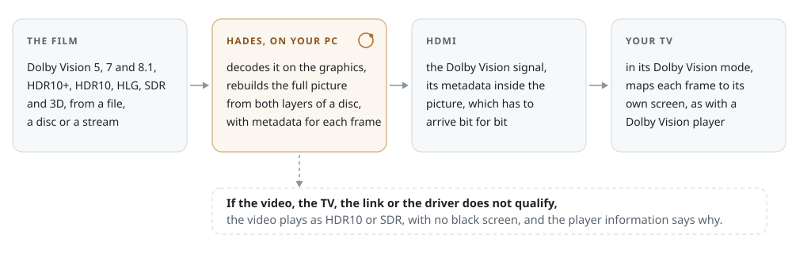

  <picture>
    <source media="(prefers-color-scheme: dark)" srcset="docs/images/header-dark.png">
    <source media="(prefers-color-scheme: light)" srcset="docs/images/header-light.png">
    
  </picture>

<b>Native Dolby Vision, HDR10+, HD audio and 3D from your PC, on LibreELEC.</b>

  

  <a href="https://github.com/hadesdevls/LibreELEC-Hades/releases/latest">Download</a> &nbsp;|&nbsp;
  <a href="#installing-and-starting">Install</a> &nbsp;|&nbsp;
  <a href="docs/features.md">What it adds</a> &nbsp;|&nbsp;
  <a href="docs/settings.md">Settings</a> &nbsp;|&nbsp;
  <a href="https://forum.libreelec.tv/thread/30682-x86-64-hadesdevls-builds-libreelec-hades-native-dolby-vision-hdr10-and-3d/">Forum</a> &nbsp;|&nbsp;
  <a href="https://github.com/hadesdevls/LibreELEC-Hades/issues">Issues</a>

LibreELEC Hades is an unofficial build of [LibreELEC](https://libreelec.tv) for 64-bit PCs (the "Generic x86_64" image). LibreELEC turns a PC into a media centre that runs Kodi and little else. Hades adds what a home cinema asks of it: Dolby Vision sent from the PC to the TV over HDMI in the TV-led way that Dolby Vision players use, including profile 7 with its full enhancement layer, HDR10+, 3D from Blu-ray and MV-HEVC, Dolby Atmos and the other HD sound formats passed to your receiver untouched, and the care of a calibrated home cinema: Filmmaker Mode by itself, a 3D LUT for each display and a projector that follows the film. Everything else that LibreELEC does is kept.

> **This is not LibreELEC and it is not official.** LibreELEC Hades is not made, supported, endorsed or certified by Team LibreELEC, Team Kodi or the XBMC Foundation, Dolby Laboratories, HDR10+ Technologies, NVIDIA, AMD or Intel, and has no affiliation with any of them. Please do not ask them for help with it. Kodi is a registered trademark of the XBMC Foundation. Dolby Vision and HDR10+ are named here only as video formats: LibreELEC Hades uses neither logo and is certified by neither. Other trademarks belong to their owners; see [NOTICE.md](NOTICE.md).

  
   The player information (press O): Kodi's own rendering of the page, in a virtual machine, with the values of a Dolby Vision profile 7 film with Dolby TrueHD Atmos on an LG C5 filled in. The capture is of version 1.1; 1.2 adds a few lines to it.

**Why the screen says "LibreELEC Hades".** The media centre of this build is Kodi with changes that the XBMC Foundation has not approved, and Kodi's trademark policy asks such a build not to use Kodi's name and logos as its own. Underneath, it is Kodi: add-ons, skins and remote-control apps work as with Kodi, its log is still `kodi.log`, and other programs still see Kodi. The page "About this build" of the system information says what it is and how to support Kodi and LibreELEC.

## Start here

- **You want to try it.** Read [What you need](#what-you-need), then [Installing and starting](#installing-and-starting). On Windows it takes a few minutes and changes nothing in Windows.
- **You have it and want to set it up.** Most people change nothing: Dolby Vision is on by default, and *Your display*, at the first start, asks only what your display cannot say of itself. *Check this setup* plays test pictures and sounds and tells you what reached your TV and which sound formats to switch on ([Your first Dolby Vision video](#your-first-dolby-vision-video)), and [the settings guide](docs/settings.md) says what each setting does and when to touch it.
- **You want to know what Hades adds.** [Extras of Hades](docs/features.md) explains each one in plain words, with an example and the setting that controls it.
- **You want to know whether it works on your hardware.** [What has been tested](docs/tested.md) lists the graphics, displays and features that I and other people have seen working, with the source of each report.
- **You want the best from your graphics and connection.** [Known limits](docs/known-limits.md) says what each kind of graphics, connection and display allows, and how to get the most from it.
- **You want to know how it works.** [How it works](docs/how-it-works.md) follows a video from the file to the TV, plainly first and in technical detail further down.
- **Something is wrong.** See [Reporting problems](#reporting-problems): one button makes a diagnostic report with the files that let me find the cause, and the [diagnostics](docs/diagnostics.md) guide says what is in it.

## How a video reaches your TV

  <picture>
    <source media="(prefers-color-scheme: dark)" srcset="docs/images/signal-path-dark.svg">
    <source media="(prefers-color-scheme: light)" srcset="docs/images/signal-path-light.svg">
    
  </picture>

A Dolby Vision player decodes the film, puts its layers together and sends the picture with the metadata of every frame; the TV does the rest with its own Dolby Vision processing. Hades does that work in the PC, with the graphics you have. Dolby Vision is used only when the video, the TV, the HDMI link and the graphics driver all qualify; otherwise the video plays the ordinary way, and the first page of the player information says why in one sentence. [How it works](docs/how-it-works.md) follows the whole path.

## What it adds to LibreELEC

### Dolby Vision

- **Native Dolby Vision over HDMI.** Each picture is rebuilt as the Dolby Vision specification defines it, including the full enhancement layer (FEL) of profile 7, and sent with its metadata for every frame. The TV does its own Dolby Vision processing, as with a certified player (its "Standard" or "TV-led" mode). Profiles 5, 7 (FEL and MEL) and 8.1.
- **NVIDIA, AMD and Intel graphics,** graphics cards and integrated graphics alike: NVIDIA with its open kernel modules, and the GeForce GTX 900 and GTX 10 cards and the TITAN V with NVIDIA's driver 580.
- **A player information page that a person can read.** Press O on a keyboard, or the red key of a TV remote that sends keys over HDMI-CEC. It says whether the video plays as intended, what the file carries, what Hades does with it and what reaches your TV, and names any of your settings that make the picture differ from what the film carries, with a button that puts them back. O, then OK, changes how the video goes out while it plays.
- **Dolby Vision where native output is not possible:** shown as HDR10 (always for profile 5, whose base picture cannot be watched on its own, and for profile 7 if you turn it on), mapped by Hades for a TV input in game mode (Low-Latency), or with the older HDMI 1.4b signalling for the TVs of 2016 that ask for it. Zoom, vertical shift and stretching keep native Dolby Vision.
- **Dolby Vision through more connections:** a passive DisplayPort adaptor (DP++) that identifies itself as HDMI, the DisplayPort-to-HDMI converter of a mini PC's board, and the converter of a USB-C hub (an expert choice), as a Chromebook reaches a TV.
- **Compare with a licensed player on your own TV.** *Check this setup* has an A/B comparison of native Dolby Vision as Hades sends it and as licensed players send it, with a test clip that it can also copy to a USB drive for the TV's own player. Expert choices send the metadata in the form that licensed set-top boxes use; nothing changes by default.

  
   The Dolby Vision page: every level of the metadata, which ones Hades uses, and what reaches the TV (the same capture as above, with example values).

### HDR10 and HDR10+

- **HDR10+** with the dynamic metadata of each frame, where the graphics driver can send it, and, as choices, HDR10+ or HDR10 sent as Dolby Vision, and Dolby Vision sent as HDR10+.
- **HDR sent more exactly:** on Intel and AMD graphics at 3840x2160 and 50 or 60 Hz over HDMI 2.0, HDR goes out as YCbCr 4:2:2 at 12 bits inside the signal that carries Dolby Vision, where the TV takes it, so that the menus and subtitles over the video keep their colour detail; on NVIDIA, where the card would send HDR in RGB at 8 bits, it goes out as YCbCr 4:2:2 at 12 bits (10 on the GeForce GTX 10 cards and the TITAN V).
- **For projectors and displays that map HDR poorly:** HDR10 and HDR10+ mapped to the display by Hades (HDR10+ by its own metadata, and HDR10 scene by scene as an expert choice), the black of the display, a limit on the luminance that HDR10 tells it, and Dolby Vision without its trims or as Low-Latency mapped to a peak set by hand.
- **A display without HDR** gets HDR mapped to SDR with the reference method of ITU-R BT.2390, which keeps everything the display can show as it was mastered, for a reference display, a bright room, a projector or the white and gamma of your own display. Any HDR video can also go out as SDR for one film, for a TV whose SDR picture you prefer, and HDR mapped to SDR can go out in BT.2020 or DCI-P3 for a projector or a TV that takes SDR in those colours (an expert choice).

### HLG and SDR

- **HLG** goes out as HLG, or as Dolby Vision: on its own where the output cannot send HLG, and by choice anywhere else. HDR videos can be played as SDR, for a TV that shows HLG badly.
- **SDR videos made in BT.2020** (some Ultra HD Blu-rays and streams) can keep their wide colours, with the menus and subtitles converted to match, on a display that takes BT.2020.

### The picture

- **Truer colour edges** in every video that Kodi draws itself (SDR, HDR10 and HLG): the colour is placed where the video puts it, and filled in with a sharper filter. It is on by default, and where the graphics cannot keep up it steps down by itself to a lighter filter.
- **Smooth gradients on an 8-bit screen.** Where Hades maps or upscales a picture into 8 bits (an SDR screen, a laptop panel), it adds a fine noise instead of rounding, so skies and fades show no steps. Never on native Dolby Vision, nor on a 10-bit output.
- **Upscalers,** an expert choice: RAVU, FSRCNNX 8, FSRCNNX 16 or AiUpscale rebuild the fine detail of a video smaller than the screen, such as 1080p on a 4K TV, with a choice of its own for animation. While a video plays, the Video page of the player information (O) has a button for them.
- **Subtitles in the black bars,** an option: for a film wider than the screen, such as a 2.39:1 film on a 16:9 TV, subtitles go into the bar under the picture so that they never cover it.

### For a home cinema

- **Filmmaker Mode by itself.** While a video plays, Hades tells the TV over HDMI that it is a film (Game for games), where the TV says it takes that, so a TV with an automatic Filmmaker Mode switches to it for the film and back for the menus, with no black screen of its own. On by default.
- **A 3D LUT for each display,** an expert choice: the calibration of your display (`.cube`, `.3dl` or madVR's `.3dlut`), one for SDR and one for HDR, applied as the last step of the colour of the video, on SDR videos and on the HDR that Hades maps to the display. Each display keeps its own.
- **A projector that follows the film,** an option: over the network, the lens memory of a home-cinema projector follows the shape of the picture, for a wide screen with constant image height, and its picture mode follows the signal (SDR, HDR10, HLG, Dolby Vision, 3D). JVC D-ILA, Sony and Epson.
- **Settings for projectors:** HDR mapped by Hades to a dim screen, and a few questions at the first start that set it up (see [HDR10 and HDR10+](#hdr10-and-hdr10) above and [the settings guide](docs/settings.md#for-projectors-and-displays-that-map-hdr-poorly)).

### The refresh rate and the picture in time

- **The refresh rate Kodi would choose,** exact for progressive video (25 fps at 25 Hz, 29.97 fps at 29.97 Hz). On NVIDIA, the modes at exactly 24, 30, 60 and 120 Hz that the driver did not offer are added. DVD films stored as interlaced video are put back together picture by picture and shown at their own rate.
- **Without the screen going black,** an expert choice for a TV with variable refresh rate (VRR): an SDR or HDR10 video, and on the RTX 40 and RTX 50 series HDR10+ and Dolby Vision sent as HDR10, HDR10+ or SDR, plays at its own rate in the mode of the menus, each picture shown at its time. It is off by default; set to *Where the display has no mode at the video's rate*, it plays films this way only on a monitor without a mode at their rate, which otherwise sends them at 120 or 360 Hz with a picture held now and then.
- **Picture and sound in step:** each frame is shown when its sound plays, measured on your display, and passthrough sound (TrueHD, Dolby Digital Plus, DTS) is kept through a pause.
- **Made for integrated graphics too.** A frame that takes most of a refresh period is prepared one refresh ahead, and the picture under menus and subtitles is redrawn only where they are.

### 3D

- **3D Blu-ray video** (H.264 MVC): both views are decoded, and a 3D display is switched to 3D over HDMI, in frame packing where it takes it, or side by side and top and bottom.
- **3D in MV-HEVC:** the spatial videos of an iPhone or a Vision Pro, and 3D films made for the Vision Pro, in MP4, MOV or Matroska, play in 3D the same way. NVIDIA graphics with driver 620 (Turing and later) decode both views on the card, other graphics on the processor; where the processor cannot keep up, the video goes on in 2D and the player information says why.
- **The depth the video was made with.** A spatial video's own depth correction is applied, so far things sit behind the screen as on the Vision Pro, and a film at 3840x2160 per eye is reduced to each eye of the 3D mode.
- **Subtitles and menus in front of the picture.** Where a 3D video carries no depth for its subtitles (MV-HEVC, side by side, top and bottom, and Blu-ray remuxes without it), Hades measures how near the picture comes where a subtitle goes and places the subtitle just in front, within a comfortable limit. The menus and the player information open in front of the picture too.
- **HDR in 3D** shows in both eyes, and a Dolby Vision 3D film (profile 20) plays in 3D, each view rebuilt from its Dolby Vision metadata as HDR10 or SDR, since no display takes Dolby Vision in 3D.

### Sound

- **Dolby Atmos and the HD sound formats passed through untouched:** Dolby TrueHD and Dolby Digital Plus with Atmos, and DTS-HD. Sound that Hades decodes goes out in no more channels and bits than your display says it takes, so that it does not go silent.
- **The sound follows the display you use,** and an AV receiver on its own output can keep it.

### Add-ons, streams and discs

- **The settings of each film, by the film.** Kodi keeps the settings of a video by its file; for a film or an episode that an add-on plays, Hades also keeps them by its IMDb, TMDb or TVDb id, so the audio and subtitle tracks (found again by what they are), the zoom, the picture settings and the Dolby Vision output come back when the same film plays from another source. On by default.
- **Streams that keep going:** a network or a streaming service that stops sending for a while no longer ends the film; it goes on from where it stopped. A disc image that an add-on streams from the internet plays as a disc, with its menus.
- **Blu-ray Java (BD-J) menus with nothing to install,** in a service of the system kept apart from Kodi, with no network unless BD-Live is turned on, and then the Internet only.

### Easy to set up and to check

- **Your display, set up from what it declares.** At the first start, *Your display* asks only what no display says of itself (whether it is a projector, and how bright, and whether you want HDR or SDR), says what Hades found (the display, a sound bar or receiver in between, the HDMI-CEC remote), and sets the picture to match.
- **A check of your setup.** *Check this setup* plays test pictures in SDR, HDR10, HLG and Dolby Vision, each speaker in turn and a chime in each sound format, and a frame packing clip on a 3D display; it says what went out, asks what you saw or heard, and switches on the sound formats that you heard.
- **Share my results** gives one line about your setup and the results of the check, for the forum or an issue, without serial numbers or addresses.
- **Settings in the order of what goes out,** each with help in plain words: *System > Display* goes from Kodi's own settings to HDR, Dolby Vision, projectors and the colour depth, with each setting under the one it depends on.

### Made for a PC

- **PCs with two graphics chips, and laptops:** Kodi starts on the TV, whichever chip it is connected to, and moves to a TV connected later (on the same graphics without a restart).
- **Safer defaults, a Windows installer, and a diagnostic report made with one button** (see below).

[Extras of Hades](docs/features.md) explains each of these, and the smaller ones that are not listed here.

## What you need

- A 64-bit PC. If it keeps Secure Boot on, tick *Start with Secure Boot* in the Windows installer (see [Secure Boot](#secure-boot-optional)); written any other way, Hades needs Secure Boot turned off.
- A USB drive of 8 GB or more. A USB SSD runs much more smoothly than a stick.
- For Dolby Vision:
  - **A TV that offers Dolby Vision "Standard" on the HDMI input you use.** Many TVs offer only low-latency Dolby Vision on an input set up for games or a PC; Hades says so and sends that input HDR10, or low-latency Dolby Vision if you turn that on. On an LG C5, "Quick Frame Transport" has to be off on that input.
  - **Supported graphics:** NVIDIA GeForce GTX 16, RTX 20 or newer, and with NVIDIA's driver 580 the GeForce GTX 900 and GTX 10 cards and the TITAN V; AMD Radeon graphics with display hardware DCN 1.0 or newer, from Raven, Picasso and Navi 1x to the RX 9000 series and the newest Ryzen processors (DCN 4.2 and 4.2B), and the Radeon RX 400 and 500 series, the Radeon RX Vega M, the Radeon RX Vega 56 and 64 and the Radeon VII (display hardware DCE 11.2 and 12; not older AMD hardware, nor the few versions listed in [docs/how-it-works.md](docs/how-it-works.md#graphics-drivers)); Intel graphics of display version 9 or newer (UHD 6xx and later). On the Polaris and Vega cards the Dolby Vision path is off unless you turn it on, and Dolby Vision plays as HDR10 there (see [Known limits](docs/known-limits.md#graphics)).
  - **The PC connected by HDMI straight to the TV** is best, from an HDMI port of the graphics or through a passive DisplayPort adaptor (DP++) that identifies itself as HDMI. A sound bar or AV receiver in between has to pass Dolby Vision through.
- Your own videos or add-ons: Hades comes with no films, add-ons or media sources.

## Installing and starting

You need the image file (`LibreELEC-Generic.x86_64-...img.gz`), from the [releases](https://github.com/hadesdevls/LibreELEC-Hades/releases) of this repository or built yourself. The Windows installer is in the same place and comes with its own README.

1. **Write the image to a USB drive.** On Windows, run `LibreELEC-Hades-Installer.exe`: it lists your drives with their model, size and serial number, asks you to type a word before it touches anything, and checks what it wrote. Any other program that writes disk images works too. The drive is erased.
2. **Start the PC from the drive.** Restart the PC, open the firmware's boot menu (F8, F11, F12 or Esc on most PCs) and choose the USB drive.
3. **Choose "Run" in the boot menu** (it starts by itself after 5 seconds). The first start prepares the storage and restarts once. Choose "Run" again.
4. **Answer the first-run wizard:** language, the name of the system, the network and the services. If you want to copy files to the system over the network, turn Samba on here; the wizard then shows the address, the user and the password that you need ([Updating](#updating) has the details). SSH is a separate switch.
5. **Tell Hades about your display.** A page of the wizard, *Your display*, says what Hades found (the display, what it takes, a sound bar or receiver in between, the TV remote over HDMI-CEC) and asks only whether it is a projector (and how bright) and whether you want HDR videos as HDR or SDR. Going on without an answer changes nothing.

  
   The boot menu on a UEFI PC (a capture of the real menu in a virtual machine). From the moment an entry starts, the same picture of the eclipse stays until the interface appears.

What the boot menu offers:

| Entry | What it does |
| --- | --- |
| Run (recommended) | The normal start. The PC's internal disks stay hidden from Hades, and each device reaches only its own memory. |
| Run (internal disks read-only) | Shows the internal disks, mounted read-only, and starts devices as LibreELEC does. |
| Live | Settings and add-ons stay in memory only and are gone at power off. |
| Installer | Installs Hades on a disk that you choose, erasing it. It asks twice first, and it is never the entry that starts by itself. |

### Windows and Hades on one PC

- **Back to Windows:** shut Hades down and start the PC normally, or choose *Restart into Windows* in the power menu.
- **Into Hades from Windows:** *Restart into LibreELEC Hades* in the installer (and a shortcut on the desktop, if you want one) starts Hades once, without the boot menu key. *Restart LibreELEC Hades* in the power menu comes back to Hades even where Windows comes first.
- **Started from USB, Hades changes nothing in Windows.** Of the PC's boot settings Hades only sets which entry starts next, once, so that a restart goes where you chose. It never adds, removes or reorders the PC's boot entries.
- **On an internal disk instead of a USB drive:** the Windows installer explains the two ways, making room without erasing anything, or using a whole secondary disk, never the one Windows starts from.

### Secure Boot (optional)

If your PC keeps Secure Boot on, as many Windows 11 PCs do, tick **Start with Secure Boot** in the Windows installer. The box is off by default, and without it nothing changes.

- The installer makes a key for that PC alone and signs the boot loader and the kernel with it. The private key stays in the Hades storage.
- On the first start the PC shows a blue screen once: choose **Enroll MOK**, **Continue**, **Yes**, type the 4-digit code that the installer showed, and **Reboot**. Updates do not ask for it again.
- From then on Hades starts with Secure Boot on, and the kernel loads only signed drivers. An update made inside Hades is signed on the PC itself.
- Hades starts through shim and MokManager of Debian 13, signed by Microsoft. It never changes the Secure Boot keys of your PC, its boot order or Windows: the only thing it writes to the firmware is the one-time request to enroll its key.

Good to know before you tick it:

- Another Linux on the same PC should be up to date (from February 2025 or later): with Secure Boot on, shim keeps older Linux boot loaders from starting. Windows is not affected.
- Some PCs, laptops above all, come with *Allow Microsoft 3rd Party UEFI CA* turned off in their firmware settings. Turn it on, or Hades will not start with Secure Boot; Windows starts as before either way.
- Turning Secure Boot itself on or off in the firmware settings can make Windows ask for its BitLocker recovery key. Enrolling the key of Hades does not.

## Your first Dolby Vision video

1. Play a Dolby Vision file. When the TV switches to its Dolby Vision mode, Hades is sending Dolby Vision. The TV's Dolby Vision logo alone does not prove that the colours are right: check the picture too.
2. Press O on a keyboard, or the red key of a TV remote that works over HDMI-CEC, to open the player information. Its first page has one sentence that says whether the video plays as intended and, if not, what is wrong and what to do about it. OK then opens the choice of output for the video that plays.
3. If you would like a short notice each time a video starts, turn on *Settings > Player > Videos > Show the playback mode when a video starts*. It says, for example, "Dolby Vision, FEL, 3840x2160 at 23.976 Hz".
4. If the picture is not Dolby Vision where you expect it, the player information says why, and [Known limits](docs/known-limits.md) lists the usual reasons. Most of them are about the TV input (game mode) or the connection (a converter or a receiver in between).
5. Not sure? *Settings > LibreELEC > System > Check this setup* plays a test picture in SDR, HDR10, HLG and Dolby Vision, a sound from each speaker and a chime in each sound format, says what went out, asks what you saw or heard and says what to do. It switches on the sound formats that you heard, and changes nothing else.
6. Curious how Hades compares with a licensed player on your TV? *Check this setup* has *Dolby Vision: Hades or licensed players (A/B)*, with a test clip that you can also play with the TV's own player.

You do not need to change any setting to watch Dolby Vision. [The settings guide](docs/settings.md) starts with the few that people do change, such as the brightness of the menus on an HDR TV, and has a section for projectors.

## Updating

From 1.2, Hades tells you when a new version is out: a notice says "New version: Settings > LibreELEC > Updates". Open *Settings > LibreELEC > Updates > Available Versions*. It shows the new version, asks, downloads it and restarts to install it. Nothing is downloaded or installed until you say yes.

Your settings, add-ons and the diagnostics folder are kept whichever way you update. The new version is installed by the system itself at the next start, and the system restarts on its own when it is done. The boot menu does not wait for you after that restart: the one start that applies an update goes straight on, and the menu is back, as it was, from the next start.

**How Hades checks a new version.** It looks on GitHub every six hours while nothing plays. It takes a version only when it is signed with the key of LibreELEC Hades, which is not on GitHub, is newer than the one you run, and arrives whole and unchanged. Anything else is refused, and nothing of it is kept. Looking sends nothing about your system: no identifier, no hardware, no version. [How it works](docs/how-it-works.md#updates-from-the-system-itself).

**Your choices,** in *Settings > LibreELEC > Updates*:

- *Automatic Updates* on "manual", the default: Hades tells you, and installs only after your yes.
- On "auto": Hades downloads a new version by itself and installs it at the next start, as LibreELEC does.
- To stop looking: keep "manual" and turn off *Show Update Notifications*. *Available Versions* still looks when you choose it.

**Other ways to update.** 1.0 and 1.1 do not look by themselves, so the update to 1.2 is made one of these ways:

- **With the Windows installer:** choose the drive that has Hades and "Update". It writes the new system and keeps everything else.
- **As in LibreELEC, with the `.tar` file** of the new version: copy it to the `Update` folder (`/storage/.update`) and restart. Over the network that folder is a share of the system, and file sharing (Samba) is off in Hades until you turn it on:
  1. In *Settings > LibreELEC > Services* turn Samba on. A window shows the name of the system, the user (`libreelec`) and the password that Hades generates for it; the same page keeps them if you need them again.
  2. On your computer open `\\<name of the system>\Update` (Windows) or `smb://<name of the system>/Update` (Mac, Linux), and sign in with that user and password.
  3. Copy the `.tar` file there and restart the system.
- **SSH is a separate switch.** While root still has LibreELEC's default password, SSH only accepts keys: set a password first (the first-run wizard asks for it when you turn SSH on) if you want to log in with one.

Hades never contacts LibreELEC's update server, because an official LibreELEC update would remove Dolby Vision. Its versions are published at https://github.com/hadesdevls/LibreELEC-Hades/releases.

## Defaults that differ from LibreELEC

Nothing from LibreELEC is removed. LibreELEC is made for a box that does nothing else. A PC that also holds your other disks and your Windows needs more care, so Hades starts with safer values for what is unsafe by default. Each one can be turned back on, and each is explained here.

### Your PC's disks

- **Started from USB, the internal disks are hidden.** In the "Run" and "Live" entries Hades does not start any internal storage controller, whatever its kind, until the next start ([how](docs/settings.md#outside-the-settings-screens)). "Run (internal disks read-only)" shows them, read-only. USB drives and SD cards are mounted as usual.
- **Installed on an internal disk,** Hades does not see the PC's other NVMe and SATA disks either, and does not mount the other partitions of its own disk.
- **To show the internal disks by default,** turn on *Settings > LibreELEC > System > Internal disks > Show the internal disks (read-only)*. It is off, and it explains what it means before it is turned on: shown disks can be read by everything that runs in Kodi, add-ons included; "read-only" is how they are mounted, not a lock; and that entry starts the kernel without lock-down. Choosing "Run" once in the boot menu, a reset to defaults or an update with the installer turns it off again.
- **To show only some of them,** *Internal disks that are shown* keeps the NVMe and SATA disks that you untick (the one of Windows, a disk of personal files) away from the kernel. Disks are told by their model and serial number; one that cannot be told apart is kept away too while any is, and so is every disk if the list cannot be read. *Internal partitions that are shown* keeps the partitions that you untick from being mounted. A partition that is not mounted is still on its disk, where a program with full rights could read it.
- **Kernel lock-down.** The entries that hide the disks start the kernel in "integrity" lock-down, and a start that keeps internal disks away locks it down before the system starts: it loads only the modules signed for that build.
- **Devices keep to their own memory.** "Run" and "Live" start the kernel with DMA translation: where the PC has an IOMMU, a network card, a USB controller or the graphics card can use only the memory that the kernel gives it, so a device whose firmware was replaced cannot read the rest. On Intel, the integrated graphics are left out, as Debian does. "Run (internal disks read-only)" starts devices as LibreELEC does, and is the way back if a device misbehaves.
- **The installer entry** of the boot menu is there, but Hades starts in "Run".

### Network and logins

- **Samba (file sharing) is off.** When you turn Samba on, in the first-run wizard or in *Settings > LibreELEC > Services*, a window shows the address, the user (`libreelec`) and a password that Hades generates, and the same page keeps them. Sharing without a password can still be chosen. This is the login that you need to copy an update file ([Updating](#updating)).
- **SSH is off,** as in LibreELEC, and while the root password is the default one it accepts only keys. Set a password first if you want to log in with one.
- **The firewall** starts in "home" mode on a new installation, and **AirPlay** is off.
- **Bluetooth** uses stricter pairing rules, with an option for older input devices.
- **Blu-ray Java (BD-J) menus** run in a service of their own, apart from Kodi, with no network. *Player > Discs > BD-Live: Internet for disc menus* gives them the Internet, and only the Internet ([how](docs/how-it-works.md#bd-live)).

### Updates and privacy

- **Updates** come only from LibreELEC Hades on GitHub, signed, and never from LibreELEC's update server ([Updating](#updating)). Hades tells you of a new version and installs it after your yes ("manual", the default); "auto" downloads it by itself. Looking sends nothing about your system: no identifier, no hardware, no version. Update files that are not Hades are refused.
- **No usage statistics** are sent by default.

### The rest

- **Clock.** The PC's hardware clock is never written, so Windows keeps the right time. Once the time has been taken from the internet, Hades measures whether the clock keeps local time, as Windows keeps it, or UTC, as a PC without Windows does, and reads it that way from the next start (*Settings > LibreELEC > System > OS Configuration > Hardware clock*, Automatic). "Local time" and "UTC" set it by hand.
- **Hardening.** Kernel and sysctl settings that make attacks harder (a file in `/storage/.config/sysctl.d` can change the sysctl ones back), BusyBox not setuid root, OpenSSL, Python and the programs of Samba built with the compiler's protections, and the add-ons' data, network passphrases and other secrets readable by root only. 32-bit programs are off (`ia32_emulation=1` on the kernel line turns them on).
- **SSD trim.** Once a week, at the lowest priority, the unused blocks of the storage partition are given back to the drive. `systemctl mask fstrim.timer` turns it off.
- **RGB range on AMD.** AMD graphics send limited-range RGB to a TV that cannot select the range, as the TV expects. If you set *System > Display > Colour range* to Limited for such a TV, set it back to Auto.
- **Tone mapping.** On a display without HDR, Kodi's tone mapping method is "Reference (BT.2390)" instead of Kodi's Hable, and a saved Hable or "Off" is switched to it once.

## What is not included

- **No third-party add-ons and no media sources.** Like LibreELEC, the image has Kodi's standard add-ons, the Kodi and LibreELEC add-on repositories, and LibreELEC's empty local folders. What you install is up to you.
- **No Dolby software.** There is no Dolby code, library or licence key in Hades, and no code or specification of HDR10+ Technologies (the layouts of the HDR10+ InfoFrame and of the Dolby vendor InfoFrame come from GPL code; see "Credits").
- **No telemetry.** Hades adds none and, by default, sends no usage statistics and no identifier of your PC. Like LibreELEC and Kodi, it contacts the services they use (add-on repositories, time servers and the like), which the page "Privacy policy" of the system information lists. The diagnostics stay on your drive.

## Reporting problems

Report problems with Hades in the [issues](https://github.com/hadesdevls/LibreELEC-Hades/issues) of this repository, not to LibreELEC, Kodi, Dolby, HDR10+ Technologies, NVIDIA, AMD or Intel: there I can follow each one to its fix. Requests are welcome there too. Please include:

- the build (*Settings > System information*, or the `PRETTY_NAME` and `BUILD_ID` lines of `/etc/os-release`);
- the graphics (the card, or the processor for integrated graphics), the TV model and how they are connected;
- what you played (container, Dolby Vision profile or HDR format) and what you saw;
- a diagnostic report: *Settings > LibreELEC > System > Submit Log > Create a diagnostic report* makes one file and can copy it to a USB drive. Look through it first: it is filtered, but it is yours to check. If Kodi does not start at all, turn the diagnostic switch on in the Windows installer and send the `hades-diag` folder of the drive.

[docs/diagnostics.md](docs/diagnostics.md) says how to get them, also from a system installed on an internal disk.

If the same problem happens with an official LibreELEC image, it belongs to LibreELEC or Kodi and can be reported there.

**To share what you see,** to ask how others set up their hardware, or to talk about the build, the [thread of LibreELEC Hades](https://forum.libreelec.tv/thread/30682-x86-64-hadesdevls-builds-libreelec-hades-native-dolby-vision-hdr10-and-3d/) on the LibreELEC forum is the place. Photos of the player information and of your TV help.

## Documentation

- [Extras of Hades](docs/features.md): what Hades adds to LibreELEC, one by one, in plain words.
- [Settings](docs/settings.md): what each setting changes on screen or in sound, when to touch it, its default and its level.
- [How it works](docs/how-it-works.md): the path of a video to the TV, told plainly first and in technical detail further down; each graphics driver, HDR10+ and 3D.
- [Diagnostics and logs](docs/diagnostics.md): how to get them, and what to look for.
- [Bluetooth](docs/bluetooth.md): why a device disconnected, and a device used in Windows and in Hades on one PC.
- [What has been tested](docs/tested.md): where Hades has been seen working, on which hardware, with the source of each report.
- [Known limits](docs/known-limits.md): what each kind of graphics, connection and display allows, and how to get the most from it.
- [Changelog](CHANGELOG.md): what changed in each version.
- [Credits](CREDITS.md): whose code, findings and ideas are in Hades, with the source of each.

Versions in 1.2: Linux 7.4-rc4 (a release candidate of Linux 7.4), Kodi 22 (the `Piers` branch after 22.0rc2, up to c1d4d42d1a74), FFmpeg 9.1 (with fixes from `master`), Mesa 26.3.1, libplacebo (bfdb8dec6ef6), NVIDIA 620.73.04 and, for the GeForce GTX 900 and GTX 10 cards and the TITAN V, NVIDIA 580.196.11, and OpenJDK 27.0.1.1 for Blu-ray Java menus, on LibreELEC `master` (13.0 development, up to c1800c3c4228). LibreELEC has not released version 13.

## Building from source

In outline; LibreELEC's own documentation covers the rest.

1. Use a Linux machine (I use Ubuntu 26.04; LibreELEC keeps container recipes in `tools/docker/`), an unprivileged user, a path without spaces and about 75 GB of free disk.
2. Get this repository: `main` is the current version, and the source of a build is the commit that its `BUILD_ID` names.
3. Build: `PROJECT=Generic DEVICE=Generic ARCH=x86_64 make image`
4. The results are in `target/`: an `.img.gz` (for a USB drive), a `.tar` (for updating) and an `.ova` (virtual machine).

Good to know:

- Every source is downloaded from the address in its recipe (`package.mk`) and checked against the SHA-256 written there. No recipe has an empty hash, and prebuilt "reusable" toolchain packages are not used (`USE_REUSABLE="no"`).
- The NVIDIA driver packages (620 and, for the GeForce GTX 900 and GTX 10 cards and the TITAN V, 580) are downloaded from NVIDIA and unpacked without being run. Only their user-space libraries and firmware are used, unchanged; the kernel modules of 620 and the GBM library of their EGL (egl-gbm) are compiled from NVIDIA's open source code. The kernel module of 580 is built as NVIDIA ships it, with its closed core (`nv-kernel.o_binary`), and its modesetting core and `nvidia-drm` are compiled from NVIDIA's open source of the same version. By building, you accept NVIDIA's licence for those files. Driver 580 makes the image about 120 MB larger.
- Everything in the image is compiled from source, except the files that [NOTICE.md](NOTICE.md) names (NVIDIA's closed parts and the BIOS boot files of syslinux, as LibreELEC takes them) and the firmware. The test clips of *Check this setup* are made during the build, with x265 and FFmpeg built for the build machine; no encoder goes into the image.
- The dates written into a build come from the time of its commit (`SOURCE_DATE_EPOCH`), so that builds of the same commit can be compared byte for byte.
- A clean build takes 20 to 45 minutes on a 32-thread machine, much longer on a small one. My builds run without network access, from sources fetched and verified beforehand.
- **If you change the tree and share your build, give it your own name** (`BUILDER_NAME=<your name> make image`) and say that it is yours. Without one, the build calls itself "Hades 1.2".
- The Windows installer is a small C# program in `tools/hades-installer/`. `build.ps1` builds it with the compiler that Windows already has, as `LibreELEC-Hades-Installer.exe`, the one that is published, and `LibreELEC-Hades-Installer-tests.exe`, the same installer with the self-tests for developers.
- The pictures of this README are in `docs/images`, with the script that draws the header, the version and the diagrams from the mark of the build.

## Credits

LibreELEC Hades is built on LibreELEC and Kodi, and on the work of many people. What it adds was written for it, except the code, findings and ideas that [CREDITS.md](CREDITS.md) names, each with its source. In short:

- **CroqueMr's Dolby Vision fork of LibreELEC, and its contributors** ([CroqueMr/libreelec-CB1](https://github.com/CroqueMr/libreelec-CB1)), where Dolby Vision on a PC began and where this work started: its Dolby Vision module for Kodi, from which the Dolby Vision output of Hades grew, its Dolby Vision output for Intel graphics, its changes to FFmpeg and libplacebo, and the ideas of several features.
- **Dom Cobley (popcornmix)** and **cinemaONE**, for the decoding of 3D Blu-ray video and 3D over HDMI on AMD graphics.
- **quietvoid** ([dovi_tool](https://github.com/quietvoid/dovi_tool) and [hdr10plus_tool](https://github.com/quietvoid/hdr10plus_tool)), the references for the Dolby Vision and HDR10+ metadata, and **CoreELEC**, read for the layouts of the HDMI packets.
- **YBLOD and big-fella**, **Felix Oghină**, **harment**, **Rudi Heitbaum**, **Daniil Gentili**, and **pannal, avdvplus, SamuriHL, matthane and Portisch** of the CoreELEC builds, for code, findings and ideas; **CorentinB, ashlar, fandangos, ht2tweak, mephis** and others for ideas and findings.
- **Bin Jin, igv and Alexkral**, whose upscalers are shipped unchanged.
- **Everyone who tried Hades and said what they saw**: their results are in [What has been tested](docs/tested.md).

[NOTICE.md](NOTICE.md) gives the licence of each part.

## Licences and source code

- LibreELEC's build system is under the GNU General Public License, version 2; each file says whether "only" or "or later". Each patch has the licence of the program it changes. Kodi is GPL-2.0-or-later, and so is the code that this build adds to it, among it the Dolby Vision module (`tools/dvbridge`), whose parts that came from code outside CroqueMr's GPL-2.0-or-later offer (the metadata serializer, the content mapping v4.0 helper, the transport packing, the CRC of the metadata packets and the check of P010 DMA-BUF descriptors) were written again from ETSI GS CCM 001, ITU-R BT.2020 and BT.2100, the field layouts of dovi_tool (MIT) and the DRM format definitions; and the files that hold the output while Dolby Vision plays (`OutputHandover.cpp` and the headers around it), written from the KMS interface of the Linux kernel. The pages of the player information for other skins are made from those of Estuary and keep its licence, GPL-2.0-only. The upscaler shaders are LGPL-3.0-or-later (RAVU, FSRCNNX) and GPL-3.0 (AiUpscale), with their licence texts beside them. As LibreELEC builds it, Kodi is linked with the Samba client (GPL-3.0-or-later), FFmpeg built under version 3 of the GPL and OpenSSL (Apache-2.0), so the Kodi built here is distributed under GPL-3.0-or-later.
- The texts of the licences are in `licenses/`, and the licence of each package is in its recipe (`PKG_LICENSE`).
- The NVIDIA user-space libraries and firmware, and the closed core of the kernel module of driver 580 (loaded only for the GeForce GTX 900 and GTX 10 cards and the TITAN V), are proprietary and come under the NVIDIA Driver License Agreement, not under a free licence. Some firmware files for other hardware have their own licences.
- The complete source of a build is this repository at the commit named in `BUILD_ID` in `/etc/os-release` of the running system, plus the source archives that its recipes name. See [NOTICE.md](NOTICE.md) for credits, trademarks and how to obtain the source.
- LibreELEC's own README, with its licence and copyright statement, is kept as [README.LibreELEC.md](README.LibreELEC.md), and its guide to contributing to LibreELEC as [CONTRIBUTING.LibreELEC.md](CONTRIBUTING.LibreELEC.md).

There is no warranty of any kind. You use this at your own risk.
