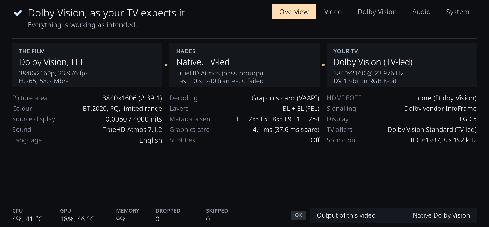
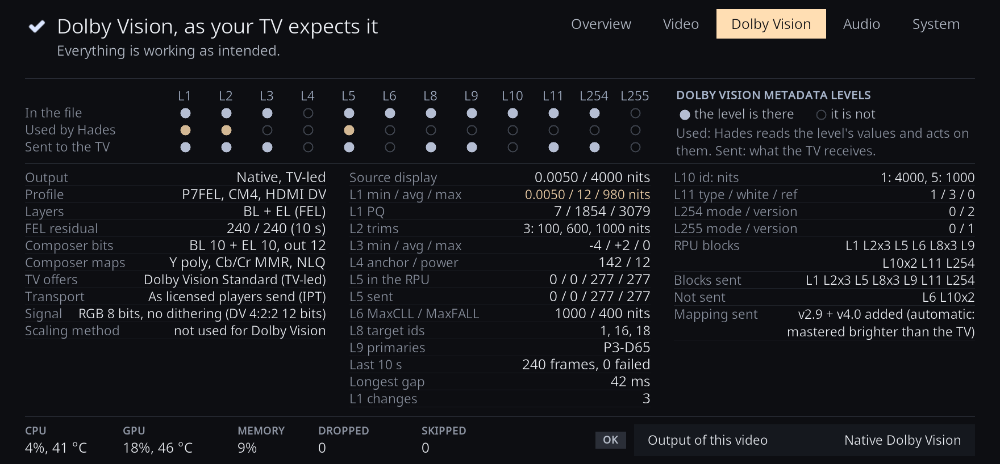
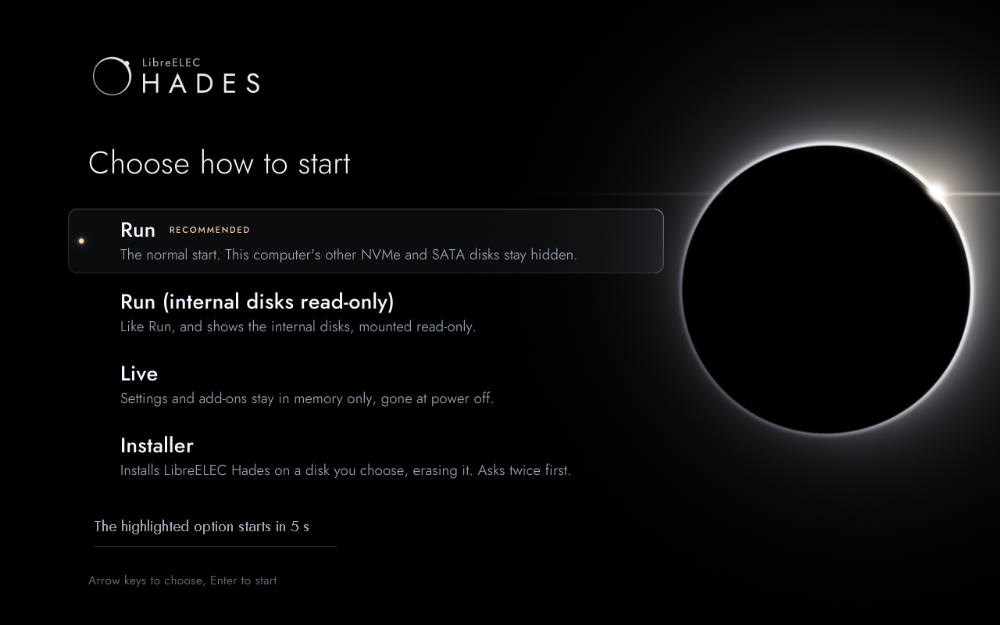

  <picture>
    <source media="(prefers-color-scheme: dark)" srcset="docs/images/header-dark.png">
    <source media="(prefers-color-scheme: light)" srcset="docs/images/header-light.png">
    
  </picture>

<b>Native Dolby Vision, HDR10+, HD audio and 3D from your PC, on LibreELEC.</b>

  

  <a href="https://github.com/hadesdevls/LibreELEC-Hades/releases/latest">Download</a> &nbsp;|&nbsp;
  <a href="#installing-and-starting">Install</a> &nbsp;|&nbsp;
  <a href="docs/features.md">What it adds</a> &nbsp;|&nbsp;
  <a href="docs/settings.md">Settings</a> &nbsp;|&nbsp;
  <a href="https://forum.libreelec.tv/thread/30682-x86-64-hadesdevls-builds-libreelec-hades-native-dolby-vision-hdr10-and-3d/">Forum</a> &nbsp;|&nbsp;
  <a href="https://github.com/hadesdevls/LibreELEC-Hades/issues">Issues</a>

LibreELEC Hades is an unofficial build of [LibreELEC](https://libreelec.tv) for 64-bit PCs (the "Generic x86_64" image). LibreELEC turns a PC into a media centre that runs Kodi and little else. Hades adds what a home cinema asks of it: Dolby Vision sent from the PC to the TV over HDMI in the TV-led way that Dolby Vision players use, including profile 7 with its full enhancement layer, HDR10+, and Dolby Atmos and the other HD sound formats passed to your receiver untouched. Everything else that LibreELEC does is kept.

> **This is not LibreELEC and it is not official.** LibreELEC Hades is not made, supported, endorsed or certified by Team LibreELEC, Team Kodi or the XBMC Foundation, Dolby Laboratories, HDR10+ Technologies, NVIDIA, AMD or Intel, and has no affiliation with any of them. Please do not ask them for help with it. Kodi is a registered trademark of the XBMC Foundation. Dolby Vision and HDR10+ are named here only as video formats: LibreELEC Hades uses neither logo and is certified by neither. Other trademarks belong to their owners; see [NOTICE.md](NOTICE.md).

  
   The player information (press O). Kodi's own rendering of the page of version 1.1, in a virtual machine, with the values of a Dolby Vision profile 7 film with Dolby TrueHD Atmos on an LG C5 filled in.

**New in 1.1.** A redesigned player information that a remote can reach, any HDR video as SDR for one film, videos that start without the screen going black on a TV with variable refresh rate, upscalers and HDR10 mapped scene by scene for those who want them, SDR videos in their wide colours, one picture from the boot menu to the interface, Dolby Vision through the USB-C hub of a Chromebook, a restart into Hades or into Windows without the boot menu key, and Secure Boot as an option of the installer. The [changelog](CHANGELOG.md) has every change. If you try Hades, please say what you see in the [forum](https://forum.libreelec.tv/thread/30682-x86-64-hadesdevls-builds-libreelec-hades-native-dolby-vision-hdr10-and-3d/) or the [issues](https://github.com/hadesdevls/LibreELEC-Hades/issues): reports from more hardware help the most.

**Why the screen says "LibreELEC Hades".** The media centre of this build is Kodi with changes that the XBMC Foundation has not approved, and Kodi's trademark policy asks such a build not to use Kodi's name and logos as its own. Underneath, it is Kodi: add-ons, skins and remote-control apps work as with Kodi, its log is still `kodi.log`, and other programs still see Kodi. The page "About this build" of the system information says what it is and how to support Kodi and LibreELEC.

## Start here

- **You want to try it.** Read [What you need](#what-you-need), then [Installing and starting](#installing-and-starting). On Windows it takes a few minutes and changes nothing in Windows.
- **You have it and want to set it up.** Most people change nothing: Dolby Vision is on by default. *Check this setup* plays test pictures and sounds and tells you what reached your TV and which sound formats to switch on ([Your first Dolby Vision video](#your-first-dolby-vision-video)), and [the settings guide](docs/settings.md) says what each setting does and when to touch it.
- **You want to know what Hades adds.** [Extras of Hades](docs/features.md) explains each one in plain words, with an example and the setting that controls it.
- **You want to know how it works.** [How it works](docs/how-it-works.md) follows a video from the file to the TV, plainly first and in technical detail further down.
- **Something is wrong.** See [Reporting problems](#reporting-problems): one button makes a diagnostic report with the files that let me find the cause, and the [diagnostics](docs/diagnostics.md) guide says what is in it.

## How a video reaches your TV

  <picture>
    <source media="(prefers-color-scheme: dark)" srcset="docs/images/signal-path-dark.svg">
    <source media="(prefers-color-scheme: light)" srcset="docs/images/signal-path-light.svg">
    
  </picture>

A Dolby Vision player decodes the film, puts its layers together and sends the picture with the metadata of every frame; the TV does the rest with its own Dolby Vision processing. Hades does that work in the PC, with the graphics you have. Dolby Vision is used only when the video, the TV, the HDMI link and the graphics driver all qualify; otherwise the video plays the ordinary way, and the first page of the player information says why in one sentence. [How it works](docs/how-it-works.md) follows the whole path.

## What it adds to LibreELEC

### Dolby Vision

- **Native Dolby Vision over HDMI.** Each picture is rebuilt as the Dolby Vision specification defines it, including the full enhancement layer (FEL) of profile 7, and sent with its metadata for every frame. The TV does its own Dolby Vision processing, as with a certified player (its "Standard" or "TV-led" mode). Profiles 5, 7 (FEL and MEL) and 8.1.
- **NVIDIA, AMD and Intel graphics,** graphics cards and integrated graphics alike: NVIDIA with its open kernel modules, and the GeForce GTX 900 and GTX 10 cards and the TITAN V with NVIDIA's driver 580.
- **A player information page that a person can read.** Press O on a keyboard, or the red key of a TV remote that sends keys over HDMI-CEC. It says whether the video plays as intended, what the file carries, what Hades does with it and what reaches your TV; O, then OK, changes how the video goes out while it plays.
- **Dolby Vision where native output is not possible:** shown as HDR10 (always for profile 5, whose base picture cannot be watched on its own, and for profile 7 if you turn it on), mapped by Hades for a TV input in game mode (Low-Latency), or with the older HDMI 1.4b signalling for the TVs of 2016 that ask for it. Zoom, vertical shift and stretching keep native Dolby Vision.
- **Dolby Vision through more connections:** a passive DisplayPort adaptor (DP++) that identifies itself as HDMI, the DisplayPort-to-HDMI converter of a mini PC's board, and the converter of a USB-C hub (an expert choice), as a Chromebook reaches a TV.

  
   The Dolby Vision page: every level of the metadata, which ones Hades uses, and what reaches the TV (the same capture as above, with example values).

### HDR10 and HDR10+

- **HDR10+** with the dynamic metadata of each frame, where the graphics driver can send it, and, as choices, HDR10+ or HDR10 sent as Dolby Vision, and Dolby Vision sent as HDR10+.
- **HDR sent more exactly:** on Intel and AMD graphics at 3840x2160 and 50 or 60 Hz over HDMI 2.0, HDR goes out as YCbCr 4:2:2 at 12 bits inside the signal that carries Dolby Vision, where the TV takes it, so that the menus and subtitles over the video keep their colour detail; on NVIDIA, where the card would send HDR in RGB at 8 bits, it goes out as YCbCr 4:2:2 at 12 bits (10 on the GeForce GTX 10 cards and the TITAN V).
- **For projectors and displays that map HDR poorly:** HDR10 and HDR10+ mapped to the display by Hades (HDR10+ by its own metadata, and HDR10 scene by scene as an expert choice), the black of the display, a limit on the luminance that HDR10 tells it, and Dolby Vision without its trims or as Low-Latency mapped to a peak set by hand.
- **A display without HDR** gets HDR mapped to SDR with the reference method of ITU-R BT.2390, which keeps everything the display can show as it was mastered, for a reference display, a bright room, a projector or the white and gamma of your own display. Any HDR video can also go out as SDR for one film, for a TV whose SDR picture you prefer.

### HLG and SDR

- **HLG** goes out as HLG, or as Dolby Vision: on its own where the output cannot send HLG, and by choice anywhere else. HDR videos can be played as SDR, for a TV that shows HLG badly.
- **SDR videos made in BT.2020** (some Ultra HD Blu-rays and streams) can keep their wide colours, with the menus and subtitles converted to match, on a display that takes BT.2020.
- **Upscalers,** an expert choice: RAVU, FSRCNNX 8 or FSRCNNX 16 rebuild the fine detail of a video smaller than the screen, such as 1080p on a 4K TV, with a choice of its own for animation. While a video plays, the Video page of the player information (O) has a button for them.

### The refresh rate and the picture in time

- **The refresh rate Kodi would choose,** exact for progressive video (25 fps at 25 Hz, 29.97 fps at 29.97 Hz). On NVIDIA, the modes at exactly 24, 30, 60 and 120 Hz that the driver did not offer are added. DVD films stored as interlaced video are put back together picture by picture and shown at their own rate.
- **Without the screen going black,** an expert choice for a TV with variable refresh rate (VRR): an SDR or HDR10 video, and on the RTX 40 and RTX 50 series HDR10+ and Dolby Vision sent as HDR10, HDR10+ or SDR, plays at its own rate in the mode of the menus, each picture shown at its time. It is off by default; set to *Where the display has no mode at the video's rate*, it plays films this way only on a monitor without a mode at their rate, which otherwise sends them at 120 or 360 Hz with a picture held now and then.
- **Picture and sound in step:** each frame is shown when its sound plays, measured on your display, and passthrough sound (TrueHD, Dolby Digital Plus, DTS) is kept through a pause.
- **Made for integrated graphics too.** A frame that takes most of a refresh period is prepared one refresh ahead, and the picture under menus and subtitles is redrawn only where they are.

### 3D

- **3D Blu-ray video** (H.264 MVC): both views are decoded, and a 3D display is switched to 3D over HDMI, in frame packing where it takes it, or side by side and top and bottom.

### Sound

- **Dolby Atmos and the HD sound formats passed through untouched:** Dolby TrueHD and Dolby Digital Plus with Atmos, and DTS-HD. Sound that Hades decodes goes out in no more channels and bits than your display says it takes, so that it does not go silent.
- **The sound follows the display you use,** and an AV receiver on its own output can keep it.

### Made for a PC

- **PCs with two graphics chips, and laptops:** Kodi starts on the TV, whichever chip it is connected to, and moves to a TV connected later (on the same graphics without a restart).
- **Blu-ray Java (BD-J) menus with nothing to install,** in a service of the system kept apart from Kodi, with no network unless BD-Live is turned on, and then the Internet only.
- **Streams that keep going:** a network or a streaming service that stops sending for a while no longer ends the film; it goes on from where it stopped. A disc image that an add-on streams from the internet plays as a disc, with its menus.
- **A check of your setup.** *Check this setup* plays test pictures in SDR, HDR10, HLG and Dolby Vision, each speaker in turn and a chime in each sound format, says what went out, asks what you saw or heard, and switches on the sound formats that you heard.
- **Safer defaults, a Windows installer, and a diagnostic report made with one button** (see below).

[Extras of Hades](docs/features.md) explains each of these, and the smaller ones that are not listed here.

## What you need

- A 64-bit PC. If it keeps Secure Boot on, tick *Start with Secure Boot* in the Windows installer (see [Secure Boot](#secure-boot-optional)); written any other way, Hades needs Secure Boot turned off.
- A USB drive of 8 GB or more. A USB SSD runs much more smoothly than a stick.
- For Dolby Vision:
  - **A TV that offers Dolby Vision "Standard" on the HDMI input you use.** Many TVs offer only low-latency Dolby Vision on an input set up for games or a PC; Hades says so and sends that input HDR10, or low-latency Dolby Vision if you turn that on. On an LG C5, "Quick Frame Transport" has to be off on that input.
  - **Supported graphics:** NVIDIA GeForce GTX 16, RTX 20 or newer, and with NVIDIA's driver 580 the GeForce GTX 900 and GTX 10 cards and the TITAN V; AMD Radeon graphics with display hardware DCN 1.0 or newer, from Raven, Picasso and Navi 1x to the RX 9000 series and the newest Ryzen processors (DCN 4.2 and 4.2B), and the Radeon RX 400 and 500 series, the Radeon RX Vega M, the Radeon RX Vega 56 and 64 and the Radeon VII (display hardware DCE 11.2 and 12; not older AMD hardware, nor the few versions listed in [docs/how-it-works.md](docs/how-it-works.md#graphics-drivers)); Intel graphics of display version 9 or newer (UHD 6xx and later). On the Polaris and Vega cards the Dolby Vision path is off unless you turn it on, and Dolby Vision plays as HDR10 there (see [Known limits](#known-limits)).
  - **The PC connected by HDMI straight to the TV** is best, from an HDMI port of the graphics or through a passive DisplayPort adaptor (DP++) that identifies itself as HDMI. A sound bar or AV receiver in between has to pass Dolby Vision through.
- Your own videos or add-ons: Hades comes with no films, add-ons or media sources.

## Installing and starting

You need the image file (`LibreELEC-Generic.x86_64-...img.gz`), from the [releases](https://github.com/hadesdevls/LibreELEC-Hades/releases) of this repository or built yourself. The Windows installer is in the same place and comes with its own README.

1. **Write the image to a USB drive.** On Windows, run `LibreELEC-Hades-Installer.exe`: it lists your drives with their model, size and serial number, asks you to type a word before it touches anything, and checks what it wrote. Any other program that writes disk images works too. The drive is erased.
2. **Start the PC from the drive.** Restart the PC, open the firmware's boot menu (F8, F11, F12 or Esc on most PCs) and choose the USB drive.
3. **Choose "Run" in the boot menu** (it starts by itself after 5 seconds). The first start prepares the storage and restarts once. Choose "Run" again.
4. **Answer the first-run wizard** that LibreELEC shows: language, the name of the system, the network and the services. If you want to copy files to the system over the network, turn Samba on here; the wizard then shows the address, the user and the password that you need ([Updating](#updating) has the details). SSH is a separate switch.

  
   The boot menu on a UEFI PC (a capture of the real menu in a virtual machine). From the moment an entry starts, the same picture of the eclipse stays until the interface appears.

What the boot menu offers:

| Entry | What it does |
| --- | --- |
| Run (recommended) | The normal start. The PC's internal disks stay hidden from Hades, and each device reaches only its own memory. |
| Run (internal disks read-only) | Shows the internal disks, mounted read-only, and starts devices as LibreELEC does. |
| Live | Settings and add-ons stay in memory only and are gone at power off. |
| Installer | Installs Hades on a disk that you choose, erasing it. It asks twice first, and it is never the entry that starts by itself. |

### Secure Boot (optional)

If your PC keeps Secure Boot on, as many Windows 11 PCs do, tick **Start with Secure Boot** in the Windows installer. The box is off by default, and without it nothing changes.

- The installer makes a key for that PC alone and signs the boot loader and the kernel with it. The private key stays in the Hades storage.
- On the first start the PC shows a blue screen once: choose **Enroll MOK**, **Continue**, **Yes**, type the 4-digit code that the installer showed, and **Reboot**. Updates do not ask for it again.
- From then on Hades starts with Secure Boot on, and the kernel loads only signed drivers. An update made inside Hades is signed on the PC itself.
- Hades starts through shim and MokManager of Debian 13, signed by Microsoft. It never changes the Secure Boot keys of your PC, its boot order or Windows: the only thing it writes to the firmware is the one-time request to enroll its key.

Good to know before you tick it:

- Another Linux on the same PC should be up to date (from February 2025 or later): with Secure Boot on, shim keeps older Linux boot loaders from starting. Windows is not affected.
- Some PCs, laptops above all, come with *Allow Microsoft 3rd Party UEFI CA* turned off in their firmware settings. Turn it on, or Hades will not start with Secure Boot; Windows starts as before either way.
- Turning Secure Boot itself on or off in the firmware settings can make Windows ask for its BitLocker recovery key. Enrolling the key of Hades does not.

To go back to your usual system, shut Hades down and start the PC normally, or, on a PC with Windows, choose *Restart into Windows* in the power menu. From Windows, *Restart into LibreELEC Hades* in the installer (and a shortcut on the desktop, if you want one) starts Hades once without the boot menu key. Started from USB, Hades changes nothing in Windows. Of the PC's boot settings it only sets which entry starts next, once, so that a restart goes where you chose (and *Restart LibreELEC Hades* comes back to Hades even where Windows comes first). It never adds, removes or reorders the PC's boot entries. Installing on an internal disk, instead of a USB drive, is also possible: the Windows installer explains the two ways (making room without erasing anything, or using a whole secondary disk, never the one Windows starts from).

## Your first Dolby Vision video

1. Play a Dolby Vision file. When the TV switches to its Dolby Vision mode, Hades is sending Dolby Vision. The TV's Dolby Vision logo alone does not prove that the colours are right: check the picture too.
2. Press O on a keyboard, or the red key of a TV remote that works over HDMI-CEC, to open the player information. Its first page has one sentence that says whether the video plays as intended and, if not, what is wrong and what to do about it. OK then opens the choice of output for the video that plays.
3. If you would like a short notice each time a video starts, turn on *Settings > System > Display > Show the playback mode when a video starts*. It says, for example, "Dolby Vision, FEL, 3840x2160 at 23.976 Hz".
4. If the picture is not Dolby Vision where you expect it, the player information says why, and [Known limits](#known-limits) lists the usual reasons. Most of them are about the TV input (game mode) or the connection (a converter or a receiver in between).
5. Not sure? *Settings > LibreELEC > System > Check this setup* plays a test picture in SDR, HDR10, HLG and Dolby Vision, a sound from each speaker and a chime in each sound format, says what went out, asks what you saw or heard and says what to do. It switches on the sound formats that you heard, and changes nothing else.

You do not need to change any setting to watch Dolby Vision. [The settings guide](docs/settings.md) starts with the few that people do change, such as the brightness of the menus on an HDR TV, and has a section for projectors.

## Updating

Your settings, add-ons and the diagnostics folder are kept whichever way you update. The new version is installed by the system itself at the next start, and the system restarts on its own when it is done. The boot menu does not wait for you after that restart: the one start that applies an update goes straight on, and the menu is back, as it was, from the next start.

- **With the Windows installer:** choose the drive that has Hades and "Update". It writes the new system and keeps everything else.
- **As in LibreELEC, with the `.tar` file** of the new version: copy it to the `Update` folder (`/storage/.update`) and restart. Over the network that folder is a share of the system, and file sharing (Samba) is off in Hades until you turn it on:
  1. In *Settings > LibreELEC > Services* turn Samba on. A window shows the name of the system, the user (`libreelec`) and the password that Hades generates for it; the same page keeps them if you need them again.
  2. On your computer open `\\<name of the system>\Update` (Windows) or `smb://<name of the system>/Update` (Mac, Linux), and sign in with that user and password.
  3. Copy the `.tar` file there and restart the system.
- **SSH is a separate switch.** While root still has LibreELEC's default password, SSH only accepts keys: set a password first (the first-run wizard asks for it when you turn SSH on) if you want to log in with one.

Hades does not look for updates by itself and does not contact LibreELEC's update server, because an official LibreELEC update would remove Dolby Vision. *Settings > LibreELEC > Updates > Available Versions* says where the versions of Hades are published.

## Defaults that differ from LibreELEC

Nothing from LibreELEC is removed. LibreELEC is made for a box that does nothing else. A PC that also holds your other disks and your Windows needs more care, so Hades starts with safer values for what is unsafe by default. Each one can be turned back on, and each is explained here.

### Your PC's disks

- **Started from USB, the internal disks are hidden.** In the "Run" and "Live" entries Hades does not start any internal storage controller, whatever its kind, until the next start ([how](docs/settings.md#outside-the-settings-screens)). "Run (internal disks read-only)" shows them, read-only. USB drives and SD cards are mounted as usual.
- **Installed on an internal disk,** Hades does not see the PC's other NVMe and SATA disks either, and does not mount the other partitions of its own disk.
- **To show the internal disks by default,** turn on *Settings > LibreELEC > System > Internal disks > Show the internal disks (read-only)*. It is off, and it explains what it means before it is turned on: shown disks can be read by everything that runs in Kodi, add-ons included; "read-only" is how they are mounted, not a lock; and that entry starts the kernel without lock-down. Choosing "Run" once in the boot menu, a reset to defaults or an update with the installer turns it off again.
- **To show only some of them,** *Internal disks that are shown* keeps the NVMe and SATA disks that you untick (the one of Windows, a disk of personal files) away from the kernel. Disks are told by their model and serial number; one that cannot be told apart is kept away too while any is, and so is every disk if the list cannot be read. *Internal partitions that are shown* keeps the partitions that you untick from being mounted. A partition that is not mounted is still on its disk, where a program with full rights could read it.
- **Kernel lock-down.** The entries that hide the disks start the kernel in "integrity" lock-down, and a start that keeps internal disks away locks it down before the system starts: it loads only the modules signed for that build.
- **Devices keep to their own memory.** "Run" and "Live" start the kernel with DMA translation: where the PC has an IOMMU, a network card, a USB controller or the graphics card can use only the memory that the kernel gives it, so a device whose firmware was replaced cannot read the rest. On Intel, the integrated graphics are left out, as Debian does. "Run (internal disks read-only)" starts devices as LibreELEC does, and is the way back if a device misbehaves.
- **The installer entry** of the boot menu is there, but Hades starts in "Run".

### Network and logins

- **Samba (file sharing) is off.** When you turn Samba on, in the first-run wizard or in *Settings > LibreELEC > Services*, a window shows the address, the user (`libreelec`) and a password that Hades generates, and the same page keeps them. Sharing without a password can still be chosen. This is the login that you need to copy an update file ([Updating](#updating)).
- **SSH is off,** as in LibreELEC, and while the root password is the default one it accepts only keys. Set a password first if you want to log in with one.
- **The firewall** starts in "home" mode on a new installation, and **AirPlay** is off.
- **Bluetooth** uses stricter pairing rules, with an option for older input devices.
- **Blu-ray Java (BD-J) menus** run in a service of their own, apart from Kodi, with no network. *Player > Discs > BD-Live: Internet for disc menus* gives them the Internet, and only the Internet ([how](docs/how-it-works.md#bd-live)).

### Updates and privacy

- **Updates.** Hades does not contact LibreELEC's update server, because an official LibreELEC update would remove Dolby Vision. You update by hand ([Updating](#updating)). Update files that are not Hades are refused.
- **No usage statistics** are sent by default.

### The rest

- **Clock.** The PC's hardware clock is never written, so Windows keeps the right time. Once the time has been taken from the internet, Hades measures whether the clock keeps local time, as Windows keeps it, or UTC, as a PC without Windows does, and reads it that way from the next start (*Settings > LibreELEC > System > OS Configuration > Hardware clock*, Automatic). "Local time" and "UTC" set it by hand.
- **Hardening.** Kernel and sysctl settings that make attacks harder (a file in `/storage/.config/sysctl.d` can change the sysctl ones back), BusyBox not setuid root, OpenSSL, Python and the programs of Samba built with the compiler's protections, and the add-ons' data, network passphrases and other secrets readable by root only. 32-bit programs are off (`ia32_emulation=1` on the kernel line turns them on).
- **SSD trim.** Once a week, at the lowest priority, the unused blocks of the storage partition are given back to the drive. `systemctl mask fstrim.timer` turns it off.
- **RGB range on AMD.** AMD graphics send limited-range RGB to a TV that cannot select the range, as the TV expects. If you turned on *System > Display > Use limited colour range (16-235)* for such a TV, turn it off.
- **Tone mapping.** On a display without HDR, Kodi's tone mapping method is "Reference (BT.2390)" by default. A saved choice of Hable, Kodi's own default, or of "Off", which every profile had up to 1.0 without anyone choosing it, is switched to it once.

## What has been tested

I test on an AMD Ryzen 9 7950X3D with an NVIDIA GeForce RTX 4080 SUPER, using both the card and the processor's integrated graphics, with an LG C5 TV, a Samsung Odyssey OLED G6 monitor (LS27DG600SLXPE), a TCL Q85H Pro sound bar (on the TV's eARC, or between the PC and the TV) and a HIKSEMI HS-USB-SYNC C PRO 128 GB USB SSD; and on a laptop with an Intel Core i5-12450H. Results marked "author" are mine. Results marked "user" were reported by people on their own hardware, in the issues of this repository and on the LibreELEC and Kodi forums. Seen working means correct colours and a clean return to the menus; the TV's Dolby Vision logo alone does not count.

### On my PC (author)

With the GeForce RTX 4080 SUPER connected by HDMI to the LG C5, the TCL Q85H Pro sound bar on the TV's eARC, and the Samsung Odyssey OLED G6 monitor:

- **Dolby Vision:** native output of profile 7 with its full enhancement layer, profile 8.1 and profile 5, including films that once dropped to HDR10; HDR10 sent as Dolby Vision, also when chosen for one video from its output.
- **Sound passed through to the sound bar:** Dolby TrueHD with Atmos (with Dolby Vision profiles 7 and 8.1), Dolby Digital Plus with Atmos (with profile 5) and DTS-HD Master Audio (with HDR10).
- **HDR10+ on the Odyssey,** which takes HDR10+ and not Dolby Vision: HDR10+ videos, Dolby Vision videos that carry HDR10+ of their own, and Dolby Vision profile 7 with its enhancement layer sent as HDR10+.
- **"As SDR (without HDR)"** for one video.
- **The player information:** it opens with O at once, and its button for the output of the video is reached with Down, or with O, then OK.
- **A change of subtitle track** shows the new track at once.
- **Displays:** moving from the LG C5 to the Odyssey and back from the settings, with the display that is not in use turned off; back to 3840x2160 at 120 Hz after a video, many times in a row.
- **The start with several displays:** the picture of the eclipse with no line of text, and the notice that Hades shows on one display, at its own size on each of them.
- **The restarts:** *Restart LibreELEC Hades*, *Restart the interface* and *Restart into Windows* in the power menu, and *Restart into LibreELEC Hades* from the installer.
- **The time** of the PC's hardware clock, which keeps local time for Windows.

### Graphics

| Maker | Graphics | Tried on |
| --- | --- | --- |
| **NVIDIA** | GeForce RTX 50 series | RTX 5060 (author); RTX 5080 and RTX 5090 (users) |
| | GeForce RTX 40 series | **RTX 4080 SUPER (author)**; RTX 4080 Laptop GPU (user) |
| | GeForce RTX 30 series | RTX 3050, RTX 3070 and RTX 3090 (users) |
| | GeForce GTX 16 and RTX 20 series, and the Quadro RTX of that generation | GTX 1650 (user, issue #22); Quadro RTX 4000 in a laptop (user, issue #4) |
| | GeForce GTX 900 and GTX 10 series, TITAN V (driver 580) | GTX 1060 (user, issue #17) |
| **AMD** | Radeon RX 7000 series | RX 7600 (user) |
| | Radeon RX 5000, RX 6000 and RX 9000 series | No reports yet |
| | Radeon RX 400 and 500 series, RX Vega M, RX Vega 56 and 64, Radeon VII | Dolby Vision not seen working yet ([Known limits](#known-limits)) |
| | Ryzen integrated graphics | **Ryzen 9 7950X3D (author)**; Ryzen 7 5800H, Ryzen 5 5600U and Ryzen 3200G (users) |
| **Intel** | Integrated graphics (display version 11 and later) | **Core i5-12450H (author)**; Core i7-1355U, Core i3-1005G1, Core 5 255H, Core i3-N305 and N100 (users) |
| | HD and UHD 6xx graphics | HD Graphics 610 with a Pentium G4560, and the UHD Graphics of a Core i5-10310U (users) |
| | Graphics that use the `xe` driver (Arc B-series, Core Ultra 200V and newer) | No reports yet |

TVs, projectors and monitors: an LG C5 TV and a Samsung Odyssey OLED G6 monitor (author); LG G5, LG C2, a Panasonic TV and a Sony Bravia 8 II with native Dolby Vision (its HDMI input set to "Enhanced format"), a Samsung S90H, a Samsung S95B and a JVC DLA-NZ9 projector with HDR10+, an LG C3 with Dolby Atmos passed through, an LG C1 through a Denon receiver and an LG G2 through an Onkyo receiver and through an Anthem AVM 90 with native Dolby Vision, a Titan Noir Max projector with native Dolby Vision and with Dolby Vision shown as HDR10 and HDR10+ through a Denon X4800H, a Hisense L9H projector with native Dolby Vision, an LG CX through a Yamaha RX-V6A receiver, an LG OLED B7 that gets its picture back after it is switched off and on, a Philips 3D TV with 3D in frame packing, and a Sony TV that offers Dolby Vision only as low-latency (users).

### Features

| What | Seen working on |
| --- | --- |
| Dolby Vision profile 7 with FEL | RTX 4080 SUPER, Ryzen 9 7950X3D and Core i5-12450H (author); RTX 4080 Laptop GPU, RTX 5080, RTX 5090, GTX 1650, RX 7600, Ryzen 7 5800H, Core i7-1355U, Core 5 255H and HD Graphics 610 (users; on the HD Graphics 610, measured: the enhancement layer in every frame, at the last level of the fidelity step-down, with no menus over the picture, issue #12) |
| Dolby Vision profile 7 with MEL | Ryzen 9 7950X3D (author); RX 7600 (user) |
| Dolby Vision profiles 8.1 and 5 | RTX 4080 SUPER and Ryzen 9 7950X3D (author); RX 7600 (user); profile 8.1 on an RTX 5090 (user, issue #16) |
| Films that once dropped to HDR10, now in Dolby Vision | Profile 7 with FEL and Dolby TrueHD Atmos, on the RTX 4080 SUPER (author, issue #1); samples of two such films on a Ryzen 7 5800H (user) |
| Dolby Vision in two video tracks | `.m2ts` on the RTX 4080 SUPER (author); MKV on an RTX 3070, and MP4 on a laptop with RTX graphics (users) |
| Dolby Vision at 60 Hz, through the HDMI port of a laptop that the graphics drive as DisplayPort | Quadro RTX 4000 in an HP ZBook 17 G6 (user, issue #4) |
| Menus and subtitles over Dolby Vision at full frame rate | Profiles 7 FEL and 8.1 on the RTX 4080 SUPER and the Ryzen 9 7950X3D (author); profile 7 FEL on an RX 7600 (user, measured with the menus over the picture: 240 of 240 frames, the largest gap 42.0 ms, issue #3) |
| Dolby Vision Low-Latency | Ryzen 9 7950X3D, through an HDMI sync box that offers only low-latency Dolby Vision (author) |
| Dolby Vision through a sound bar or an AV receiver | RTX 4080 SUPER through the TCL Q85H Pro sound bar to the LG C5 (author); Ryzen 5 5600U through a Denon AVC-X3900H to an LG C1 (user, issue #15); HD Graphics 610 through an Onkyo receiver to an LG G2 (user, issue #12); Core i7-1355U through an Anthem AVM 90 to an LG G2 (user, issue #28); RTX 5090 through a Denon X4800H to a Titan Noir Max projector (users, issues #16 and #25); GTX 1060 with driver 580 through a Denon receiver, at every refresh rate (user) |
| Dolby Vision shown as HDR10 | Profile 5 on the RTX 4080 SUPER (author); profiles 5 and 7 FEL on a Core i3-1005G1 (user); an RTX 5090 with a Titan Noir Max projector (user, issue #16) |
| Dolby Vision shown as HDR10+ | Profile 7 FEL on the RTX 4080 SUPER with a Samsung Odyssey OLED G6 (author); profile 7 FEL on an RX 7600 with a JVC DLA-NZ9, shown as HDR10+ with its FEL at full resolution, and measured: the JVC reports HDR10+ throughout, and DistributionY99, read from the output, follows the peak that the Dolby Vision metadata give each scene (user, issue #10); a Core i3-1005G1 with a Samsung S90H (user, issue #2); an RTX 5090 with a Titan Noir Max projector (user, issue #16) |
| Changing the output of a video while it plays (Dolby Vision, HDR10, HDR10+, SDR) | RTX 4080 SUPER (author); Ryzen 7 5800H, from the on-screen controls (user) |
| HDR10+ | RTX 4080 SUPER with a Samsung Odyssey OLED G6 (author); Core i3-1005G1 with a Samsung S90H, Ryzen 3200G with a Samsung S95B, Ryzen 7 5800H, and RX 7600 with a JVC DLA-NZ9 (users; on the RX 7600, measured: the HDR10+ packets of four HDR10+ films byte for byte those of a licensed player in 10 of 10 samples, issue #10) |
| HDR10+ as Dolby Vision | RTX 4080 SUPER (author); Ryzen 7 5800H (user) |
| HDR10 with more than 8 bits on NVIDIA | RTX 4080 SUPER (author); GTX 1650 in YCbCr 4:2:2 at 12 bits, through a Yamaha RX-V6A to an LG CX (user, issue #22); Quadro RTX 4000 in YCbCr 4:2:2 at 12 bits (user, issue #4); GTX 1060 with driver 580, in YCbCr 4:2:2 at 10 bits, with an LG OLED65C8, straight and through a Denon receiver (user, issue #17) |
| A TV switched off and on gets its picture back | RTX 3050 to an LG OLED B7 at 3840x2160 at 50 Hz (user, issue #11) |
| A 24 fps video at exactly 24 Hz on NVIDIA | RTX 4080 SUPER (author) |
| Dolby TrueHD with Atmos, passed through | RTX 4080 SUPER, Ryzen 9 7950X3D and Core i5-12450H (author); RTX 3090 (user) |
| Dolby Digital Plus with Atmos and DTS-HD Master Audio, passed through | RTX 4080 SUPER (author); DTS-HD Master Audio from an RTX 3050 to a Pioneer receiver on an output of its own (user, issue #24) |
| 3D: both views decoded, the display switched to 3D | Ryzen 7 5800H, 3D Blu-ray video (MVC) and full side by side (user); the UHD Graphics of a Core i5-10310U with a Philips 3D TV, in frame packing (user, issue #23) |
| The use and temperature of the graphics in the player information | A laptop with RTX graphics (user) |
| Check this setup, and Check the Dolby Vision output | RX 550 with an LG G3 (user, issue #20) |
| The diagnostic report made with one button | Intel and NVIDIA graphics (users, issues #22 and #23) |
| Kodi on the TV in a PC with two graphics chips | RTX 4080 SUPER and Ryzen 9 7950X3D, with the TV on the NVIDIA card (author) |
| Started from USB with the internal disks hidden, and with DMA translation | Ryzen 9 7950X3D (author) |
| Windows installer | "Update" of a USB SSD, and *Restart into LibreELEC Hades* (author); the other operations on a virtual disk |

Every change is tested before a release on the host, with the code that the image runs, and on my PC where it has the hardware. Reports with the diagnostic switch on ([diagnostics](docs/diagnostics.md)) help confirm the rest.

### Not tried on hardware yet

These need hardware, a display or a connection that I do not have. Each was checked on the host, with the code that the image runs, or in a virtual machine. If you have one of them, please say what you see in the [forum](https://forum.libreelec.tv/thread/30682-x86-64-hadesdevls-builds-libreelec-hades-native-dolby-vision-hdr10-and-3d/) or the [issues](https://github.com/hadesdevls/LibreELEC-Hades/issues).

- **AMD graphics:** Dolby Vision on the newest Ryzen processors (DCN 4.2 and 4.2B); the Dolby Vision path of the Radeon RX 400, RX 500 and Vega cards, and the check of the output that says where such a card changes the bytes.
- **Intel graphics:** HDR over HDMI on HD and UHD 6xx graphics; AV receivers that switch inputs (issue #28); reading the EDID on Panther Lake and Wildcat Lake.
- **NVIDIA graphics:** a card held to a low power limit, which now presents frames ahead; a card with 2 GB of memory; *Video at its own rate with VRR* with Media VRR on the RTX 50 series, and with HDR10+ there; a change of mode with several displays on driver 580 (GTX 900 and 10 series); a laptop that keeps its card at full speed while HD audio plays on its charger.
- **Connections:** passive DisplayPort adaptors (DP++), for Dolby Vision, HDR and 3D, including SDR at 8 bits on AMD graphics and an adaptor that says DVI on NVIDIA; USB-C hubs and adapters, for Dolby Vision and surround sound; the DisplayPort-to-HDMI converter of a mini PC or NUC board.
- **Displays:** projectors and LCD TVs with Dolby Vision Low-Latency (their black level, colours past BT.2020, a peak or colours that cannot be used); a TV whose EDID counts extra blocks with an HDMI Forum EEODB (issue #7); a TV that does not lock onto its link after it is turned on (issue #24); a display that takes PCM sound of 16 or 20 bits only; 3D displays (side by side at 1080p, the lines between the eyes of frame packing, the second view after a picture that empties the decoder).
- **Sound and HDMI-CEC:** an AV receiver on an output of its own kept on with `hades-keep-outputs`; a receiver with a back centre speaker, for 6.1 and 6.0 tracks; a CEC adapter on an output without the picture, CEC over a DisplayPort connector, adapters plugged in later, and SECO boards (UDOO x86).
- **PCs:** Chromebooks; laptops with Secure Boot; a PC without a temperature sensor for its processor; a PC whose HPET timer stops (issue #22); the firmware of more MediaTek and Qualcomm Wi-Fi and Bluetooth adapters; infrared remotes that use the decoders compiled from source; the fast side of an external USB hub that may sleep.

SDR, HDR10, HLG, audio passthrough, menus and refresh-rate switching use Kodi's own code and behave as in LibreELEC, apart from the additions above.

## Known limits

- **Dolby Vision needs an untouched HDMI signal** from an HDMI port of the graphics, or from a DisplayPort port through a passive adaptor (DP++) that identifies itself as HDMI (a type 2 adaptor carries it up to 3840x2160 at 30 Hz; a type 1 adaptor stops at 1080p, so it does not carry Dolby Vision, which goes out at 3840x2160); on NVIDIA, also from a DisplayPort port that the graphics drive as HDMI, as the HDMI port of some laptops; on Intel graphics, also through the DisplayPort-to-HDMI converter of a board on the list, or of a USB-C hub with the expert setting. Variable refresh rate, scaling and colour adjustments in the graphics driver are not compatible with it, and most active converters between DisplayPort or USB-C and HDMI do not carry it. An adaptor that does not identify itself as HDMI gets no Dolby Vision, on NVIDIA too.
- Native Dolby Vision goes out at 3840x2160, up to 60 Hz. On Intel UHD 6xx graphics, up to 30 Hz and only from an HDMI port of the graphics itself.
- **Radeon RX 400 and 500 (Polaris) and Vega cards:** the Dolby Vision path is off unless you turn on *System > Display > Dolby Vision on this Radeon (experimental)* (Expert level; it appears only on those cards), because an RX 550 with an LG G3 showed a black picture with the Dolby Vision logo, and *Check the Dolby Vision output* found that card changing the pixels. Dolby Vision plays as HDR10 there, and where the check finds a card not exact, Hades does not use the path on that output.
- **HDR in 4:2:2 at 12 bits over HDMI 2.0** (Intel and AMD graphics) needs one more change of mode at the start of an HDR video at 3840x2160 and 50 or 60 Hz: the TV blanks once more than before. If that bothers you, turn the setting off in *System > Display*, and HDR goes out as before.
- On AMD integrated graphics, the first Dolby Vision video after installing a new build may stutter briefly while Hades measures which of two ways of drawing is faster there.
- On integrated graphics, profile 5 can drop frames while the player information is open.
- **GeForce GTX 900 and GTX 10 cards and the TITAN V** use NVIDIA's driver 580, which Hades chooses at start by the card. A PC with one of them and a newer NVIDIA card at once gets the newer driver, and the older card gets none. Driver 580 offers Kodi no window of more than 8 bits, so Hades draws HDR10 on these cards into 10-bit buffers of its own, and `kodi.log` says the depth that the driver then reports. Over HDMI the driver sends RGB at 8 bits at most on these cards; on the GTX 10 cards and the TITAN V, *HDR at more than 8 bits where the card sends RGB at 8 (NVIDIA)* (on by default) sends HDR in YCbCr 4:2:2 at 10 bits instead where the TV takes it. The GTX 900 cards stay at 8 bits over HDMI. DisplayPort is not under that limit.
- **Dolby Vision Low-Latency is mapped by Hades, not by Dolby's display management**, which is not public. The TV is in its Dolby Vision mode and shows Hades' mapping to the brightness and colours its Dolby Vision block gives.
- **HDR10+ goes out only where the graphics driver can send it with each frame,** otherwise as HDR10; [docs/how-it-works.md](docs/how-it-works.md#hdr10) says where. The player information says "HDR10+" while its metadata go out.
- **HDR10 sent as Dolby Vision** carries metadata measured from the picture as it plays, not the studio's: scene cuts are found from the picture, and a few are missed or found where there is none. **HDR10+ sent as Dolby Vision** keeps the brightness of each scene, not the studio's tone curve, target display or windows; only in Low-Latency, where Hades maps the picture itself, is the studio's tone curve applied.
- **Video at its own rate with VRR** is exact only where the display engine holds each picture until its time (NVIDIA) or keeps the rate itself (Media VRR, RTX 50 series); on AMD graphics Kodi times each picture, and `kodi.log` says how close it came. Native Dolby Vision and HLG always change the mode, and so do HDR10+ and Dolby Vision sent as HDR10, HDR10+ or SDR except on the RTX 40 and RTX 50 series.
- **BD-Live** reaches the Internet over IPv4 only, and the updates that a disc can fetch over BD-Live are not implemented by libbluray: such a disc is told that the update failed.
- **3D:** I have no 3D display, and the 3D results above are users'. If a 3D video shows a black or broken picture, turn off *System > Display > Switch the display to 3D (HDMI)*. Through an active DisplayPort or USB-C converter, the graphics driver offers no 3D mode, and `kodi.log` says so. More in [docs/how-it-works.md](docs/how-it-works.md#stereoscopic-3d).
- **The USB receiver of a wireless keyboard, mouse or remote** (2.4 GHz) can lose range next to USB 3 ports, cables and hubs, whose links give off noise in that band. A USB 2.0 port fixed it for a user (issue #13).
- **With Secure Boot** an image written without the installer's *Start with Secure Boot* does not start.
- This is an independent implementation written from public specifications. It has not been tested or certified by Dolby or by HDR10+ Technologies, and it may differ from a certified player.

## What is not included

- **No third-party add-ons and no media sources.** Like LibreELEC, the image has Kodi's standard add-ons, the Kodi and LibreELEC add-on repositories, and LibreELEC's empty local folders. What you install is up to you.
- **No Dolby software.** There is no Dolby code, library or licence key in Hades, and no code or specification of HDR10+ Technologies (the layouts of the HDR10+ InfoFrame and of the Dolby vendor InfoFrame come from GPL code; see "Credits").
- **No telemetry.** Hades adds none and, by default, sends no usage statistics and no identifier of your PC. Like LibreELEC and Kodi, it contacts the services they use (add-on repositories, time servers and the like), which the page "Privacy policy" of the system information lists. The diagnostics stay on your drive.

## Building from source

In outline; LibreELEC's own documentation covers the rest.

1. Use a Linux machine (I use Ubuntu 26.04; LibreELEC keeps container recipes in `tools/docker/`), an unprivileged user, a path without spaces and about 75 GB of free disk.
2. Get this repository: `main` is the current version, and the source of a build is the commit that its `BUILD_ID` names.
3. Build: `PROJECT=Generic DEVICE=Generic ARCH=x86_64 make image`
4. The results are in `target/`: an `.img.gz` (for a USB drive), a `.tar` (for updating) and an `.ova` (virtual machine).

Good to know:

- Every source is downloaded from the address in its recipe (`package.mk`) and checked against the SHA-256 written there. No recipe has an empty hash, and prebuilt "reusable" toolchain packages are not used (`USE_REUSABLE="no"`).
- The NVIDIA driver packages (620 and, for the GeForce GTX 900 and GTX 10 cards and the TITAN V, 580) are downloaded from NVIDIA and unpacked without being run. Only their user-space libraries and firmware are used, unchanged; the kernel modules of 620 and the GBM library of their EGL (egl-gbm) are compiled from NVIDIA's open source code. The kernel module of 580 is built as NVIDIA ships it, with its closed core (`nv-kernel.o_binary`), and its modesetting core and `nvidia-drm` are compiled from NVIDIA's open source of the same version. By building, you accept NVIDIA's licence for those files. Driver 580 makes the image about 120 MB larger.
- Everything in the image is compiled from source, except the files that [NOTICE.md](NOTICE.md) names (NVIDIA's closed parts and the BIOS boot files of syslinux, as LibreELEC takes them) and the firmware. The test clips of *Check this setup* are made during the build, with x265 and FFmpeg built for the build machine; no encoder goes into the image.
- The dates written into a build come from the time of its commit (`SOURCE_DATE_EPOCH`), so that builds of the same commit can be compared byte for byte.
- A clean build takes 20 to 45 minutes on a 32-thread machine, much longer on a small one. My builds run without network access, from sources fetched and verified beforehand.
- **If you change the tree and share your build, give it your own name** (`BUILDER_NAME=<your name> make image`) and say that it is yours. Without one, the build calls itself "Hades 1.1".
- The Windows installer is a small C# program in `tools/hades-installer/`. `build.ps1` builds it with the compiler that Windows already has, as `LibreELEC-Hades-Installer.exe`, the one that is published, and `LibreELEC-Hades-Installer-tests.exe`, the same installer with the self-tests for developers.
- The pictures of this README are in `docs/images`, with the script that draws the header, the version and the diagrams from the mark of the build.

## Documentation

- [Extras of Hades](docs/features.md): what Hades adds to LibreELEC, one by one, in plain words.
- [Settings](docs/settings.md): what each setting changes on screen or in sound, when to touch it, its default and its level.
- [How it works](docs/how-it-works.md): the path of a video to the TV, told plainly first and in technical detail further down; each graphics driver, HDR10+ and 3D.
- [Diagnostics and logs](docs/diagnostics.md): how to get them, and what to look for.
- [Bluetooth](docs/bluetooth.md): why a device disconnected, and a device used in Windows and in Hades on one PC.
- [Changelog](CHANGELOG.md): what changed in each version.

Versions in 1.1: Linux 7.3.5, Kodi 22 (the `Piers` branch after 22.0rc2, up to 51b30cf19be9), FFmpeg 9.0.2 (with `release/9.0` up to 8c7ef49002ff and fixes from `master`), Mesa 26.3.0, libplacebo (f2e04cb1840e), NVIDIA 620.70.06 and, for the GeForce GTX 900 and GTX 10 cards and the TITAN V, NVIDIA 580.196.07, and OpenJDK 27.0.1 for Blu-ray Java menus, on LibreELEC `master` (13.0 development, up to 3a98afddff5b). LibreELEC has not released version 13.

## Credits

What this build adds to LibreELEC was written for it, except what is named here, which is the work of others and is used with thanks:

- **CroqueMr's Dolby Vision fork of LibreELEC, and its contributors** ([CroqueMr/libreelec-CB1](https://github.com/CroqueMr/libreelec-CB1)), where this work began: its Dolby Vision module for Kodi (`dvbridge`), from which this build's Dolby Vision output grew, its Dolby Vision output for Intel graphics in the Linux kernel (the Dolby vendor InfoFrame that its patches added to `drivers/video/hdmi.c`, with the same interface, was written again for this build, under the licence of that file), and its changes to FFmpeg and libplacebo, among them a faster scaler for profile 7. Several features follow ideas from its releases and were written anew here, among them the Java menus with nothing to install and the settings for the colour format and the depth of the link (its Kodi pull requests 30099 and 30192, by smp79, read as data and written again on the property of the Linux kernel), and, in the packing of the Dolby Vision signal, the value that the two pixels of a pair share worked out once through the quad operations of the GPU and a shorter path for black pixels of the interface; the [changelog](CHANGELOG.md) names each one on its item.
- **Dom Cobley (popcornmix)**: the decoding of 3D Blu-ray video (his changes to FFmpeg's H.264 decoder) and how Kodi reads 3D discs.
- **cinemaONE** ([cinema-ONE/LibreELEC.tv](https://github.com/cinema-ONE/LibreELEC.tv)): the changes to AMD's kernel driver for 3D over HDMI, and Kodi pull requests 29463 (opaque menus over HDR video) and 29060 (picture subtitles resized and moved); and the ideas of 3D through a passive DisplayPort adaptor and of side by side at 1080p, written anew here.
- **Adrian Betschart**: the change to AMD's kernel driver that sends HDMI RGB in limited range on CTA modes, which is part of Linux 7.3 and which two patches of this build build on.
- **quietvoid** ([dovi_tool](https://github.com/quietvoid/dovi_tool) and [hdr10plus_tool](https://github.com/quietvoid/hdr10plus_tool), MIT): references for the Dolby Vision and HDR10+ metadata.
- **CoreELEC** and the GPL kernel code of Amlogic that it carries, read as data: the layouts of the HDR10+ InfoFrame and of the Dolby vendor InfoFrames, the Low-Latency signal, and which Dolby Vision displays are sent which InfoFrame; and the format of the `Player.Process(video.sidedata)` label, which add-ons read (from its Kodi branch; the code is written here).
- **YBLOD** ([dangerouslaser/libreelec-yblod](https://github.com/dangerouslaser/libreelec-yblod)): ideas for a few features, written anew here, among them Dolby Vision through the DisplayPort-to-HDMI converter of a board, with the first board of its list, and HDR sent as YCbCr 4:2:2 at 12 bits inside the Dolby Vision signal; and **big-fella**, for his HDMI patches to the Intel and AMD kernel drivers in YBLOD, taken with his authorship, and an idea for AMD graphics.
- **Felix Oghină**: what a Chromebook needs for its USB-C output, Dolby Vision through a USB-C hub and its HD sound (pull request #29), done again here after his findings.
- **Bin Jin and igv**: the upscalers RAVU and FSRCNNX, mpv shaders under LGPL-3.0, shipped unchanged.
- **pannal (p3i), avdvplus, SamuriHL and matthane**, whose CoreELEC builds and work gave the ideas for several features, written anew here; SamuriHL's changes to libbluray for BD-J menus, and the CEC fixes of pannal's CoreELEC tree (by CoreELEC, pannal and Stuart Marks), are taken as patches with their authors.
- **harment**: the file that keeps chosen outputs on for their sound (`hades-keep-outputs`), taken as his patch, with his authorship.
- **CorentinB, damnms, Pro-me3us, malard, primez and mephis**: ideas written anew here, for films rebuilt from interlaced video, the display latency measured at the screen, nameservers with DHCP, USB disks stopped at power off, network reads that stall, and disc images, subtitles and languages from streaming add-ons. **corgeone**, for measurements with an AV receiver.
- **The Linux kernel developers:** the fixes to the `fs/ntfs` driver, to the Wi-Fi drivers `mt7921` and `mt7925` and for AMD's DCN 4.2B display that Hades takes from mainline, and Ville Syrjälä's fixes of Intel's GMBUS for Panther Lake and Wildcat Lake, from Intel's development tree, with their authors and messages.
- **Fixes from other projects, taken as patches with their authors:** among them avahi, expat, OpenSSL, curl, OpenSSH, glibc, Python, iptables, libdrm, FFmpeg, BlueZ, BusyBox, libbluray (Daniel Oberlin's fixes for BD-J menus), libdvdcss (Saifelden Mohamed Ismail's change for CPXM discs), the pull requests to Kodi of 78andyp, olympia, Markus Härer, tanio99 and heit88, the commits of Kodi's `Piers` branch and `master`, and User65k's fix to Kodi's UPnP from CoreELEC's Kodi.
- **Team LibreELEC and Team Kodi**, and the authors of every program in the image. Patches taken from other projects keep their authors in their headers (the sixteen files of CroqueMr's fork that have no description of their own are named in [NOTICE.md](NOTICE.md)), and Rudi Heitbaum's OpenSSL 4 commit from LibreELEC keeps its author in this repository's history.
- **Everyone who tried Hades and said what they saw,** in the issues of this repository and on the LibreELEC and Kodi forums: the rows marked "user" in [What has been tested](#what-has-been-tested) are theirs. Among them roronoazoro-blip, BigRedJim, cinema-ONE, wright96d, sultan917, Iftuga, andrei-er, Levi741i, vinc-lab-creator, harment, bevigilant, Khazar321, pulento, sat4all1-dev, nissel, SunnySnacks, RaphS8, SeaMonkey82, NTM-3D, corgeone and Felix Oghină on GitHub, and testmest, ht2tweak, lfemperor, vertox, astrotrain, louyeh and MrMagic on the forums.

[NOTICE.md](NOTICE.md) lists them with their licences.

## Licences and source code

- LibreELEC's build system is under the GNU General Public License, version 2; each file says whether "only" or "or later". Each patch has the licence of the program it changes. Kodi is GPL-2.0-or-later, and so is the code that this build adds to it, among it the Dolby Vision module (`tools/dvbridge`), whose parts that came from code outside CroqueMr's GPL-2.0-or-later offer (the metadata serializer, the content mapping v4.0 helper, the transport packing, the CRC of the metadata packets and the check of P010 DMA-BUF descriptors) were written again from ETSI GS CCM 001, ITU-R BT.2020 and BT.2100, the field layouts of dovi_tool (MIT) and the DRM format definitions; and the files that hold the output while Dolby Vision plays (`OutputHandover.cpp` and the headers around it), written from the KMS interface of the Linux kernel. The pages of the player information for other skins are made from those of Estuary and keep its licence, GPL-2.0-only. The upscaler shaders are LGPL-3.0-or-later, with their licence texts beside them. As LibreELEC builds it, Kodi is linked with the Samba client (GPL-3.0-or-later), FFmpeg built under version 3 of the GPL and OpenSSL (Apache-2.0), so the Kodi built here is distributed under GPL-3.0-or-later.
- The texts of the licences are in `licenses/`, and the licence of each package is in its recipe (`PKG_LICENSE`).
- The NVIDIA user-space libraries and firmware, and the closed core of the kernel module of driver 580 (loaded only for the GeForce GTX 900 and GTX 10 cards and the TITAN V), are proprietary and come under the NVIDIA Driver License Agreement, not under a free licence. Some firmware files for other hardware have their own licences.
- The complete source of a build is this repository at the commit named in `BUILD_ID` in `/etc/os-release` of the running system, plus the source archives that its recipes name. See [NOTICE.md](NOTICE.md) for credits, trademarks and how to obtain the source.
- LibreELEC's own README, with its licence and copyright statement, is kept as [README.LibreELEC.md](README.LibreELEC.md), and its guide to contributing to LibreELEC as [CONTRIBUTING.LibreELEC.md](CONTRIBUTING.LibreELEC.md).

## The forum and the issues

- **[The thread of LibreELEC Hades](https://forum.libreelec.tv/thread/30682-x86-64-hadesdevls-builds-libreelec-hades-native-dolby-vision-hdr10-and-3d/)** on the LibreELEC forum is the place to share what you see (photos of the player information and of your TV help), to ask how others set up their hardware, and to talk about the build.
- **[The issues](https://github.com/hadesdevls/LibreELEC-Hades/issues)** of this repository are for faults and for requests, with a diagnostic report: there I can follow each one to its fix.

## Reporting problems

Report problems with Hades in the [issues](https://github.com/hadesdevls/LibreELEC-Hades/issues) of this repository, not to LibreELEC, Kodi, Dolby, HDR10+ Technologies, NVIDIA, AMD or Intel. Please include:

- the build (*Settings > System information*, or the `PRETTY_NAME` and `BUILD_ID` lines of `/etc/os-release`);
- the graphics (the card, or the processor for integrated graphics), the TV model and how they are connected;
- what you played (container, Dolby Vision profile or HDR format) and what you saw;
- a diagnostic report: *Settings > LibreELEC > System > Submit Log > Create a diagnostic report* makes one file and can copy it to a USB drive. Look through it first: it is filtered, but it is yours to check. If Kodi does not start at all, turn the diagnostic switch on in the Windows installer and send the `hades-diag` folder of the drive.

[docs/diagnostics.md](docs/diagnostics.md) says how to get them, also from a system installed on an internal disk.

If the same problem happens with an official LibreELEC image, it belongs to LibreELEC or Kodi and can be reported there.

There is no warranty of any kind. You use this at your own risk.
