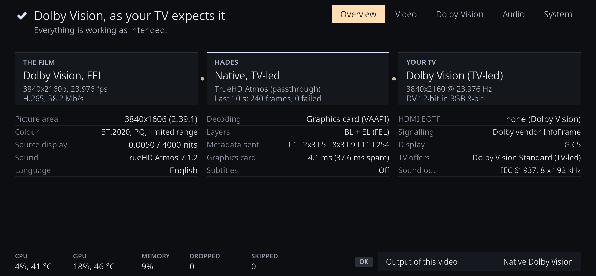

# Extras of Hades

What LibreELEC Hades adds to LibreELEC, one by one, in plain words. Each entry says what it does, when you would want it and where to control it. What has been seen on which hardware is in [What has been tested](tested.md). For the exact behaviour of a setting, see the [settings guide](settings.md). For how a video travels to the TV, see [how it works](how-it-works.md).

Nothing here replaces anything that LibreELEC does. Without a Dolby Vision TV, most of this does nothing at all, and a video plays as it does in LibreELEC.

## Words used in these pages

- **HDR10, HDR10+, HLG.** Ways to carry a brighter picture with richer colours than ordinary video (SDR). HDR10 sends one description for the whole film. HDR10+ sends a new description for each scene. HLG is the form that broadcasters use.
- **Dolby Vision.** Another form of HDR. Its description changes frame by frame, and the TV uses it to show each scene as the film's colourist intended.
- **Profile 5, 7, 8.1.** The kinds of Dolby Vision file. Profile 5 is what streaming services use. Profile 7 is what UHD Blu-ray discs use, in two layers. Profile 8.1 is single-layer Dolby Vision with an HDR10 picture underneath, common in files.
- **FEL and MEL.** Profile 7 has a base layer and an enhancement layer. The full enhancement layer (FEL) adds real picture detail to the base layer. The minimal one (MEL) adds none. Hades rebuilds the FEL picture in the PC, because the TV cannot.
- **Standard, or TV-led.** The normal way a Dolby Vision player works: the player sends the picture and the metadata, and the TV decides how to show it. **Low-Latency, or player-led,** is a second form for game modes, in which the player does that work.
- **Trims.** The colourist's fine adjustments for how each scene should look on displays of a few given brightnesses.
- **Tone mapping.** Squeezing a picture that is brighter than your display can show into what it can show.
- **Passthrough.** Sending the sound to the receiver exactly as it is on the disc, so that the receiver decodes it (Dolby Atmos, DTS-HD).
- **EDID.** The description that a TV or monitor gives the PC of what it can show.
- **Settings level.** Kodi hides the settings that few people need. The level (Standard, Advanced, Expert) is set at the bottom of the left-hand list of a settings screen. Hades puts what most people want at Advanced and the rest at Expert.

## Dolby Vision

### Native Dolby Vision over HDMI

**What it does.** Sends a Dolby Vision video to the TV as Dolby Vision, in the TV-led mode, with the metadata of every frame. For profile 7 the PC combines the base and enhancement layers, so the full picture of a UHD Blu-ray reaches the TV.

**You would want it** whenever you have a Dolby Vision TV: it is on by default.

**Where.** *Settings > System > Display > Native Dolby Vision output*. In the player, *Dolby Vision output (this video)* chooses for one video.

**Seen working** on NVIDIA, AMD and Intel graphics ([what has been tested](tested.md)).

**Safe by design.** Hades uses it only when the video, the TV, the HDMI link and the graphics driver all qualify. If anything is in doubt, or it fails during a video, the video goes on as HDR10 or SDR, and the player information says why.

### The player information page

**What it does.** Opens a panel over the video. Its first line is a sentence: either that the video plays as intended, or what is wrong and what to do. Lost frames count there only where the loss is steady, since a start, a seek or a pause loses a few by design, and the sentence names the cause where it can: the graphics busy, or a video that buffers. Below it, the path of the signal: what the film carries, what Hades does with it, and what reaches your TV. More pages hold the details: the video, every level of the Dolby Vision metadata and which of them are used and sent, the sound with a plan of the speakers, and the system, with how the TV is connected (the link and its speed, the depth, whether variable refresh rate is on) and the versions of Hades, of the graphics driver and of the kernel. A bar at the bottom of every page gives the use and temperature of the processor and of the graphics, the memory, the pictures dropped and skipped, and the button *Output of this video*.

**You would want it** to check that Dolby Vision is really on, or to see why it is not, and to change how a video goes out while it plays: O, then OK, opens the choice of output.

**Where.** Press O on a keyboard, or the red key of a TV remote that sends keys over HDMI-CEC. On a remote without colour keys (a Fire TV remote over Bluetooth, for one), hold Menu while the video plays; a short press of Menu still opens the on-screen controls. On a game controller, hold Start while the video plays: the Menu button of an Xbox controller, Options on a PlayStation one, over USB or Bluetooth; on another controller, the button set as Start in *Settings > System > Input*. A short press of Start still shows the information of the video, as in Kodi. There is also a button in the video's on-screen controls. Down from the tabs goes to the button, with a remote, a keyboard or Yatse.

**Status.** Seen working on an RTX 4080 SUPER with an LG C5 (author), and, with changing the output from the on-screen controls, on a Ryzen 7 5800H (user); see [what has been tested](tested.md).

### Check this setup

**What it does.** Plays short test clips that the build of Hades makes itself: a test picture in SDR, HDR10, HLG and Dolby Vision (profiles 8.1 and 5), a soft noise from each speaker in turn, and a chime in each sound format that a receiver or TV may take as it is (Dolby Digital, Dolby Digital Plus, Dolby TrueHD). After each one it says in plain words what went out (the display mode, the HDR signal, whether Dolby Vision went out natively and why not, the sound format), asks what you saw or heard, and says what to do if it was wrong: for example, that pink and green colours mean the TV did not switch to Dolby Vision, and that a receiver in between may be the cause. On the SDR picture it also asks how many of the dark and light squares you can see, which tells whether the black level and the contrast of the TV are right.

**You would want it** after installing, after changing the TV or the receiver, or when a sound format plays silence. It switches on only the sound formats that you heard, and switches one off only if you say so; nothing of the picture settings changes. DTS cannot be checked this way.

**Frame packing.** Where the display says it takes 3D, the card first asks the graphics driver, without changing the picture, whether it takes frame packing with the buffers that a 3D video would use, and says what it answered and why. Then a 15-second 3D clip goes out in frame packing, and the card says whether the driver took it, or what it went out as and why. It is skipped on a display without 3D.

**3D: HDR.** Nothing that a display sends says whether it shows HDR in 3D, and many 3D projectors and TVs do not. On a display that takes 3D and HDR, *3D: HDR* plays a short HDR10 clip in 3D, in the 3D layout of the display, and asks what you saw. The answer is kept for that display (by the make and model in its EDID): *How 3D video goes out* on *Automatic* then sends HDR in 3D where you saw it, and SDR where you did not. Until a display has been checked, an HDR 3D video goes out in SDR (in BT.2020 where the display takes it), the first one says once where to check it, and the player information says "HDR in 3D not checked yet".

**A/B comparison.** *Dolby Vision: Hades or licensed players (A/B)* shows a test clip as Hades sends it and as licensed players send it, and asks which looks right on your TV; it can also copy the clip to a USB drive, to see it first with the TV's own player. Your answer goes into the diagnostic report with the name of your TV; nothing changes unless you say so.

**Where.** *Settings > LibreELEC > System > Check this setup*. *Show the last result* shows what it found last time. A user ran it on an RX 550 with an LG G3 (issue #20), where it showed which of the paths broke on that card.

### A notice of the mode when a video starts

**What it does.** A short line appears a moment after a video starts: for example "Dolby Vision, FEL, 3840x2160 at 23.976 Hz".

**Where.** *Settings > Player > Videos > Show the playback mode when a video starts*. Off by default.

### Dolby Vision for the menus

**What it does.** Keeps the TV in Dolby Vision while you browse, so that a Dolby Vision film starts without the TV changing its picture mode. The menus look as the TV shows Dolby Vision, which can differ from its SDR look.

**You would want it** to avoid the pause and flash when the TV changes mode.

**Where.** *Settings > System > Display > Dolby Vision for the menus*. Off by default. When you turn it on, a question asks you to confirm, and the setting goes back to Off by itself after 15 seconds unless you answer Yes, so a black picture cannot lock you out.

### Dolby Vision Low-Latency (game-mode inputs)

**What it does.** Some TV inputs offer Dolby Vision only in its low-latency form, which is what they use in game mode. Hades can send that form. The PC then maps the picture to your display itself, with its own method and not Dolby's, which is not public.

**You would want it** if your TV offers only this form and you prefer Dolby Vision to HDR10. On some TVs, leaving game mode brings back Dolby Vision Standard, which is better.

**Where.** *Settings > System > Display > Dolby Vision for TVs in game mode (Low-Latency)*. Off by default: such an input gets HDR10 and a notice.

**Displays whose values cannot be used.** Where the peak or the colours that the display gives for Low-Latency cannot be used, a display that also takes Standard gets Standard, and one that offers only Low-Latency gets the video rebuilt as HDR10, enhancement layer included. Colours that a display gives past BT.2020 (a laser projector) are taken to the edge of BT.2020 instead of refusing Low-Latency. *Low-Latency: use the black level the display gives* (Expert, on) lifts the darkest parts of the film to the black that the display gives, so that they do not sink into it; most OLED TVs give 0, and nothing changes. Not tried on hardware yet: it needs a projector or an LCD TV.

### Older TVs (HDMI 1.4b)

**What it does.** Some TVs of 2016 (LG OLEDs among them) ask for an older way of signalling Dolby Vision. Hades can use it.

**Where.** *Dolby Vision for older TVs (HDMI 1.4b)*. Shown only for a TV that asks for it. Off by default. If the colours look wrong, turn it off.

### The output of one video

**What it does.** Chooses, for the video that plays, how it goes out: as the settings say, as native Dolby Vision, as HDR10 or HDR10+, without Dolby Vision, or "As SDR (without HDR)", for a projector or a TV whose SDR picture you prefer for that film. An HLG video gets the choice too ("HLG as Dolby Vision", "Without Dolby Vision", "As SDR"). The choice is remembered for the file.

**Where.** *Output of this video*, the button of the player information (O, then OK), the button of the video's on-screen controls, or the video settings of the player. For a video that is not Dolby Vision it is called *HDR output (this video)*.

### Dolby Vision sent as composed

**What it does.** The Dolby Vision picture of profiles 7 and 8 goes to the TV exactly as the composer of the specification makes it, in its own colours, bit for bit. Measured over the whole colour of every pixel, that is as close to the film as the other way, IPT, or closer, however the TV fills in the colour between the pixels. IPT, which licensed players are reported to send, stays as an expert choice.

**Where.** *Settings > System > Display > Dolby Vision engine > Transport*, Expert.

### Dolby Vision shown as HDR10

**What it does.** When Dolby Vision cannot be sent (a display without it, or a TV input in game mode), Hades rebuilds the picture from the Dolby Vision data and sends it as HDR10. Profile 5 is always rebuilt, because its base picture cannot be watched on its own. Profile 7 and 8.1 normally play their own HDR10 picture; two settings rebuild them too.

**Where.** *Show Dolby Vision as HDR10 when the display cannot* (on by default), *Also with an enhancement layer*, and *Send it as HDR10+ where the display takes it*.

### Your display

**What it does.** Hades sets the picture for a display from what the display declares. *Your display* asks the two things no display declares: whether it is a projector, and how bright (then it sets the mapping for it, as the settings guide says, by whether the projector takes Dolby Vision, HDR10 or SDR only), and whether HDR videos should go out as HDR, HLG as SDR, or everything as SDR. It also says what Hades found by itself: the display and its connector, what it takes, whether a sound bar or receiver is in between, and where the TV remote reaches the PC over HDMI-CEC (the adapter on the output of the picture, on another output, a USB-CEC adapter, or none). Going on without an answer changes nothing, and another answer later puts back what an earlier one changed.

**Where.** At the first start, a page of the wizard; later, *Settings > LibreELEC > System > Check this setup > Your display*.

**Status.** Not tried on a projector.

### Share my results

**What it does.** Makes one line of LibreELEC Hades and its version, the processor, the graphics and their driver, each display (its name, its connector, what it takes, a sound bar or receiver in between) and the results of the last *Check this setup*, to paste in the forum or in an issue. It shows the line and copies it to a USB drive as `hades-results.txt`. It names no serial number, no address and no network, and no name of the PC. A diagnostic report has the same line.

**Where.** *Settings > LibreELEC > System > Check this setup > Share my results*.

### Projectors and displays that map HDR poorly

**What it does.** A projector is much dimmer than a TV, and many map HDR badly. Hades can do the mapping in the PC, to the peak brightness, the colours and the black that you set: for Dolby Vision shown as HDR10 (*Adapt Dolby Vision to my display*), for HDR10 and HDR10+ (*HDR10 and HDR10+ adapted to the display*, which follows the HDR10+ data of each scene), and for Low-Latency (its manual peak, colours and black). *Black of the display* lifts the darkest parts of the film above a projector's own black. *Dolby Vision: ignore the studio's fine-tuning (trims)* stops sending the trims to a display that shows washed-out blacks. *HDR10: limit the luminance told to the display* tells the display a lower peak. *Play HDR videos as SDR* sends HLG, or every HDR video, as SDR to a display whose SDR picture you prefer.

**Where.** All at Expert level. The [settings guide](settings.md#for-projectors-and-displays-that-map-hdr-poorly) has a short section for projectors.

**Trims.** Where Hades maps the picture to the display, *Dolby Vision: apply the trims when adjusting to your display* (Expert, off) applies the colourist's trims made for your display's peak, in the only way the standards publish. Measured against a studio's own version of a film for a 1000-nit display, that way made the shadows much darker than the studio did, so it is off. Native Dolby Vision is not affected: the TV applies the trims itself.

### Projector control over the network

**What it does.** For a home-cinema projector on your network, Hades selects its lens memory by the shape of the picture (on a JVC, its anamorphic mode too) and its picture mode by the kind of signal, and keeps the player controls inside the picture of a scope film. For a wide screen with constant image height, up to three lens memories (narrower pictures, wide pictures from 2.10:1, and the widest from a shape you set) are chosen by the shape of the picture without its black bars: from the Dolby Vision level 5 of the video where it has one, otherwise measured on the picture as *Subtitles in the black bars* does. At the start of a video the lens moves after 2 seconds; in the middle of a video only when a new shape lasts (10 seconds by default), so an IMAX scene moves it once and not back and forth; when the video ends it goes back to the memory of the menus. A picture mode can be set for SDR, HDR10 and HDR10+, HLG, Dolby Vision and 3D, sent once when that signal starts: a mode that you then choose with the projector's remote stays until the signal changes. In 3D the lens does not move.

**The menus and SDR in BT.2020.** The menus can have a picture mode of their own (a user mode in Rec.709 or DCI, say), apart from the one of the videos (a user mode in BT.2020 for HDR that Hades maps to SDR in BT.2020): *Picture mode for the menus*, *Picture mode for SDR in BT.2020*, and *for SDR in DCI-P3*. Each takes the mode for SDR video until you set it, so nothing changes for anyone who does not. A paused video with its controls shown is still the video, and the next video of a playlist does not bring the mode of the menus in between.

**The anamorphic mode of a JVC.** With an anamorphic lens, each shape can have an anamorphic mode as well as a lens memory, or instead of one: Off, A, B, C or D, as the projector names them (A or C for a scope film, B or D for a 16:9 picture through a lens that stays in place, C and D for the DCR lens of Panamorph). It follows the shape with the same waits as the lens, and is sent after the lens memory, because a lens memory of a JVC holds an anamorphic mode of its own. The command is the one in JVC's External Command Communication Specification. Sony and Epson have no such command in Hades: their anamorphic settings stay on their own remote or in their lens memories.

**The player controls inside a scope picture.** When the projector zooms or stretches the 16:9 picture for a scope film, what Kodi draws above and below the film is off the screen. While the projector shows a scope picture, Hades keeps the player controls, the seek bar, the clock, the notices and the subtitles inside the picture of the film, in a band of 2.40:1 (or of the film's own shape, where it is wider). *Player controls inside a scope picture* can also keep them there always while a video plays, for a projector that you zoom by hand, with no projector control at all.

JVC D-ILA (NZ, NX, NP, N, X, RS and V series), Sony ADCP (VPL-XW, and the VPL-VW models that have it), Sony SDCP (VPL-VW) and Epson ESC/VP.net. Hades connects only to the IP address that you write, never listens, and sends nothing while the setting is Off; an address outside a home network needs your confirmation. The password is kept like the password of Kodi's web server and is never written to the log. A projector that is off or warming up gets nothing until it is on, and a problem gives one notice, not one per try.

**Where.** *Settings > System > Display > Projector control over the network* (Advanced, off by default): the projector, its address and password, *Test the connection* (its model and whether it is on), the lens memories and anamorphic modes, the picture modes, and *Player controls inside a scope picture*. While it is on, the System page of the player information shows what was selected ("JVC: memory 2 + A for 2.39:1 (measured), mode Natural", with the anamorphic mode after the number of the memory) or what stands in the way, and `kodi.log` has every command and every answer, without the password.

**Status.** The picture modes of a JVC NZ800 have been seen working by a user, and SDR in BT.2020 is shown by it as BT.2020. The rest is tested against a simulator of each protocol, and end to end in a virtual machine against a JVC simulator; the anamorphic modes, the picture modes of the menus and of SDR in BT.2020, and the controls inside a scope picture are new in 1.2.3 and not tried on a projector yet.

### HDR10, HDR10+ and HLG sent as Dolby Vision

**What it does.** For a TV that takes Dolby Vision but not HDR10+, an HDR10+ video can be sent as Dolby Vision, with metadata made from its HDR10+ data; and, if you prefer Dolby Vision, also to a TV that takes both, where the video's own HDR10+ is the more faithful picture. An HDR10 video can be sent as Dolby Vision with metadata that Hades measures from the picture as it plays. An HLG video can be sent as Dolby Vision, with its picture converted to PQ as ITU-R BT.2100 describes. Each is off by default, and each changes the picture on purpose: the TV then shows it with its Dolby Vision processing. These are not the studio's metadata. Where an output cannot send HDR10 or HLG at all but can carry Dolby Vision (as the HDMI of some Intel graphics), Hades does it on its own, so that the video keeps its HDR instead of being mapped to SDR.

**Where.** *Play HDR10+ videos as Dolby Vision*, *Make HDR10 videos Dolby Vision (measured)*, *HLG as Dolby Vision*.

### HDR converted to SDR

**What it does.** On a display without HDR, Dolby Vision and HDR videos are mapped to SDR with the reference method of ITU-R BT.2390: everything the display can show goes out as it was mastered, and only what is brighter is squeezed in. You can say what kind of display the SDR is made for: a reference display (white at 203 nits), a bright room (300 nits), a projector (100 nits), or Custom, with the white and the gamma of your own display. If you preferred the look of before 1.0, with darker middle tones and a little more detail in the brightest highlights, choose "BT.2390, libplacebo's knee" as the tone mapping method of the video. For a projector or a TV that takes SDR in a wider gamut, *HDR to SDR: gamut of the output* sends that SDR in BT.2020 or DCI-P3, the video mapped into it and the menus converted to match (Expert, BT.709 by default).

**Where.** *HDR to SDR: the display it is made for*. Reference by default. It applies to HDR10, HDR10+ and HLG as well, with the knee of the ITU-R report or a Custom display. Measured with the software bridge. A profile that still has Kodi's tone mapping method "Off", which left HDR washed out on a display without HDR, is switched to "Reference (BT.2390)" once.

**HDR10 mapped scene by scene** (*System > Display*, Expert, off). Where Hades maps an HDR10 video itself (to SDR, or adapted to a projector), it can measure each scene as it plays and map it by its own brightest and average light, as it does for Dolby Vision, instead of by the one brightness of the whole film. A dark scene keeps more of its highlights, and the mapping changes slowly within a scene, so the picture does not pump.

### Videos with both Dolby Vision and HDR10+

**Where.** *Videos with both Dolby Vision and HDR10+*: Dolby Vision by default, or HDR10+. It also chooses between two video streams of one picture in a file, one with Dolby Vision and one with HDR10+. For one video, *Dolby Vision output (this video)* can choose either.

### Tone mapping v4.0

**What it does.** Dolby Vision data has an older (2.9) and a newer (4.0) tone-mapping part. TVs with newer processing use the 4.0 part. Hades can add a neutral 4.0 part where a video has none, or leave it out for a TV that shows a wrong picture with it. This changes what the TV makes of the picture.

**Where.** *Dolby Vision: new tone mapping (v4.0)*, Expert. If your TV states its peak brightness wrongly, *Tone mapping v4.0: set the TV's peak by hand* fixes what the automatic choices decide.

## HDR and the signal

### The refresh rate that Kodi would choose

**What it does.** Dolby Vision never changes the refresh rate that Kodi would choose. Progressive video gets its exact rate: 25 fps at 25 Hz, 29.97 fps at 29.97 Hz. On NVIDIA, the modes at exactly 24, 30, 60 and 120 Hz that the driver did not offer are added. With *Whole-number multiples of the frame rate*, 24 fps can play at 120 Hz without a change of mode.

### HDR10+

**What it does.** Sends HDR10+ with the metadata of each frame, where the graphics driver can send it. Where it cannot, the video goes out as HDR10. Nothing to set.

### Colour depth and format

**What it does.** At 4K above 30 Hz, an HDMI 2.0 link carries RGB at only 8 bits, so HDR would lose two bits. Hades sends HDR in a format that carries 10 or more (YCbCr). On NVIDIA, 10-bit video goes out through the 16-bit path, without banding. *Colour format* and *Maximum bit depth* choose these by hand where the driver allows it, and a depth that another program left on the output is put back when Hades starts. Both at Expert level, Automatic by default.

### HDR above 8 bits on NVIDIA

**What it does.** Where an NVIDIA card would send HDR over HDMI in RGB at only 8 bits (the GeForce GTX 10, GTX 16 and RTX 20 cards, the TITAN V, and newer cards at 3840x2160 and 50 or 60 Hz without an HDMI 2.1 link), Hades sends it as YCbCr 4:2:2 at 12 bits (10 on the GTX 10 cards and the TITAN V), at the same link speed: less banding, and all the colour detail of the video. If the TV does not lock onto it, that mode goes back to 8 bits by itself.

**Where.** *HDR at more than 8 bits where the card sends RGB at 8 (NVIDIA)*, Expert, on by default. Seen working by users at 10 bits on a GeForce GTX 1060, and in YCbCr 4:2:2 at 12 bits on a GeForce GTX 1650 and a Quadro RTX 4000.

### HDR in 4:2:2 at 12 bits on Intel and AMD

**What it does.** At 3840x2160 and 50 or 60 Hz, Intel graphics and some AMD graphics (such as those of the Ryzen 7000 series) sent HDR in YCbCr 4:2:0, which halves the colour detail of the menus and subtitles drawn over the video. Hades now sends HDR10, HLG and HDR10+ there as YCbCr 4:2:2 at 12 bits, inside the same signal that carries Dolby Vision, where the TV takes 4:2:2. The video arrives exactly as decoded, and the text over it keeps its colour edges.

**You would notice** sharper colour at the edges of subtitles and menus over an HDR video at 50 or 60 Hz, and one more change of picture mode of the TV as such a video starts.

**Where.** *Settings > System > Display > HDR in 4:2:2 at 12 bits over HDMI 2.0*, Advanced, on by default, shown only where the driver offers it. If the graphics cannot keep up, Hades goes back to the ordinary output by itself.

### The output after Dolby Vision

**What it does.** Native Dolby Vision changes how the graphics drive the TV (depth, colour format, range and more). When the video ends, Hades puts back everything that it changed, checks that the driver took it, and uses the colour settings that you have at that moment, also if you changed them during the video. If Kodi stops during Dolby Vision, the next start puts the output back. Nothing to set.

### Dolby Vision on more graphics and connections

**What it does.** Native Dolby Vision on the newest Ryzen processors (display hardware DCN 4.2 and 4.2B), checked by reading the display pipe back each time it starts, and through a passive DisplayPort adaptor (DP++) that identifies itself as HDMI, on Intel and AMD graphics (NVIDIA already did). An adaptor that does not say HDMI gets no Dolby Vision, on NVIDIA too. The Radeon RX 400, RX 500 and Vega cards get Dolby Vision only with *Dolby Vision on this Radeon (experimental)*, and the older Intel HD and UHD 6xx graphics can send HDR over HDMI with *HDR over HDMI on this Intel graphics*: both expert settings, shown only on that graphics, kept in the boot menus. *Check the Dolby Vision output* (*Settings > LibreELEC > System > Check this setup*) measures whether an AMD or Intel graphics card sends the Dolby Vision picture unchanged, and says which colour of the output changes; where it finds a card not exact, Hades uses neither native Dolby Vision nor HDR in 4:2:2 at 12 bits on that output. The check was run by a user on an RX 550 (issue #20).

### Dolby Vision through a DisplayPort-to-HDMI converter

**What it does.** The HDMI socket of many mini PCs and NUCs is behind a converter that Linux treats as a DisplayPort output, and so is the HDMI socket of a USB-C hub or adapter, which is how a Chromebook reaches a TV. Most converters do not carry Dolby Vision. Hades uses one only on the boards where it was seen working, unless you tell it to try. The converter is found by asking the port itself, so a hub or adapter is offered too, and the kernel log names the converter.

**Where.** *Dolby Vision through a display converter*, Expert level, Automatic by default, shown only where such a converter is behind the port. Not tried on hardware yet.

### SDR videos in wide colours

**What it does.** A few SDR videos (some Ultra HD Blu-rays and streams) are made in the wider colours of BT.2020. Kodi converts them to the ordinary colours of BT.709 and clips what lies outside. With *Keep the wide colours of SDR videos (BT.2020)* on, on a display whose EDID says that it takes BT.2020, they go out as they are, and the menus and subtitles are converted to match so that they keep their usual colours. The ordinary conversion to BT.709 keeps the greys and the black of the video.

**Where.** *Settings > System > Display*, Advanced, off.

### Upscalers

**What it does.** When a video is smaller than your screen (1080p on a 4K TV, a DVD on a 1080p one), Kodi scales it up with a filter. An upscaler redraws it instead and rebuilds edges and fine lines: RAVU is the lightest, FSRCNNX 8 gives more detail, and FSRCNNX 16 the most and needs a strong graphics card. Measured against Kodi's Lanczos 3, they come closer to the original picture by 0.1 to 1.3 dB, 0.3 to 3.4 dB and 0.4 to 4.7 dB. AiUpscale (film) and AiUpscale (animation) ask a little less of the graphics card than FSRCNNX 16 and come closer than it to the original on animation and on SDR film (+1.1 dB and +3.9 to +4.1 dB against Lanczos 3), a little less close on HDR10 (+3.3 to +3.4 dB); the animation one is made for drawn lines. They change the picture, so they are off unless you choose one; they are never used for Dolby Vision, and if the graphics cannot keep up, the upscaler turns itself off for that video and a message tells you.

**Where.** *Settings > Player > Videos*, Expert: *Upscaler for videos of 1080p and above*, *Upscaler for videos below 1080p*, and *Upscaler for animation* for the videos whose genre says Animation or Anime. Or, while a video plays, the button of the Video page of the player information (O): it names the upscaler of the videos like the one that plays and changes it, for all of them (OK on the button, or on the Video tab).

### Colour edges and smooth gradients

**What it does.** Most videos keep their colour at half the resolution of their brightness. Where Kodi draws a video itself (SDR, HDR10 and HLG), Hades now puts the colour where the video places it and fills it in with a sharper filter: colour edges, red text on black for example, are cleaner and no longer slightly shifted. Measured against masters with full colour, the colour error goes down by 13 % on animation and 26 % on film. Where Hades maps or upscales a picture into 8 bits (an SDR screen, a laptop panel), it also adds a fine noise instead of rounding, so skies and fades show no steps.

**Where.** Nothing to set: both are on. If the graphics cannot keep up, the colour filter steps down by itself for that video and `kodi.log` says so. Native Dolby Vision and 10-bit output are not touched.

### A 3D LUT for each display

**What it does.** A calibration program (Calman, ColourSpace, DisplayCAL, madVR) measures a display in one picture mode and writes a 3D LUT that corrects its colours, or a 1D LUT, the curves that a calibration loads into the video card (the `.cal` of DisplayCAL and ArgyllCMS, or a `.cube` of `LUT_1D_SIZE`, alone or before a 3D LUT). Hades applies it as the last step of the colour of the video, after the tone mapping and before the picture is turned into the codes that go out: a LUT for SDR on SDR videos, whether Kodi draws them or Hades does with an upscaler, and on HDR and Dolby Vision mapped to SDR (a projector, a display without HDR, *Play HDR videos as SDR*); a LUT for HDR on HDR10 and HDR10+ adapted to the display, Dolby Vision adapted to it, and Dolby Vision Low-Latency. Never on native Dolby Vision that the TV maps, nor on HDR that the display maps itself, whose own mapping comes after the LUT and changes with each film. Each display keeps its own LUTs, by the make and model in its EDID, so the LUT of a projector is never applied to the TV. A file made for another kind of picture (a LUT for PQ in the SDR place, for example) is refused with a notice. If the graphics cannot apply it, the picture goes out without it and Hades says so; it is never left out in silence.

**Where.** *Settings > System > Display > 3D LUT (display calibration)*, Expert, off by default: the LUT for SDR and the LUT for HDR on this display (`.cube`, `.3dl`, madVR's `.3dlut` or a `.cal`), the range of a `.cube` or `.3dl`, and the gamut that the SDR LUT was made for. The Video page of the player information names the LUT in use, or why it is not applied, and `kodi.log` says each file read and each decision. The menus and subtitles are not corrected, as in Kodi's own colour management. The videos of the DRM PRIME decoder (hidden and off in LibreELEC Hades) go out without a pass that could apply it: the player information says so, and Hades asks once whether to turn that decoder off. See [how-it-works.md](how-it-works.md#a-3d-lut-of-the-display).

**Status.** Checked on the software renderer, in the bridge and in Kodi's own video shaders (an identity LUT leaves the picture as it was, but for a few pixels in Kodi's shaders rounded one code the other way; a known LUT gives what it says to a millionth); not tried on a calibrated display yet.

### Video at its own rate with VRR

**What it does.** Each video normally changes the mode of the display to its own rate, and the screen goes black for a moment as it starts and stops. On a TV with variable refresh rate (VRR), Hades can play an SDR or HDR10 video at its own rate in the mode of the menus instead, each picture shown at its time: 23.976 fps goes out at 47.952 Hz, each picture twice. It cannot go out at 23.976 Hz itself: no display takes VRR that low (an LG C5 from 40 Hz, a Samsung Odyssey G60SD from 48 Hz), so each picture goes twice, or three times at 71.928 Hz on the monitor, for exactly the same motion. On NVIDIA GeForce GTX 16 and newer the display engine holds each picture until its time; on the RTX 50 series Media VRR keeps the rate; on AMD graphics Kodi times each picture. On the RTX 40 and RTX 50 series HDR10+ goes too, and so does Dolby Vision that is sent as HDR10, HDR10+ or SDR to a display without Dolby Vision. Dolby Vision sent as Dolby Vision, HLG and 3D change the mode to the rate of the video as always: Dolby Vision needs modes of its own of up to 60 Hz, and no display says that it takes it with VRR.

**You would want it** if your monitor has no mode of 24, 48 or 72 Hz, so a film goes out at 120 or 360 Hz with a picture held a refresh longer now and then (choose *Where the display has no mode at the video's rate*); or if the black at the start of every video bothers you and your display has VRR (choose *Always*; on an LG TV, turn on "VRR & G-Sync" for NVIDIA graphics or "AMD FreeSync Premium" for AMD graphics). With VRR on, the display's own information shows the rate it gets (47 Hz on the LG C5, 72 Hz on the monitor), and the player information says the same, measured.

**Where.** *Settings > System > Display > Video at its own rate with VRR*, Expert: *Off* (the default), *Where the display has no mode at the video's rate*, or *Always*. On NVIDIA it leaves *HDMI variable refresh rate (VRR)* to the driver where it needs it. In the first second of each video Hades checks that the refresh really follows the video (on NVIDIA, as the driver says and by when each picture reached the output), and plays the video as with the setting off where it does not; the player information says which it was. `kodi.log` says how exact the timing was.

### Filmmaker Mode by itself: films said to be films

**What it does.** HDMI tells the TV what kind of picture it gets (the content type of the AVI InfoFrame). NVIDIA and AMD graphics said "computer graphics" for everything, films included, and Intel said nothing. Hades now says *Cinema* while a video plays and *Game* while a game of the game players (RetroPlayer) plays, each only where the TV declares in its EDID that it takes that kind; the menus go out as the graphics driver always said them. A TV that chooses its picture mode by it changes by itself: an LG TV with *Filmmaker Mode Auto Start* on shows a film in Filmmaker Mode and goes back for the menus. Dolby Vision that the TV processes itself says no content type, as licensed Dolby Vision players send it (the TV uses its Dolby Vision modes then); Dolby Vision Low-Latency is a video. Not a byte of the picture changes.

It changes only together with a change of the display mode that happens anyway (a video at its own refresh rate, with *Adjust display refresh rate*), never with a black screen of its own. So a video that plays in the mode of the menus (the same refresh rate, *Adjust display refresh rate* off, or *Video at its own rate with VRR* at *Always*) keeps what the menus have, and `kodi.log` says so.

**You would want it** if your TV has an automatic Filmmaker Mode, or switches its picture mode by what it is shown (on an LG TV: *Filmmaker Mode Auto Start* in its picture settings). Without such a setting on the TV, nothing changes on the screen.

**Where.** *Settings > System > Display > Content type (Filmmaker Mode)*, Expert: *Automatic* (the default) or *As LibreELEC* (Hades does not set it, and the graphics driver says what it always said). The player information shows what the TV is told (Video page, Video output, *Content type*), and `kodi.log` each change. On NVIDIA graphics it needs Hades' own driver, which offers the content type (all the NVIDIA drivers of Hades do).

### Picture in step with its sound

**What it does.** On every driver, the picture left the PC one refresh before its sound: 42 ms at 24 Hz. Hades now measures when each frame really reaches the screen and shows it with its sound. Which frames are seen, and for how long, does not change. If you had set *Audio offset* to make up for it, set it back to 0.

**Where.** *Settings > Player > Videos > Picture in step with its sound*, Advanced, on.

## Performance

### Integrated graphics

**What it does.** Where the graphics need most of the time of a frame to prepare a Dolby Vision picture (typically integrated graphics with 4K Blu-ray video), the next frame is prepared while the last one waits, and the picture under menus and subtitles is redrawn only where they are. If even that is not enough, an automatic step-down rebuilds the picture slightly less precisely, only as far as the video needs to play smoothly; so does Dolby Vision shown as HDR10 or SDR on a display without Dolby Vision, whose enhancement layer is still drawn. Graphics that keep up always show the exact picture.

**Where.** *Present frames a frame ahead*, *Fidelity step-down* and the other settings of the Dolby Vision engine group, all Expert. Leave them at Automatic unless a row of the settings guide says otherwise.

### A lighter interface

**What it does.** While Dolby Vision, HDR10 or HLG video plays, the menus are drawn again only where something changed. Opening the player information no longer redraws the whole interface for the values that change with every packet: they move twice a second. Dolby Vision made from HDR10, HDR10+ and profile 8.1 takes about a third less GPU time, and the colour table that a mapping to the display needs is made ahead, so the first picture no longer waits for it.

## Sound

### Passthrough and Dolby Atmos

**What it does.** TrueHD with Atmos, Dolby Digital Plus with Atmos and DTS-HD go to the receiver untouched. This is Kodi's own passthrough, kept as in LibreELEC. Hades adds a few things around it: sound that Hades decodes goes out in no more channels than your TV says it takes, so that a multichannel track does not go silent; where a TV takes only stereo PCM but also takes Dolby Digital, surround sound is encoded to Dolby Digital Plus 5.1 so it stays surround; and *Dialogue normalisation at 0 dB in passthrough* (off) stops the receiver from lowering the sound.

**The speakers on the Audio page.** A plan of the room with four kinds of mark, explained under it: a full mark for a speaker that gets sound (passed through: the channels of the track; decoded: the channels sent, with the downmix said in words, such as "FC > FL+FR"); a ring of the same colour for a speaker of the receiver that renders the Atmos objects (passed through to a receiver that declares Atmos, its declared speakers beyond the base); a grey ring for a speaker that the TV or receiver declares and that gets no sound; a faint ring where nothing is known. The declared speakers are read from the EDID of the display that Kodi plays to. The Dolby Atmos label says "+ objects" when it is passed through and "no Atmos" when it is decoded, which is when the heights are lost. The speakers your TV or receiver declares come from the EDID of the display that the sound goes to, on whichever output it is, with its Room Configuration and Speaker Location blocks where it has them, or from its ELD where no output has it, and they are worked out again as soon as the receiver says something new.

**Also.** Dynamic range compression for Dolby Digital, the level of the dialogue when 5.1 plays on fewer speakers, and the choice of the audio output that follows the screen you use. Sound that Hades decodes goes out in 16 bits to a display that declares PCM of 16 or 20 bits only (one such TV played nothing), a 6.1 or 6.0 track keeps its back centre on a receiver that has that speaker, and Dolby Digital at 32 kHz is passed through.

### Surround sound through a USB-C adapter or hub

**What it does.** Some USB-C hubs and DisplayPort to HDMI adapters tell the computer that the TV takes stereo only, even when the TV or the sound bar behind them takes more. This setting tells the sound driver that what is behind the adapter takes PCM in 8 channels, Dolby Digital, Dolby Digital Plus and Dolby TrueHD. Use it only if your TV or sound bar takes them: if it does not, a film plays without sound.

**Where.** *Settings > System > Audio > Surround sound through this USB-C adapter or hub*, Expert, off, shown only where such an adapter is behind a port of Intel graphics. It takes effect from the next start. Not tried on hardware yet.

### Passthrough through a pause and a seek

**What it does.** A pause keeps passthrough sound (TrueHD, Dolby Digital Plus, Dolby Digital, DTS): it goes on where it stopped, in sync, and the receiver stays on the stream while paused. After a start or a seek, the sound of TrueHD comes back after about 320 ms instead of 680. Several faults of DTS-HD passthrough that could stop the sound or close Kodi are fixed. Nothing to set. Measured on the host.

### Keeping an NVIDIA card at full speed during HD audio

**What it does.** On a laptop on its charger, the sound of TrueHD or DTS-HD could cut out every few seconds, because the graphics card changed speed. This setting holds the card at full speed while that sound plays.

**Where.** *Keep the graphics card at full speed while HD audio plays through*. Off by default; shown only with an NVIDIA card. Seen working on a laptop with an RTX 3070 Laptop GPU on its charger (user, [issue #8](https://github.com/hadesdevls/LibreELEC-Hades/issues/8)).

## Discs, 3D and files

### Blu-ray Java menus

**What it does.** Disc menus written in Java work with nothing to install. They run in a service apart from Kodi, with no network. With *BD-Live: Internet for disc menus* on, the disc's menus can reach the Internet and nothing else.

### 3D Blu-ray

**What it does.** Decodes both eyes of a 3D Blu-ray and switches a 3D display to 3D over HDMI. It needs a display that says it takes 3D. I have no 3D display; users have seen 3D Blu-ray video (MVC) and full side by side on a Ryzen 7 5800H, and frame packing on a Philips 3D TV from Intel graphics. In 1.0 the lines between the two eyes of frame packing are sent black, and the second view stays right after a picture that empties the decoder. Through an active DisplayPort or USB-C converter the graphics driver offers no 3D mode, and `kodi.log` says so.

**Side by side and top and bottom of 2160p** go out at 2160p where the display declares that 3D layout at 2160p. Where it declares 3D only up to 1080p, *Automatic* sends them at 1080p with the 3D signal, so that the TV switches to 3D by itself (each eye at 960x1080 in side by side); *Automatic, keep 2160p* keeps 2160p (each eye at 1920x2160), with the TV switched to 3D by hand. Never at fewer than 1080 lines. On NVIDIA, which lists no 3D modes, Hades reads the 3D layouts from the EDID, and the display is told of them where the EDID declares them, at 2160p at 24 to 30 Hz too: there the driver names the format by its CTA-861 number next to the layout, as Linux does on Intel and AMD. `kodi.log` lists what the EDID declares. Leaving a 3D video changes the display mode once, straight to the menus in 2D.

**Where.** *Decode both views of 3D video (Blu-ray MVC, MV-HEVC)*, *Switch the display to 3D (HDMI)* and *How 3D video goes out*, all Expert.

### 3D in MV-HEVC

**What it does.** Plays the 3D videos of an iPhone or a Vision Pro (spatial video) and 3D films made for the Vision Pro, in MP4, MOV or Matroska, in 3D, as a 3D Blu-ray plays. NVIDIA graphics with driver 620 (Turing and later) decode both views on the card; other graphics on the processor. Where the processor cannot keep up, AMD and Intel graphics decode the first view and the processor only the second, with exactly the same pictures (Hades compares the first ones, and a few now and then, bit for bit); only where that cannot keep up either does the video go on in 2D, and the player information says why. *MV-HEVC 3D: the graphics card decodes the first view* (Expert) can use the graphics card for every MV-HEVC video, or never. A spatial video keeps its intended depth, so far things sit behind the screen as on the Vision Pro. A Dolby Vision 3D film (profile 20) plays in 3D, with its colours right: each view rebuilt as HDR10 or mapped to SDR. *How 3D video goes out* (Expert) lets you choose HDR, SDR in BT.2020 or SDR in BT.709 for 3D video, to try what your 3D TV or projector takes.

**Where.** The same settings as 3D Blu-ray. Seen in frame packing on a JVC projector with a Radeon RX 7600, both views decoded on the processor: a commercial film and a Dolby Vision profile 20 file, and HDR10 in 3D (issue #34); and on XGIMI projectors with a Ryzen 7 H 255, a Dolby Vision profile 20 film decoded on the processor in frame packing. The graphics card's part has not been tried on hardware yet. Checked with the ITU-T test streams too.

### Subtitles and menus over 3D

**What it does.** A 3D Blu-ray tells the player how far in front of the screen to put each subtitle. Where a 3D video does not (MV-HEVC, side by side, top and bottom, a remux without it), Hades measures how near the picture comes where the subtitle goes and puts the subtitle just in front, gliding forward when it has to and never jumping while it is shown, within a comfortable limit. The menus and the player information open in front of the picture too.

**Where.** *Player > Subtitles > Depth of subtitles and menus over 3D video*: Automatic, or Fixed, as in Kodi. Not seen on a 3D display yet.

### Blu-ray jumps and seeks

**What it does.** Where a part of a Blu-ray starts at a picture that is not a key picture (the next part of a playlist, or where a menu jumps to), the pictures before it are decoded and not shown, so it plays from its first picture instead of up to a second later. After a jump or a seek in a film with a Dolby Vision full enhancement layer, the layer is there from the first picture. Chapter marks, joins and subtitles around a jump are kept right. The audio or subtitle stream that you choose is the one that plays, and the menus of an Ultra HD Blu-ray are drawn as the disc made them for its HDR picture, not grey. A disc image over the network opens with its menu, and faster.

### Several editions in one file

**What it does.** Some Matroska files hold more than one cut of a film. Hades can ask which one to play. **Where:** *Ask which edition when a file has several*. Off by default.

### Picture subtitles

**What it does.** Dims picture-based subtitles (PGS, VobSub) that are too bright, makes their colours paler if they are too vivid, resizes them, and moves them to where the text subtitles go. *Bitmap subtitles made for* fixes subtitles made for SDR in an HDR film (they glare) or the other way round (they look grey). A subtitle now shows with its own frame, not one late. **Where:** *Player > Subtitles > Image based subtitles*.

### Subtitles in the black bars

**What it does.** Many films are wider than the TV, and most UHD remuxes keep their black bars inside the 16:9 picture. With this on, the subtitles of such a film go into the bar under the picture, so that they never cover it. Hades finds the bar from the Dolby Vision data where the video has them, and otherwise by measuring the picture: only a bright scene can widen it, so dark scenes do not move the subtitles, and a scene that opens up to the full screen brings them back at once. Two lines must fit at your subtitle size.

**Where.** *Settings > Player > Subtitles*, off by default.

### DVD and telecined films

**What it does.** A film on a DVD that is coded at 23.976 pictures per second with the flags to show it at 29.97 is shown at 23.976 Hz, each picture once, instead of in uneven steps. Hades tells it before the first picture, from the flags of the stream: in a file by what most of it is, and in a DVD image (ISO) or `VIDEO_TS` folder title by title. A disc in a drive is not read ahead, so it plays as before. Seeks in Matroska files start at the earliest key frame.

A film stored as interlaced video (3:2 pulldown on NTSC discs, a PAL film marked interlaced, a film at 25 in 29.97 frames) was deinterlaced at 59.94 or 50 Hz, softer and with uneven motion. With *Rebuild films from interlaced video* (*Settings > Player > Videos*, on), Hades looks at a few seconds at four places of a DVD title or an MPEG-2 file before it plays; where all of them show the same film, each picture is put back together from its own fields and the film plays at its own rate. Real interlaced video, mixed titles and anything uncertain play as before. The idea is CorentinB's.

### Streams and the library

**What it does.** A network or a streaming service that stops sending for a while no longer ends the film as if it had been watched: Hades waits, says "Connection interrupted", and goes on from where it stopped when the data is back (up to 5 minutes). A second video asked for while another opens no longer waits for it. When a video ends, the library keeps what its playback found of its HDR (the Dolby Vision profile and layer, HDR10+), also for a `.strm`, a disc or a stream, so the skin can show it.

For streaming add-ons: a Blu-ray image plays as a disc even when the address of the add-on does not end in `.iso`; a server that allows one connection per file no longer stalls each seek (61 s before, under 2 s measured); an address whose token ran out is asked again of the add-on; disc images on the internet open faster; and a change of subtitle track shows at once, from what was read.

### The settings of a film, by the film

**What it does.** Kodi keeps what you choose for a video (its audio and subtitle tracks, the delays, the zoom, the picture settings) by its file. For a film or an episode that an add-on plays, Hades also keeps it by its IMDb, TMDb or TVDb id (with the season and number of an episode), so it comes back when the same film plays from another source. Each setting is taken where it still fits: the tracks are found again by what they are (the language and its variety, forced, for the hearing impaired, commentary, name, codec, channels), never by their number, and only where the new file has them; subtitles that you turned off stay off; the zoom for a picture of the same shape; the picture settings for a video of the same format; the volume for the same cut; and the audio and subtitle delays only for the same release, the same length to the second and the same video. The Dolby Vision output chosen for it is taken again too. Two films are never mixed: what was kept under ids that disagree with those of the film is left out. A short notification says what was restored, and `kodi.log` says what was taken and why (lines `Film settings:`).

Files on this PC and on the local network, discs and the library keep their settings for their file, as in Kodi. The settings are kept in a table of their own in Kodi's video database, whose version does not change, so an older build opens the same database as before.

**Where.** *Settings > Player > Videos > Remember the settings of films from add-ons*, on by default.

### The variety of a language

**What it does.** Some videos have the same language twice: Spanish from Spain (Castilian) and from Latin America, Portuguese from Portugal and from Brazil, French from France and from Canada, Chinese in simplified and in traditional characters. This says which one plays first, for the audio and for the subtitles. Automatic follows the region of your language settings (Spanish (Mexico) prefers Latin American Spanish); a track that you choose in a video is remembered for it and still comes first.

**Where.** *Settings > Player > Language > Variety of Spanish, Portuguese, French or Chinese*.

## The system

### Safe defaults

Hades is made for a PC that also holds your other disks and your Windows. The internal disks are hidden when it runs from USB, file sharing is off until you turn it on and then has a password, and the update server of LibreELEC is not used. Every one of these can be turned back on, and *Network access* (*Settings > LibreELEC > Services*) sets the network ones as LibreELEC has them in one choice, after showing what changes. The README lists them with the reason in [Defaults that differ from LibreELEC](../README.md#defaults-that-differ-from-libreelec).

### Updates from Hades itself

**What it does.** From 1.2, Hades looks on GitHub every six hours for a newer version of itself and tells you when there is one; *Available Versions* shows it, asks, downloads it and restarts to install it. Only a version signed by LibreELEC Hades, newer than yours and whole is taken, and looking sends nothing about your system. "Auto" downloads by itself and installs at the next start.

**Where.** *Settings > LibreELEC > Updates*. How it is checked: [Updates from the system itself](how-it-works.md#updates-from-the-system-itself).

**A file copied by hand.** From 1.2.3, an update copied into the `Update` folder that is not signed by LibreELEC Hades is installed only after a yes on the screen, which names the file; *Ask before installing an update placed by hand* turned off installs any, as in LibreELEC. [How updates are kept safe](updates.md).

### The Windows installer

**What it does.** Writes the image to a USB drive or a secondary disk, updates it without touching your settings, and removes it. It shows each drive's model and serial number, asks you to type a word first, and checks what it wrote. It is available in English and Spanish.

### Boot menu

**What it does.** Four entries (Run, Run with the internal disks read-only, Live, Installer), a wait of 5 seconds by default (10, 5, 3 or 1, in *Settings > LibreELEC > System > Boot menu*, kept by every update), and no second menu after an update. Run and Live keep each device to its own memory where the PC has an IOMMU.

Since 1.1, on a UEFI PC, the picture of the start (the eclipse over the name, on black) stays on the screen from the moment an entry starts until Kodi shows its interface, with no black box, cursor or line of text, on every display at its own size, also where the NVIDIA driver loads after the start; the line of the version shows only with an error. If Kodi stops three times in a row, every display shows a card that says so, with what to do and the version. Seen in virtual machines, not on a PC.

### HDMI-CEC

**What it does.** The remote of the TV controls Kodi over HDMI-CEC with a Pulse-Eight USB adapter, as in LibreELEC, and also through a DisplayPort-to-HDMI adapter that carries CEC over the DisplayPort cable, and on SECO boards (UDOO x86). Over DisplayPort on Intel graphics, CEC keeps working through changes of display mode and hot-plug storms: the kernel keeps reading it while the port's interrupts are off and no longer drops the CEC address at every check of the port, Kodi claims the address again when a claim fails, and `kodi.log` says when CEC is lost and when it is back. The keys work sooner after a start where an amplifier answers slowly, and faults of libCEC that could close Kodi are fixed. The red key of the remote opens the player information. Through an adapter on an output that does not carry the picture (an AV receiver for the sound only), Kodi no longer switches the TV's input; turning CEC off takes the PC off the bus at once; and an adapter that comes back, or is plugged in later, is found without restarting Kodi.

### PCs with several graphics chips, and laptops

**What it does.** Kodi starts on the TV, whichever chip it is connected to. If you connect the TV later, it moves there: on the same graphics without a restart (it asks first, and goes after a few seconds without an answer), on other graphics with one. *Settings > System > Display > Monitor* picks the display by hand. Outputs that Kodi does not draw on are turned off, except the one whose sound Kodi uses, and one that the file `hades-keep-outputs` keeps on, which keeps its sound too.

**Chromebooks** with Intel graphics: the drivers of the ChromeOS embedded controller and of the DisplayPort mode of USB-C load on Chromebooks, so a hub or an adapter on the USB-C port gets a picture. Based on the work of Felix Oghină. Not tried on hardware yet.

### The clock of the PC

**What it does.** Hades never writes the clock of the PC, so Windows keeps the right time. Once the time has been taken from the internet, it measures whether that clock keeps local time, as Windows keeps it, or UTC, as a PC without Windows does, and reads it that way from the next start. **Where:** *Settings > LibreELEC > System > OS Configuration > Hardware clock*: Automatic by default, or "Local time" and "UTC" by hand.

### The frame of the video

**What it does.** Saves the frame of the film alone, without menus, the player information or subtitles, as `videoNNNNN.png` in the screenshot folder, with an SDR copy beside it when the video is HDR. It is saved at the video's own size wherever it can be drawn so (a 4K Dolby Vision film on a 4K output, and the videos that Kodi draws itself); a picture that Hades maps or upscales to the screen is saved at the size it is shown, and the notice says so. Asked for in issue #30.

**Where.** Shift+Print Screen on a keyboard, or *Save the frame of the video* in the video settings of the player, which a remote reaches; any key can be mapped to `TakeScreenshot(video)`. Print Screen still saves the whole screen, as in Kodi. The screenshot folder is in *Settings > System > Logging*.

### The diagnostic report and switch

**What it does.** *Create a diagnostic report* makes one file, at once, with what is needed to find out why something does not work, every part of it through a filter that takes out what is private, and offers to copy it to a USB drive. *Save diagnostics at every start* keeps such a record of each start, for problems that only a start shows; the boot menus then also have the kernel write a line for each driver that it starts, so a start that stops while drivers load leaves the driver it was in. Both send nothing anywhere. **Where:** *Settings > LibreELEC > System > Submit Log*. See [diagnostics](diagnostics.md).

### For add-on authors

`Player.Process(video.sidedata)` gives the Dolby Vision and HDR payloads of the picture on screen, in the same format as the CoreELEC builds, so that add-ons that read them work. `Player.Process(videooutputhdrtype)` and the output transfer function now report what the graphics driver holds, not what Kodi asked for. Nothing is collected until an add-on reads the label.
