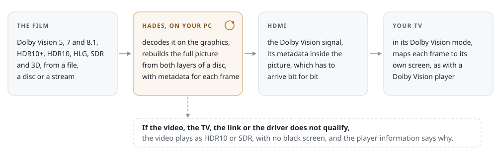

# How the Dolby Vision output works

LibreELEC Hades sends Dolby Vision the way TVs call "Standard" or "TV-led": the PC rebuilds the picture and sends it with the Dolby Vision metadata of every frame, and the TV does its own display mapping. A TV input that offers Dolby Vision only in its low-latency form ("player-led") gets HDR10 and a notice. With the setting "Dolby Vision for TVs in game mode (Low-Latency)" on, it gets Dolby Vision Low-Latency instead, for which the PC maps the picture to the display itself ([Dolby Vision Low-Latency](#dolby-vision-low-latency)).

After the plain story below, this document covers native Dolby Vision output, Dolby Vision for the menus, Dolby Vision shown as HDR10, Dolby Vision Low-Latency, the videos that a setting sends as Dolby Vision, HDR10+, HDR10 and HLG over the tunnel, HDR on a display without HDR, SDR in BT.2020, the upscalers and HDR10 mapped scene by scene, a video at its own rate with VRR, files and Blu-ray discs, and stereoscopic 3D. Other SDR, HDR10 and HLG video plays through Kodi's ordinary code, as in LibreELEC, except for what [Other parts](#other-parts) lists. Near the end, [Updates from the system itself](#updates-from-the-system-itself) says how a new version is found and checked.

Dolby Vision and HDR10+ are named here only as video formats. LibreELEC Hades is not certified by Dolby Laboratories or by HDR10+ Technologies, and it uses no Dolby software, library or key.

## The path of a video, in plain words

This is the short story, with no jargon. Take a UHD Blu-ray film in Dolby Vision profile 7, played from a file on a PC with an NVIDIA, AMD or Intel graphics chip that is connected by HDMI to a Dolby Vision TV.

<p align="center">
  <picture>
    <source media="(prefers-color-scheme: dark)" srcset="images/signal-path-dark.svg">
    <source media="(prefers-color-scheme: light)" srcset="images/signal-path-light.svg">
    
  </picture>
</p>

1. **Kodi opens the file.** FFmpeg, the program inside Kodi that reads video files, finds the picture and, next to it, the Dolby Vision data. That data is a small set of numbers for every frame. It says how to rebuild the frame and how a TV should show it.
2. **The graphics chip decodes the picture.** A profile 7 film has two pictures: a base layer, and a second layer, the enhancement layer, that holds extra detail. Hades has the graphics chip decode both.
3. **Hades checks that Dolby Vision can go out.** It asks the TV what it can show, checks the video mode and the driver, and checks that nothing between the PC and the TV will touch the signal. If any of this fails, the video plays the ordinary way, as HDR10 or SDR, and Hades writes why.
4. **The PC rebuilds the picture.** It combines the base layer, the enhancement layer and the data of the frame, as the Dolby Vision specification says. A TV cannot do this step, because it only ever receives one picture. This is what lets the full picture of a disc reach the TV.
5. **Menus and subtitles are drawn on top,** if there are any, at the brightness that you set for them.
6. **The picture is packed into a signal that looks like plain RGB video.** Dolby Vision over HDMI travels as an ordinary-looking frame that really carries a 12-bit picture in a different colour format, with the data of the frame hidden in its low bits. This is why nothing may change the signal on its way: no scaling, no colour adjustment, no dithering. The picture has to arrive bit for bit.
7. **The graphics driver sends it with a label.** A small extra packet tells the TV that this is Dolby Vision. The TV switches to its Dolby Vision mode and shows each frame with its own processing, as it does for any Dolby Vision player in this mode. This is the "Standard", or "TV-led", mode.
8. **If anything goes wrong, Hades steps back.** If the TV refuses, or frames stop coming, the video carries on as HDR10 or SDR, with no black screen, and the log and the player information say why. Hades tries again with the next video.

HDR10, HDR10+ and SDR videos follow a shorter path: Kodi decodes them and sends them with the signal that says which format they are. Hades adds the exact refresh rate, the HDR10+ data and some options. On Intel and AMD graphics, HDR at 3840x2160 and 50 or 60 Hz goes through the packing of step 6, as YCbCr 4:2:2 at 12 bits, so that the menus and subtitles over it keep their colour detail. A TV that cannot show HDR gets the picture mapped to SDR.

Each step has a technical section below. The table in the next section says which program does what.

## From the file to the HDMI cable

From here on this page is the technical record: what each part does, with the figures that it was checked against. You do not need it to use Hades.

Four parts share the work: FFmpeg reads the Dolby Vision metadata; libplacebo composes the picture; `dvbridge` (the bridge), a module that this build adds to Kodi, packs and presents the frames; and the output backend of the graphics driver sends them.

| Step | Done by | What happens |
| --- | --- | --- |
| Read and decode | Kodi and FFmpeg | The base layer is decoded in hardware with VAAPI. Single-layer Dolby Vision (profiles 5, 8 and 10, in HEVC or AV1) that the processor decodes instead (VAAPI turned off, or graphics without that codec) is drawn from the 10-bit planes that Kodi uploads, which give the composer the same codes. Profile 7 needs VAAPI for its enhancement layer, as HDR10 and HDR10+ sent as Dolby Vision need it for their measurement; a stream that can be drawn neither way plays as Kodi plays it, and the overview page of the player information says why. FFmpeg reads the Dolby Vision metadata (the RPU) of every frame. Dolby Vision in two video tracks is joined into the form of one track before the decoder ([Files and streams](#files-and-streams)). |
| Enhancement layer (profile 7) | the bridge's FEL module | A full enhancement layer (FEL) is decoded by a second HEVC decoder, also with VAAPI. Each enhancement picture is paired with its base picture: by picture order when both layers are in one track, by presentation time when they are in two. Paired by picture order, the layer starts at a random-access picture of its own, also where the two layers do not share one. A picture takes the metadata that came with its enhancement picture; one that goes out without it (after a seek, or late) takes the RPU of its own access unit. A minimal enhancement layer (MEL), whose metadata rebuild no residual, is not decoded at all: the picture is the same, byte for byte. |
| Compose | libplacebo, with this project's patches | The picture is composed from its layers and metadata in integers, as clause 5.4 of ETSI GS CCM 001 V1.1.1 defines the composer: the polynomial and MMR mappings of the RPU and, with FEL, the residual of the enhancement layer, resampled with the filters of annex B.3. The composed planes were checked sample for sample against two independent transcriptions of the clause. A picture that the clause does not cover (MMR on the luma, or a layer of another size, for example) is composed by libplacebo's own reshaping, which an expert setting can also choose for every picture; it differs from the clause by 4 to 15 codes of 4095 in almost every pixel, and by up to 742 at edges of high luma contrast. A base layer in SDR (BT.1886: profile 8.2, whose Dolby Vision record says base layer compatibility 2) is composed at 14 bits and converted to PQ as clause 5.5 says, by the method of its annex C, with the luminances of the mastering display taken from the source display of the RPU; on a software renderer, against a transcription of the clause and of the annex in double precision, every sample is within one code of 4095 (made-up pictures: no profile 8.2 sample has been at hand). Such a picture is never composed by libplacebo's reshaping, which would take its base layer for PQ: where the composer does not compose it, the video goes on as Kodi plays it, from its SDR base layer, and `kodi.log` and the overview page of the player information say why. A base layer in HLG (profile 8.4, base layer compatibility 4: iPhone recordings among others), which the specification does not name, is composed as one in PQ where the RPU of the picture declares its HDR picture in PQ at the depth it is composed at (signal_eotf 0xFFFF with its parameters 0, as the specification sends a PQ picture): the reshaping of the RPU takes the HLG signal there itself, and nothing is converted after it. The RPUs of Dolby's profile 8.4 sample and of the iPhone 13 (as dovi_tool makes it) declare so; on a chart of HLG codes, the iPhone's picture follows the conversion of BT.2100 from HLG to PQ at 1000 cd/m2 (mid grey 54.6 cd/m2 against 53.6), and read as if it were still HLG it would be 83 Delta E ITP off on average. A picture whose RPU declares another one is neither sent natively nor shown as HDR10, decided picture by picture before anything is drawn: it plays as Kodi plays HLG, and `kodi.log` and the overview page of the player information say why. The black bars that the metadata describe are written first and are not composed. Since 1.2.3 the composer tells the graphics chip the bounds of the integers it multiplies (`libplacebo-9988`: codes below 2^16, samples within the pivots of the RPU), so that the chip makes those products in 24-bit multiplies at its full rate instead of 32-bit ones at a quarter of it; the same integers, so the same picture, and by the estimate of the compiler of AMD's graphics chips (ACO, through Mesa's radeonsi) 27 % less time for the luma pass of a profile 7 FEL picture and 15 % for its chroma pass (not measured on a graphics chip). |
| Menus and subtitles | Kodi | Menus, the OSD and subtitles are drawn over the picture, at the brightness set for HDR: their sRGB is made linear (IEC 61966-2-1), BT.2020 and PQ (or HLG) exactly, in the GPU's full precision (`gles_gui_composite.frag`; until 1.0 RC4 two tables of 256 entries darkened the darkest tones). HDR image subtitles (UHD Blu-ray) keep their own levels. |
| Pack | the bridge's packers (OpenGL ES shaders) | The picture becomes the Dolby Vision tunnel: 12-bit 4:2:2 carried in an 8-bit RGB frame, with the display-management metadata of the frame in the low bits of the chroma. By default (since 1.0) it goes out as composed: the composer's picture as it is, in the representation of its RPU (YCbCr for profiles 7 and 8, IPT for profile 5), as clause 6 allows, with the chroma of each pair from its even pixel. The expert choice "As licensed players send (IPT)" sends it in IPT-PQ-c2, as licensed players are reported to send every profile ([what licensed players send](#what-licensed-players-send)): profile 5 as composed (it is IPT already), and the YCbCr picture of profiles 7 and 8 converted, in floats: the composer's 4:2:0 chroma brought to 4:2:2 with a 12-tap Lanczos filter and, between the pairs, with the same filter, then R'G'B' by the RPU, the PQ EOTF, the LMS of BT.2020 without the crosstalk of profile 5, the PQ OETF and IPT, with the matrices that the RPUs of profile 5 carry and display-management metadata that say so (signal_color_space 2): I of every pixel, P and T of each pair from its even pixel, where the composer's chroma sits. Pixels with menus or subtitles drawn over them are converted into the representation sent; the others are sent exactly as made. A video scaled to the screen (a 1080p one), and the part of a picture that zoom, a vertical shift or stretching shows, are scaled in the composer's representation (and then converted to IPT for profiles 7 and 8 where IPT is chosen): the luma and the chroma (from 4:2:0 straight to the 4:2:2 of the frame) with Lanczos 3 from the composer's integer codes, the same bytes on any graphics chip. Measured against the 4K masters of six 1080p renditions, that is nearer than the conversion it replaces (mean Delta E ITP from 10 % to 25 % lower for profile 5 and for a dark picture, about 1 % for two bright YCbCr pictures; the median lower in all). Only scaling up: a picture drawn smaller than its own size, and a picture composed by libplacebo's reshaping, are rebuilt in RGB and converted to BT.2020 YCbCr; an expert setting sends every picture that way. |
| Send | the output backend of the graphics driver (DRM/KMS) | The frame goes out with the Dolby vendor-specific InfoFrame, as full-range RGB at 8 bits per component. The output must be bit-exact: no colour conversion, look-up table, dithering, scaling, variable refresh or DSC. |

The tunnel follows the public specification ETSI GS CCM 001 V1.1.1. Dolby Vision Low-Latency uses the same tunnel in another way ([below](#dolby-vision-low-latency)).

### What licensed players send

Clause 6 lets the tunnel carry the output picture of the composer, in the representation of its RPU, or another picture that its metadata describe (signal_color_space 0 is YCbCr, 2 is ICtCp), Cb on the even pixels and Cr on the odd ones; it does not say which one licensed players send, nor how the 4:2:0 chroma of the composer is brought to 4:2:2. What is known says IPT for every profile: the Linux driver of Amlogic's licensed Dolby Vision hardware names its only TV-led output mode "IPT tunnel", for every source; the YBLOD project reports captures of two licensed Amlogic players whose metadata carry IPT matrices for a profile 8.1 video; and a published comparison (DMDreview, October 2026) reports IPT in the tunnel of a MediaTek Blu-ray player and of two Amlogic players with profile 7 FEL. None of this has been measured for this project with a licensed player. From 1.0 RC5 to 1.0 RC8, Hades sent profiles 7 and 8 in IPT as well. Since 1.0 it sends them as composed by default, and IPT is an expert choice: measured over I, P and T of every pixel (delta E ITP, ITU-R BT.2124) against a full 4:4:4 picture, on pictures of two profile 7 films and on patterns whose full colour is known, the composer's YCbCr came out as close or closer for every way a TV can rebuild the right pixel of a pair, and it goes out bit for bit. IPT adds a rounding to 12 bits and gives the right pixel of a pair P and T worked out with the left pixel's intensity: up to 13 to 19 delta E ITP at the edges of neon lights in real films, and 4 to 25 on stripes one pixel wide. With a TV that rebuilds the right pixel with a four-tap filter, the mean over the pictures of the two films was 0.127 and 0.131 as composed, 0.163 and 0.178 in IPT. `tools/regress/chroma` carries that measure. The comparison of intensity that follows, made before, looked at I alone: a TV decodes either representation with the matrices that the metadata carry. On a software renderer, against the composer's picture converted to 12-bit IPT in double precision, both give the same codes where the 4:2:2 chroma sits. Between those samples, the intensity that a TV computes from a YCbCr tunnel depends on how it interpolates the chroma (with linear interpolation, up to 9 to 120 codes of 4096 off on pictures of a profile 7 stream, and 301 at the hard colour edges of a test pattern, against a reference that interpolates the chroma between the pairs with the same filter as Hades, so those figures mostly show how far the two interpolations differ), and that of an IPT tunnel does not (3 codes at most, and 1 on those edges). As the bridge draws it on a software renderer, the IPT tunnel of 14 pictures of a profile 7 FEL stream is the conversion in double precision but for 1 code in 0.008 % of the I samples, 0.007 % of P and 0.005 % of T (the float arithmetic of the GPU; the PQ curves are read from tables made in double precision, so that no exponential or logarithm of the graphics chip enters, and where a chip has OpenGL ES 3.1 one compute pass converts each pixel once; since 1.2.3 the products of its chroma filter are made in 24 bits at the chip's full rate, with the same bytes), and within 4 codes of the conversion of the composed picture with its chroma interpolated in floats; at a hard colour edge of one picture (0.01 % of its pixels) up to 67 codes of I, where that interpolation rings past the codes and the transport's, in integers, is clamped to them. Profile 5, and the pictures sent as composed, keep the same bytes as before. Where a graphics chip cannot make those conversions in the time of a frame, the fidelity step-down sends the composer's YCbCr at its last level ([below](#a-step-down-in-fidelity-where-the-graphics-chip-cannot-keep-up)).

Hades adds no constant offset to the picture. Against the composer of the specification, on 14 pictures of a profile 7 stream, the reshaping of the libplacebo in this build stays within 0.4 codes of 4096 in I, P and T; the libplacebo of early October 2026 was off by up to 5.4 codes of I, 6.1 of P and 2.7 of T.

## What is sent as metadata

Every frame carries its own metadata; nothing of an earlier frame is reused. For a Dolby Vision video, Hades does not change, add or invent display-management data: the TV's mapping is the one the source was mastered for, unless "Dolby Vision: ignore the studio's fine-tuning (trims)" is on. For an HDR10+ or HDR10 video that a setting sends as Dolby Vision, Hades makes the metadata, and says so ([Other formats sent as Dolby Vision](#other-formats-sent-as-dolby-vision)).

| Level | What it is | How it is sent |
| --- | --- | --- |
| L1 | Minimum, average and maximum brightness of the scene | As in the stream. An average outside its minimum and maximum (an encoder error) is moved inside them instead of refusing the frame |
| L2 | Trims for target displays | As in the stream. Left out with "Dolby Vision: ignore the studio's fine-tuning (trims)" |
| L5 | Active area (the black bars) | Converted to the place of the picture in the 3840x2160 HDMI frame, after Kodi's scaling and letterboxing (and through the part of the picture shown, with zoom or a shift). On each edge where menus or subtitles are drawn over a bar, the offset sent is 0, so that the active area holds what is drawn there, and it stays 0 for 2 s of video after the last frame with something drawn there: subtitles in a bar change the area once when they come and once after they are gone, not with each line. Offsets that fit no reading of the picture are left aside for the rest of the video: the active area is then where the picture is, and nothing of it is painted black. So are offsets that say bars where the picture has content (an open-matte picture with the metadata of a letterboxed one): during native output a few pictures are measured (one a second in the first 10 s, then at most one at a scene cut every 10 s and one every 30 s), and three with content over more than half of a bar, the first and the last 2 s or more apart, leave the offsets aside. `kodi.log` says so. An HD picture whose level 5 offsets can be read two ways (as its own, or as those of a 4K master it was scaled from) takes the smaller bars until a few measured pictures show the band between the two readings black with picture next to it; then the whole bars, for the rest of the video (since 1.1). One picture with picture in that band keeps the smaller bars. Where the RPU has no level 5 and the picture fills the 3840x2160 frame, no level 5 is sent (since 1.1): such a block describes nothing that its absence does not (ETSI GS CCM 001, 6.2.2, takes the active area as the whole picture without one), but a block that the video does not have can make a display apply adjustments that are not meant for it. Bars that the player adds still get their block, an RPU's own level 5 goes out as it is, and the metadata that Hades makes itself carry their own level 5, the same bytes as before; the player information says "L5 sent: none" |
| L4 | Further display-management data (content mapping v2.9) | As in the stream |
| L3, L8, L9, L10, L11, L254 | Content mapping v4.0 data | As in the stream, to a TV of display management 4 or later; L8 and L10 (the trims and their targets) are left out with "Dolby Vision: ignore the studio's fine-tuning (trims)". A TV of display management 2 or 3 does not read them and is not sent them: an RPU carries them apart, where a reader of content mapping v2.9 does not look, and ETSI GS CCM 001 V1.1.1 reserves their levels. A v4.0 part that cannot be carried (a block of a length or a value that dovi_tool does not know, or one that would take the metadata of a frame past 512 bytes) is left out for the rest of the stream, whose frames keep native output with the v2.9 part, and `kodi.log` says why. The overview page of the player information shows what is sent ("Content mapping sent") |
| L6 | Mastering display, MaxCLL and MaxFALL | Not part of what the tunnel carries. Used as the HDR10 static metadata when Dolby Vision is shown as HDR10 |
| L255 | Encoder debug data | Left out |

The header of the metadata describes the picture that is sent: as composed (the default, and profile 5), the colour matrices and offsets of the RPU and its bit depth (clause 6.2.2); in IPT, for profiles 7 and 8, the IPT matrices and offsets of the RPUs of profile 5 and signal_color_space 2; for a picture converted to BT.2020, BT.2020 YCbCr in limited range at 12 bits. The metadata of a frame may take up to 512 bytes (clause 6.3.3.3).

A new scene is marked where the RPU marks one, and where the frames do not follow on. A frame that comes more than 1.5 frame periods after the one before it, or more than a tenth of a second, starts a new scene in its metadata: the frame in between, which was not shown, may have been the first of a scene, and the TV would carry its temporal filtering over the cut. Where most of the last 16 gaps were longer than 1.5 periods (a frame rate that does not describe the stream), only the tenth of a second counts. The first frame after a seek, and the first of a new stream, also start a new scene. What is drawn over the bars never marks a new scene (the flag says that the picture is the first of a scene, clause 6.2.2): a change of the active area takes a new metadata id instead (clause 6.3.1). A paused picture that is sent again keeps the metadata of the frame it repeats.

## When native Dolby Vision is used

Only when every condition below holds. Otherwise the video plays without native output: its HDR10 or SDR picture, or rebuilt as HDR10 where the settings say so ([Dolby Vision shown as HDR10](#dolby-vision-shown-as-hdr10)). `kodi.log` and the overview page of the player information say why, with the reason the graphics driver gives where it refuses the tunnel (Intel and AMD).

| Condition | Notes |
| --- | --- |
| The video is Dolby Vision with valid metadata, progressive and not stereoscopic 3D, decoded with VAAPI | Any profile, in HEVC or AV1. Also an HDR10+ or HDR10 video that a setting sends as Dolby Vision |
| "Native Dolby Vision output" is on (the default), and the video's own choice in the player's video settings is the automatic one | See [settings.md](settings.md) |
| The display has exactly one Dolby Vision block (VSVDB) in valid EDID blocks: version 2 with the Standard interface, or version 1 in its 12-byte form with the low-latency field at 1, of any display management version | Kodi and the Intel and AMD kernel backends read the block with the same rule. A display of display management 2 or 3 is sent the part of the metadata it reads ([above](#what-is-sent-as-metadata)). A display that advertises only low-latency Dolby Vision (often a TV input set to its game or PC mode, or a TV that has no other form) gets HDR10 and a notice, or Dolby Vision Low-Latency where that setting is on. Older blocks (version 0, the 15-byte version 1 block, or the low-latency field at 0) ask for the HDMI 1.4b vendor InfoFrame: such a display gets HDR10, or Dolby Vision with that signalling where its setting is on ([below](#dolby-vision-with-the-hdmi-14b-signalling)) |
| The graphics driver has a Dolby Vision backend, on an HDMI connector or, on NVIDIA, a dual-mode DisplayPort connector that it drives as HDMI (but not through a passive adaptor that does not identify itself as an HDMI one), and modesetting is atomic | See [Graphics drivers](#graphics-drivers) |
| The display lets the source select the RGB range (VCDB QS bit) | Full-range RGB has to be signalled, with every graphics driver (until 1.0 RC3 only NVIDIA asked for it). Not asked for Low-Latency, which is signalled as YCbCr in limited range |
| The display mode is 3840x2160, progressive, at 23.976, 24, 25, 29.97, 30, 50, 59.94 or 60 Hz, without a 3D layout, and the output has such a mode at the refresh rate in use | Above 30 Hz, the display must also take Dolby Vision at 2160p60 (for Low-Latency, its low-latency mode at 2160p60). An HDMI port of 300 MHz, as on Intel graphics of display version 9, has 3840x2160 up to 30 Hz only: a video at 50 or 60 Hz then says that the output has no mode at that rate |

The mode is the one Kodi chooses for the video: Dolby Vision never changes the refresh rate Kodi would choose. Progressive video gets its exact rate (25 fps at 25 Hz, 29.97 fps at 29.97 Hz). When the menus run at 1920x1080, the video's mode is 3840x2160 at the same rate, also for a file opened while another plays. When the refresh rate is not adjusted to the video and the menus run at a rate that the tunnel does not have (100 Hz or more, or 48 Hz), the video plays without native output.

The display's EDID is read again when each video starts, never in the middle of one: a TV that was switched on after the PC, or whose input setting changed since, is taken as it is now. An EDID that cannot be read at that moment replaces nothing. Every block of the EDID is read, also the blocks that only an HF-EEODB counts; nvidia-drm gave Kodi the EDID without those blocks, and now gives all of them (`nvidia-open-kernel-modules-9041`). Add-ons that ask which HDR formats the display takes (`System.SupportedHDRTypes`) are told Dolby Vision only where native output can be had with the settings as they are, and HDR10+ only where it can go out to a display of application version 1 or later ([HDR10+](#hdr10)).

Native output fails closed. If it cannot start, or stops working during a video (the driver refuses a commit, frames cannot be drawn, or the page flips of its frames stop coming: one that does not come within 2 seconds twice in a row, or within 5 seconds once), the video continues on the ordinary output and `kodi.log` says why. Native output is tried again with the next video; if it fails again, the wait grows to two, four and at most eight videos, and a display that changed is tried at once. A frame whose enhancement layer cannot be used is drawn without it, and counted in the log. On nvidia-drm, an output whose page flips stop coming is turned off and on again after 1, 2, 4 and up to 64 s, for as long as they do not come, with its state read from the kernel.

## Two ways of drawing a frame

With the default transport, a frame with nothing over it is drawn directly: its planes are composed and packed into the tunnel in one pass. A frame with menus, subtitles or the player bar over it is composed: the picture is decoded from the tunnel into a full-precision picture, Kodi draws over it, and the packer converts the pixels that were drawn over back.

The full-precision picture is made only in the tiles of 16x16 pixels that what Kodi draws can reach; elsewhere the packer takes the codes of the transport as they are. The bytes sent are the same as with the whole picture made. Measured on the integrated graphics of the Ryzen 9 7950X3D through Mesa's OpenGL on Direct3D 12 under Windows (not yet with the Linux drivers), a profile 7 FEL frame with two lines of subtitles or the seek bar over it takes about 18 ms of GPU time instead of about 30 (a frame at 23.976 Hz has 41.7 ms). `<video><dvdrawntiles>false</dvdrawntiles></video>` in `advancedsettings.xml` makes the whole picture every time, to measure the difference.

Where the GUI is opaque and did not change, its packed bytes are not made again. A pixel that the GUI covers entirely is, after the composite, the GUI's colour and nothing of the picture under it, and its codes in the transport are that colour's: the conversion back takes nothing of the video (it is (1 - a) times a finite value, with a = 1). So a tile of 16x16 pixels whose GUI texels (all those that its pixels may sample) are opaque and the same as at the frame before is packed once more as before into a texture of the bridge, with a check that each of its pixels came out of the composite with an alpha of exactly 1, and from the next frame on its bytes are copied from there: its picture is not made, its pixels are not converted (also the pass of its own for the pictures sent in IPT) and it is not packed again. Translucent pixels are composed and converted at every frame, as before. A tile is made again when one of the texels that it may read changes, or when what its codes are made with does: the colour representation in the video's metadata, the level of the conversion under the GUI of a picture sent in IPT, the size of the GUI, or Kodi's composite (a new GUI white). The first row of tiles, which holds the metadata, is never kept. The bytes are the same as without it on every picture and configuration of the test bench (the software bridge: profile 5, 7 FEL with and without its layer, and 8.1, every fidelity step-down level, GUIs of every opacity, at 3840x2160 and 1920x1080). The idea is YBLOD's, which measured Home over a profile 8.4 picture from 93 to 15.6 ms on an Intel N150 with its own engine; with Hades, not measured yet. `<video><dvguicache>false</dvguicache></video>` turns it off to measure what it saves, and `<video><dvguicachecheck>true</dvguicachecheck></video>` packs the tiles copied again on every such frame and compares them.

Pictures sent in IPT (profile 5, and profiles 7 and 8 where IPT is chosen) are not a matrix away from RGB: converting a pixel drawn over back to its codes takes three PQ round trips, where YCbCr as composed takes a matrix. For them, a pass of its own converts each pair of pixels drawn over once, in the tiles that the GUI reaches, before the transport takes their codes, and the picture under a pixel is decoded once; the bytes are the same. The pass and its transport are programs of their own: where a GPU does not compile or link them, the transport converts those pixels itself (the same bytes, more GPU time), and `kodi.log` says so once in a stream that would have taken the pass. Where such frames still do not keep up, the conversion goes up in levels of its own ([below](#a-step-down-in-fidelity-where-the-graphics-chip-cannot-keep-up)).

The two pixels of a pair share their chroma in the tunnel. Since 1.0, where the GPU's fragment shaders have quad operations (`GL_KHR_shader_subgroup`), the packer works out a pair drawn over once: the odd pixel takes the two chroma codes, and whether anything is drawn over it, from its even neighbour through the quad (`subgroupQuadSwapHorizontal()`), instead of making that neighbour's picture again and converting it a second time. Where the neighbour is not its even pixel, or the GPU has no quad operations, each pixel makes them itself, with the same expressions. A black pixel of the interface takes its PQ value once for its three components, and the picture under an opaque one is not read. The bytes are the same as without these steps in all 18 cases of the test bench, on llvmpipe and on zink; with the interface read in place over part of the picture, packing took 14 to 28 % less time on zink and 6 to 11 % less on llvmpipe, both software renderers on the host, and nothing changes for a frame with nothing over it. Not measured on real graphics yet. The shared pair and the shorter path for black pixels follow ideas of CroqueMr's build; the opaque one is Hades' own.

To say in its active area (L5) which bars have something drawn over them, a frame presented the way that waits ([A frame ahead, when needed](#a-frame-ahead-when-needed)) measures them on the GPU, reading each pixel of the bars once, in blocks.

A picture that goes out converted to BT.2020 (one drawn smaller than its own size, or an expert setting of the transport or of the composition) can be drawn either way when nothing is over it: directly (rebuilt and packed in one pass) or composed (rebuilt into a full-precision picture, then packed). Which way is faster depends on the graphics, so Hades measures the GPU time of both for each picture format (size, active area, with or without an enhancement layer) whose frames take a large part of the refresh period, and uses the faster; formats that take little go the way found for the others. What it finds is kept for each graphics chip, driver and build. After an update of the build or of the driver, the first video starts from what the last build found with the same graphics chip (the GL renderer without the versions of LLVM, DRM and the kernel), and so do the fidelity step-down levels, instead of from the defaults: on the integrated graphics of a Ryzen 9 7950X3D a FEL picture drawn directly, the default, takes 35 to 37 ms of the 41.7 ms of a refresh at 23.976 Hz, composed 30 ms. It is measured again as anything kept is: a way is tried again when the one in use becomes slower than the other was or does not fit in the refresh, and a step-down level goes up as soon as the one above fits. Only a new installation measures from the defaults. `kodi.log` says where each value it starts from comes from. Frames with menus or subtitles, and pictures that do not fill the screen, are always composed. The expert setting "Drawing path" can fix the way.

With the composer of the specification, the two ways give the same bytes. With libplacebo's reshaping, on three pictures of a profile 7 FEL stream, they give the same bytes at step-down level 0 and differ by one code of 4096 at most at the others (two shaders that round the same value): in fewer than 0.01 % of the samples at level 1, and in about 0.3 % of the chroma samples at levels 2 and 3, where the enhancement layer is scaled bilinearly. They never differ in the bars or in a bit of metadata.

A picture that stays on the screen for more than one refresh (a film at 60 Hz, a paused video) is kept there instead of being drawn and sent again: the display gets the same bytes, and the GPU does less work. Where the output has vertical blanks to wait for, they pace it. nvidia-drm has none with its default module parameters: there a picture that repeats after a frame presented the way that waits is kept by committing it again with a commit that waits for its flip, and the log says so once. A refused commit, or three in a row that come back in less than a quarter of a refresh, end that for the native output, which then draws every refresh again; after a frame presented a frame ahead the picture is drawn again too. `<video><dvkeepbycommit>true</dvkeepbycommit></video>` keeps repeats by a commit also where there are vertical blanks.

Where menus or subtitles are over such a picture (a pause with the OSD over it, subtitles over a picture shown for another refresh), the frame is drawn again, but not the picture under them: it takes what the frame before made of the same picture, and only the picture under the GUI, the GUI and the packing are made again (since 1.2.2). In the source transport that is the composed planes, their rows of 4:2:2 chroma and the codes of the IPT tunnel; converted, in Low-Latency and for HDR10 and HLG over the tunnel (which keeps no picture on the screen), the picture itself, from a copy of it that the first such frame keeps (132 MB at 3840x2160, until the video ends) where the GUI was composited into it. The same picture is the same textures of the decoder, the same time, metadata, place and part of the picture, and the same settings of everything that changes it; the bytes are the same. On the software renderer, where the processor does the GPU's work, with a GUI over about half of the raster, such a frame of a profile 7 FEL picture took 100 ms instead of 266 in YCbCr as composed, 186 instead of 395 in IPT, 46 instead of 213 converted and 43 instead of 299 in Low-Latency; on a graphics chip, not measured. Such frames are not measured for the step-down of the frames with GUI elements nor for presenting a frame ahead, as a picture that stands still is not. `<video><dvreuse>false</dvreuse></video>` turns it off.

## A frame ahead, when needed

Frames are normally presented the way that waits: each commit waits for the GPU's work and for the screen. Where the GPU needs, on average over a second of film, at least half of a refresh period to prepare a frame (integrated graphics with profile 7 FEL; at 50 or 60 Hz, where the period is shorter, more graphics), frames are presented one refresh ahead instead: the GPU's work is fenced, the commit does not wait for the screen, and Kodi schedules each frame one period earlier so that picture and sound stay in sync. The GPU then has up to two refresh periods for a frame. When the frames take less than 35 % of the period again, they go back to the way that waits. Frames are also presented a frame ahead where those presented the way that waits miss their refresh again and again whatever their average: of the frames without GUI elements, counted in runs of 240, two of the last three runs with three late frames or more call for it (with "When needed" only), and an average that is light again does not turn it off (while frames go a frame ahead, nothing tells whether they would be late the other way). Since 1.1 a sustained rule also calls for it (`CDVAhead`, with "When needed" only): of the last 30 runs of 240 frames presented the way that waits, about five minutes of film, 7 runs each with a late frame and a frame drawn without GUI elements in more than a refresh period of GPU time; it is for a graphics card held to a low power limit, which misses a refresh now and then all through a film, too seldom for the rule above (issue #4: a Quadro RTX 4000 at 35 W). Replayed on the logs received, it turned on for the film of issue #4 in 50 replays of 50, within about seven minutes, and never for those of an RTX 4080 SUPER, an RTX 4080 Laptop GPU and an RTX 5090. The rules before it come first, unchanged, and `kodi.log` says which rule turned it on. The cost: menus over such a video respond one frame later.

The two seconds of video after a seek, and the second in which menus or the OSD come or go, are not like those that follow (the decoder starts again, the GPU's clocks are those of lighter frames, the composed way is new): in them, frames ahead are turned on only where every frame takes a refresh period or more, and never turned off.

A frame that the driver refuses this way is presented the ordinary way at once, so no frame is lost. Three such frames close together (a minute of film without one forgets them) turn it off for that native output; three native outputs in a row that turned it off, or an output without enough buffers for it, turn it off until Kodi starts again. The setting "Present frames a frame ahead" chooses when needed (the default), always or never ([settings.md](settings.md)).

## A step down in fidelity, where the graphics chip cannot keep up

On graphics that cannot prepare native frames in the time of a refresh, even drawn the faster way and a frame ahead, the picture of a format is composed a little less precisely, one level at a time and only as far as its frames need to keep up. This is the setting "Fidelity step-down" at "Automatic", the default. Graphics that keep up always show the faithful picture, level 0.

How it decides, for each picture format (size, active area, and whether the residual of an enhancement layer is drawn):

- frames are measured in windows of 48, of one level, one way of drawing, one pace and one refresh rate, leaving out frames with menus, subtitles or a capture, a picture that stands still, the first two seconds of a video and after a seek, and the first frames after a change;
- a window is behind only when the GPU times and the refreshes both say so: frames presented a frame ahead that take more than 85 % of the period on average (without the slowest one), or frames presented the way that waits of which 5 % or more (at least 3) take more than 80 % of it; and in both cases 5 % or more of its presentations (at least 3, of at least 24 whose outcome is known) missed their refresh;
- two windows behind in a row, or one in which the GPU could not keep up in any case, take the format one level down, and that level is measured before anything more is decided. A level that is measured not to save time is passed over; when none keeps up, the format stays at the fastest level measured until the refresh rate or the pace changes;
- the format goes back up when what the level above would take now fits with room to spare (75 % of the period a frame ahead, 70 % the way that waits), no sooner than a minute of film after it went down, and twice that each time it had to come down again, up to about an hour of film;
- nothing is decided while the two ways of drawing a format are compared, and no format goes down while frames can still be presented a frame ahead and are not yet;
- a format keeps a level and its measurements for each set of levels its frames can have, which the transport of the frame decides: a frame that goes out the other way does not make it forget what was measured;
- what is found is kept for the graphics chip, its driver and the build, so that a later session draws such a format at its level from its first frame (except what is found while an expert setting of the engine gives the frames other work).

Frames with menus, the OSD or a window over the picture are composed with them and take longer: on a small graphics chip they can miss their refreshes while the frames without them keep up. They are measured apart, by the same rule, for each picture format, level of its frames without them and refresh rate, leaving out the second after menus come: where they do not keep up, they are drawn at a lower level of the same ladder while the menus are over the picture, never at a higher one than the other frames, and only at a level measured to save time there. The frames without them stay at their level, and a graphics chip on which they keep up draws them at that level too, the same bytes. What is found is kept from one video to the next, not for a later session. The overview of the player information shows both levels while they differ (for example "level 0, 2 with GUI"), and `kodi.log` says each change and why.

What a level changes depends on how the picture is composed and sent. With the composer of the specification and its picture sent in IPT (an expert choice since 1.0), frames of profiles 7 and 8 can step down to level 3, which sends the composer's YCbCr instead and saves the conversion of every pixel (59 ms on top of 170 for a 4K profile 7 FEL frame on a software renderer with four threads, where the CPU does the GPU's work, and 124 ms before 1.2.1 converted each pixel once and read PQ from tables; on a graphics chip not measured, but since 1.2.3 the compiler of AMD's graphics chips estimates about a third less time for that pass, whose multiplications a CPU makes at the same cost either way): it comes last because between the pairs it lets the TV's chroma interpolation change the intensity (up to 9 to 120 codes of 4096 on pictures of a profile 7 stream with linear interpolation, against at most 15 at level 2). Frames that draw the residual of a full enhancement layer (FEL) can also step down to levels 1 and 2, and pictures scaled up to the screen (a 1080p video), which from level 1 on go out converted to BT.2020, as earlier builds sent them (scaling them in their own representation takes more GPU time); every other frame is drawn at level 0. Where the picture goes out converted to BT.2020 (the expert transport setting, or a picture drawn smaller than its own size), level 3 is used as well, and it is the only level of a frame without a residual.

| Level | With the composer of the specification | Change measured on one picture of a profile 7 FEL stream |
| --- | --- | --- |
| 1 | The luma of the enhancement layer is resampled between columns from the two nearest samples instead of with the 8-tap filter of annex B.3: 25 million texture fetches fewer of about 197 million for a 3840x2160 frame | 11.7 % of the pixels of the active picture, by 9 codes of 4095 at most, 0.17 on average |
| 2 | Also between rows (the two nearest samples instead of 4 taps), and its chroma between columns: 39 million fewer | 34.3 %, by 12 codes at most, 0.52 on average |
| 3 | Also the composed chroma scaled up bilinearly instead of with Lanczos: one pass fewer, and 106 million fetches fewer in all | 2.1 % to 47.8 % of the pixels, depending on the picture; the bilinear chroma alone, 28.5 % of the pixels by 0.36 on average, but up to 331 codes at edges of strong colour |

The changes were measured on a software renderer against the faithful picture, in the composed planes (codes of 4095) of three pictures of that stream. On pictures whose enhancement layer is flat, levels 1 and 2 change nothing. Level 3 comes last although it saves the most, because it changes the most.

With libplacebo's reshaping (an expert setting), the planes that are scaled up to the size of the picture are scaled up bilinearly instead of with Lanczos: level 1 the chroma of the base layer, level 2 also the chroma of the enhancement layer, level 3 also its luma. On three pictures of that stream the three levels change up to 22 %, 48 % and 56 % of the pixels, most of them by one code of 4095 and none by more than 7, 10 and 16. A frame without the residual of an enhancement layer can step down to level 1 only.

What a level saves in GPU time is not known before it is measured on the graphics at hand, and may be nothing: a level is kept only for what it was measured to do there. The level of each frame is in the GPU-time lines of `kodi.log` and on the overview page of the player information. The setting can also turn the step-down off, or set a level for every frame to measure it ([settings.md](settings.md)). Nothing else changes at any level: the metadata, the tunnel, the bars.

Dolby Vision shown as HDR10 or SDR (a display without Dolby Vision) has the same levels and the same rule (`CDVConvertStep`, `xbmc/windowing/gbm/DVConvertStep.h`), with what Kodi's ordinary output can tell: each new picture has one refresh period (the way that waits); its GPU time is that of the bridge's work on it, the rebuilding, the mapping and the copy into the window; and it missed its refresh when the flip of the commit that carried it came more than one and a half periods after the flip before it (while pictures are rebuilt, the out-fence of every commit is read). A picture shown again for a refresh where the video has none is not measured. A level goes down only where both the GPU times and the missed refreshes say so, to the levels of the picture's own ladder, and back up when the level above fits with room to spare: graphics that keep up draw every picture at level 0, the faithful one, the same bytes as before. The enhancement layer is drawn at every level. *Fidelity step-down* decides as for native output; what is found is kept from one video to the next until Kodi stops. On the software bridge (Mesa's llvmpipe through zink), picture 51 of the profile 7 FEL test stream (the one with the most of its layer) took, at levels 0 to 3, 206, 170, 141 and 112 ms rebuilt as HDR10 and 326, 288, 260 and 231 ms mapped to SDR (the mapping itself takes the same at every level); on a graphics chip, not measured. `kodi.log` says how the setting is taken once, and each change of level with the window that decided it (`DVBridge: Dolby Vision rebuilt for output as HDR10 or SDR ...`). `tools/regress/dvbridge`, stage `convstep`, and `tools/regress/kodi-host`, `convstep_test`.

The step-down leaves frames with menus, the OSD or the player bar over them out of its measurements. For profile 5, whose pixels drawn over cost the most to convert back ([Two ways of drawing a frame](#two-ways-of-drawing-a-frame)), such frames have levels of their own for that conversion. They are chosen by the same rule, for each picture format, step-down level and refresh period, and only while "Fidelity step-down" is at "Automatic":

- level 1 takes the picture under each pixel from the pass that makes the full-precision picture, instead of decoding it again: the same bytes, with 132 MB more GPU memory at 3840x2160;
- level 2, only where level 1 does not keep up either, simplifies the rounding of the conversion: a pixel drawn over can come out one code apart where its value lies close to halfway between two codes;
- each level comes down by one when the level below would fit with room to spare, no sooner than a minute of film after it went up; where it has to go up again before the level below kept up for a minute, that wait doubles.

Pixels with nothing drawn over them and frames with no GUI element over them (subtitles alone do not count) are never drawn at these levels; profiles 7 and 8 in IPT take them as profile 5 does. Since 1.0, a frame with GUI elements over a picture in YCbCr without an enhancement residual (profile 8, profile 7 whose layer is not drawn, and HDR10 and HDR10+ sent as Dolby Vision) has a level 1 of its own, where it goes out converted while the GUI is on screen, used only where it is measured to save time (on a software renderer, 21 % less with the player information over half of the picture, nothing with subtitles alone). For those pictures the composer's mapping is the identity, and the source transport takes the decoder's planes as the composer's: the same bytes, about a third less GPU time per frame (an HDR10+ frame sent as Dolby Vision: 35.0 ms instead of 53.5 on a software renderer). `kodi.log` says each change, and the player information says so while frames are drawn at level 2.

## Leaving Dolby Vision

When the video ends, the ordinary output comes back: the menus' mode, the colour properties and range of before, the InfoFrame off. When Kodi sets another mode of the same size right after the video (to go back to the menus' refresh rate), the restoration waits for that change of mode, two seconds at most, with the last frame on screen, and goes out in the same commit: one change of the HDMI link instead of two, with every graphics driver. Where no such change comes, the output is restored on its own; on NVIDIA it is then turned off and on, so that the HDMI link is set up from scratch.

What native output changed is given back whole. When it takes the output, Hades captures every property of the connector, the CRTC and the plane in use that is not read-only (a blob by its bytes), except those that something else owns, that cannot be put back or that are not a state, each named with its reason (`OutputHandover.cpp`, with its decisions in `OutputState.h`). The transport sets two kinds of property: its signals (the Dolby Vision, Low-Latency, HDMI 1.4b and HDR tunnel flags of the kernel, and the InfoFrame of nvidia-drm), which every attempt carries, and the settings that it makes neutral (depth, range, colorimetry, colour format, HDR metadata, dithering, HDMI variable refresh and the colour processing of the CRTC and the plane). The end puts in its request only what is not as it was found, with the range and the colour format that the settings ask for at that moment, so that a change made during the video is not lost. Once the commit is taken, the output is read back, and what is not as found is set again in a commit of its own; what could not be is logged. A setting that the driver will not take back in the mode of that commit stays at the transport's value, with a warning in `kodi.log`, and Kodi sets its own with its next change of mode; the signals always go. Objects are told by their ids, so an output that was unplugged and found again is the same output, and another display is not. A start of native output that does not complete gives back what it captured. With NVIDIA's driver 620, the transport also sets the driver's own depth and colour format (`NV_CONNECTOR_OUTPUT_BPC`, `NV_CONNECTOR_COLOR_FORMAT`) to `auto`, and gives them back at the end; `nvidia-open-kernel-modules-9062` refuses a Dolby Vision signal with any other value of them.

Starting is one change too. When Kodi sets the video's mode before the video opens, for a video that goes out natively as Dolby Vision Standard (profiles 5, 7, 8.1 and 8.6), that mode goes out at once with the native output and a transport frame of black with valid metadata, in the commit that its first frame would make: VideoPlayer and the audio engine are told of the change before the decoder and the audio stream open, the display sets itself up while the video opens, and the video's first frame is one more frame of the tunnel, with no modeset. Its metadata go through the same serializer as the video's, so the first frame of the video takes another metadata id and refreshes the scene. The output waits for the video while the player plays, 10 seconds at most; if the player stops first, the time passes, or the video's renderer does not draw natively, the ordinary output comes back. Where this cannot be done, or it failed before since Kodi started, the mode waits for the first frame of the native output and goes out with it, where that can be done (an output that is on, and a mode of the same size as the one on the screen). The idea is YBLOD's, which measured on an Intel N150 with an LG B4 no picture lost at the start (one or two before) and the HDMI sound back after 0.6 s instead of 2.1; with Hades, not measured yet. The same holds for HDR10 and HLG videos, whose HDR signalling goes out with the mode of the video and ends with the mode of the menus. Each such wait has a deadline (3 seconds at the start, 2 at the end), after which what waited goes out alone. While a change of mode waits for the video, the frames of the menus go out alone in the mode on the screen, so the menus do not freeze. On a dual-mode DisplayPort connector of NVIDIA that drives the display as HDMI, the video's mode goes out first, alone, and native output starts only in the mode that the output has taken, as the kernel says, with the output turned off and on so that its link starts from scratch; until that mode is on the output, no frame of the tunnel is sent, and after 2 s the video goes on on the ordinary output. Every change of mode on such a connector, for the menus and for SDR and HDR10 videos too, goes out the same way, with the output turned off and on, and the HDR signalling of a video after its mode.

From one native Dolby Vision video to the next (the next file of a list, or a file opened while another plays) the tunnel stays: where the next video takes another mode that carries it, native output goes on into that mode without restoring the ordinary output first. The display changes mode once, and not at all for the next file of a list at the same rate.

The audio engine is told of every modeset of native Dolby Vision, also those that do not change the mode, so that it reopens its HDMI output (on Intel and AMD such a modeset changes the InfoFrames and the tunnel property of the connector). A change of mode that the driver refuses is not taken as made: the mode is sent again alone. The HDR state that Kodi keeps follows what the kernel took: after a refused commit it is read back from the connector. After a wake from suspend, where nvidia-drm left the output off, the mode is set again, also where Kodi learns of the wake late: the next frame sees that the system slept (the boot clock went on further than the monotonic one) and has the output looked at before it is committed.

If Kodi stops while native output is on (it crashes or is killed), the console takes the display back without the tunnel: the kernel leaves the Dolby Vision properties of the connector out of the console's state (`linux-9958` for Intel and AMD, `linux-9983` for the DisplayPort connector of a board's converter, `nvidia-open-kernel-modules-9040`). What the transport made of the output is kept in `/run/hades-dv-state`, written whole with a checksum: the next Kodi puts back, with its first change of mode, each property that is still as the transport left it, and leaves alone those that something changed since; the colour format and the HDR metadata are left to Kodi's own settings. `<video><dveos>true</dveos></video>` sends one more transport frame, black, that marks the end of the signal before the ordinary output comes back, to compare on a display ([settings.md](settings.md#advancedsettingsxml)).

## Dolby Vision for the menus

With "Dolby Vision for the menus" on (`videoscreen.hadesdvmenus`, off by default; shown for a display that takes Dolby Vision Standard, with the menus at 3840x2160), the menus go out in the tunnel while no video plays, so that a Dolby Vision video starts without the TV changing its picture mode. The idea is YBLOD's; Hades makes the frames, the metadata and the moves between the menus and videos its own way.

**A frame of the menus** is Kodi's GUI made PQ in BT.2020 by the same conversion that composes it over an HDR video (the BT.1886 curve by default: *GUI and subtitle gamma in HDR*), with its white at "GUI and subtitle brightness in HDR" (203 cd/m² at 100 %), over black, packed as a picture converted to BT.2020 is packed (BT.2020 YCbCr in limited range at 12 bits, the chroma of each pair of pixels from its even pixel). The menus therefore look as the OSD over a Dolby Vision video. A frame is sent only when Kodi draws one; otherwise the display keeps the last one, metadata included. Each frame clears the full-precision picture, draws the GUI into it and packs it: about 450 MB of GPU memory traffic at 3840x2160 (not measured on a GPU).

**Its metadata** describe that static picture and nothing else, the same bytes for every frame of the same white:

| Field (ETSI GS CCM 001 6.2) | Value | Why |
| --- | --- | --- |
| The matrices and offsets of the header, signal_bit_depth 12, signal_color_space 0 | those of the converted transport | they describe the picture that is packed (6.2.2) |
| source_min_PQ | 7 | the GUI's black, 0 cd/m², written as dovi_tool and Hades write a mastering display of 0.001 cd/m² or less |
| source_max_PQ | the PQ code of the GUI's white, at least 2081 (100 cd/m²) | the display the GUI is made for; 2081 is dovi_tool's floor for the maximum of content mapping v2.9 |
| Level 1: min, max, avg | source_min_PQ, source_max_PQ, their midpoint (kept within 819 and max − 1, as dovi_tool keeps a level 1 block of v2.9) | what 6.2.2 infers for a frame without a level 1 block: the range of the GUI, nothing measured |
| Level 5 | the whole raster | no bars |
| Levels 2 and 4, content mapping v4.0 | none | the GUI has no trims for a target display |

At 100 % the white is code 2378 and level 1 is 7, 2378 and 1192. Level 1 is not measured from each frame on purpose: the TV would then map the menus otherwise whenever what they show changes. The first frame, and the first after the white is changed, starts a scene; the frames after it follow on and keep the metadata id.

**Between the menus and videos.** A native Dolby Vision video takes the output over from the menus: at the menus' rate nothing changes on the HDMI link; at another rate the next frame of the tunnel carries the mode (one change of the link, and the TV stays in Dolby Vision); at its end the output goes back to the menus the same way. Any other video (SDR, HDR10, HDR10+, HLG, Dolby Vision that does not go out natively) ends the menus' tunnel with its change of mode, in one commit, or before its first picture; once nothing of it is left on the output, the menus go out in Dolby Vision again. Counted on a model of the window system with the decisions of the tree (a host test), for one video played from menus at 2160p60, changes of the HDMI link and of the TV's picture mode, with the setting and without it:

| Video | With the setting | Without it |
| --- | --- | --- |
| Dolby Vision at 23.976 Hz | 2 of the link, none of the picture mode | 2 and 2 |
| Dolby Vision at 60 Hz | none | 2 and 2 |
| HDR10 at 23.976 Hz | 4 and 4 | 2 and 2 |
| SDR at 23.976 Hz | 3 and 2 | 2 and none |

The menus never choose a mode: they follow the one Kodi sets, and the cadence of a video is the one it would have without them.

**Fail closed.** The menus end, and the ordinary output comes back, when the setting or native output is turned off, the display is put to sleep, the system wakes from a suspend (they start again 5 seconds later), the display sends a hot-plug event (it is looked at again 3 seconds after it, as a video looks at it, before they start again: a TV whose input no longer offers Dolby Vision Standard gets SDR menus), a game plays, or the GUI is drawn in 3D. They do not start with Low-Latency or the HDMI 1.4b signalling, where the player maps the picture, nor with partial redraws of the GUI asked for in `advancedsettings.xml` (`algorithmdirtyregions` 1 or 2). A frame of them that cannot be prepared, packed or committed, or whose flips do not come, ends them; they are tried again after 30 seconds, then after 5 minutes, and then only once the display changes, the setting is turned off and on, or Kodi starts again. What they do never turns native output off for videos.

`kodi.log` says when they go out ("the menus go out in Dolby Vision", with the white and the metadata), why they do not or why they end, and when a video takes them over or gives them back. The overview page of the player information has a row "Menus in Dolby Vision".

**Known limits.**

- Not yet seen on a TV: whether a TV takes these metadata for graphics alone, which of its Dolby Vision picture modes it uses for them and how the menus look there, and how long its change into Dolby Vision takes. Hades sends the menus in BT.2020 YCbCr, the representation of its converted transport, which Dolby Vision TVs have shown for video since the first builds; whether certified players send their graphics as ICtCp (IPT-PQ-c2) has not been measured against one.
- The GUI is converted exactly (see the table at the top): measured on a software renderer, packed as the menus are, a grey of sRGB 13 goes out at luma code 746 and sRGB 1 at 433, as the exact conversion gives them (with the tables of 1.0 RC4: 494 and black).

## Dolby Vision shown as HDR10

Where native output is not possible (a display without Dolby Vision, a TV input that offers only low-latency, a mode that cannot carry the tunnel), a Dolby Vision video can be rebuilt the same way and sent as HDR10, inside Kodi's ordinary HDR10 path, so any window size, zoom or shift works.

This is always done for profile 5, whose base picture is not a usable picture on its own (without it, profile 5 plays with wrong colours), and for an AV1 stream whose base layer is compatible with nothing, whatever "Show Dolby Vision as HDR10 when the display cannot" says; profile 7 with an enhancement layer can be added in the settings; other videos play their HDR10 picture. In the player's video settings, a Dolby Vision video can also be sent as HDR10, or played as Kodi plays it (but not one of profile 5), for that video only. If 48 frames in a row cannot be rebuilt, the video continues on Kodi's ordinary path.

A picture is rebuilt into a second texture and shown only once it is whole, so one that fails halfway leaves the last whole picture on screen instead of a black frame (it costs 132 MB of GPU memory at 3840x2160). Where nothing rebuilt can stand in for a picture (the first pictures of a stream that come without their metadata, or after a seek), its base layer is shown where it is a picture by itself in PQ and BT.2020, not mapped to the display; a profile 5 stream that starts without metadata shows nothing until its first rebuilt picture. A picture shown again after the view changed (zoom, aspect, shift) is copied into the place of the new frame. Its 8-bit copy in limited range has white at 235.

By default the picture is not tone mapped: the display receives the master and adapts it as plain HDR10, and the HDR10 static metadata come from the stream's L6. For projectors and displays that adapt HDR10 poorly, the setting "Adapt Dolby Vision to my display (projectors)" adapts the picture to the peak and the colours of the display set there, shot by shot with the brightness of each shot (L1), with libplacebo's tone and gamut mapping, and tells the display that the picture now fits it. While it is on, and "Show Dolby Vision as HDR10 when the display cannot" is on, every Dolby Vision video that is not sent natively is sent this way, whatever its profile. The creative trims of Dolby Vision (L2 and L8) are not applied: this is libplacebo's mapping, not Dolby's.

That mapping, and every other mapping to a display in this document, maps to the display's peak. Given the average of a scene, libplacebo would map into a virtual peak above the display's and darken the whole picture by the ratio, by 2 to 11 % on the pictures of a test stream; `libplacebo-9943` turns that off. Against a reconstruction in double precision, mapped to SDR and to a display of 150 cd/m2, this lowers the 99th percentile of the error in what the display can show in every mapping measured (at best from 7.60 to 1.35 Delta E ITP), and keeps the highlights above the display's peak within 1 Delta E ITP of what the virtual peak gives. The gamut mapping reads a table of 96x64x512 entries instead of 48x32x256 (24 MB, made once for a video): on a profile 5 chart, the largest error to SDR is 1.10 Delta E ITP instead of 2.22, and to the display of 150 cd/m2 1.19 instead of 2.42. The expert setting "Finer gamut mapping" takes one of 256x192x512 entries (192 MiB): in ten mappings measured (profile 7 FEL and profile 5 to SDR and to a projector, PQ and HLG charts to SDR), 99.9 % of the pixels within 0.08 to 0.30 Delta E ITP of a table finer still instead of 0.52 to 0.95, the largest error 0.14 to 0.55 instead of 0.61 to 1.27; a table finer in hue as well, of the same memory, comes out farther, and libplacebo's tricubic and tetrahedral lookups do not come closer. Where the graphics chip filters no 16-bit unorm texture (OpenGL ES without `GL_EXT_texture_norm16`), the table is kept in 32-bit floats, which hold the same mapping (`libplacebo-9950`); libplacebo put its saturation mapping in its place there.

The PQ curve of the Dolby Vision decoding is computed without cancellation (`libplacebo-9942`). In its usual form two terms cancel above a few cd/m2, and the matrix of profile 5 moves that error into the dark component of a saturated colour: a profile 5 chart rebuilt as HDR10 had bands of up to 315 codes of 4095 at the edge of BT.2020, and now has 39 at most. Profiles 7 and 8.1 in BT.2020 do not take that path and give the same bytes.

Every mapping to a display (Dolby Vision as HDR10 mapped, as SDR and in Low-Latency, HDR10, HDR10+ and HLG to SDR or adapted, SDR in BT.2020 or DCI-P3) reads the PQ curves from two tables made in double precision instead of computing them with powers on the graphics chip (`libplacebo-9982`, since 1.2.2): 37 powers of a component a pixel mapped to SDR, 40 to a PQ display, and none now, but the 3 of the SDR gamma. Against ST 2084 in double precision, over every 16-bit code and 6.3 million samples a curve, on a software renderer: the EOTF within 5.2e-5 of a 12-bit code (0.054 before), its inverse within 2.5e-4 (0.086 before), 200 to 1000 times nearer in every part of the range. Where a mapped picture changes, it is at the edge of the display's gamut, where the gamut mapping leaves a channel at or near 0: the matrix from cone values to RGB cancels terms thousands to millions of times larger than that channel, and the gamma and PQ curves are steep near 0, so an error of 1e-4 in a cone became up to 9 codes of 255 to SDR, or 205 of 4095 to a PQ display, in a channel of less than 0.1 cd/m² beside others of 100 to 800 cd/m². To the eye that is nothing: between before and after, at most 0.072 delta E ITP (ITU-R BT.2124, where 1 is about the smallest difference one can see) over every changed pixel of 19 pictures and charts. Taken back after the gamut mapping and computed to the output in double precision, that last part is now exact (at most 7 codes of 4095, 0.14 on average, in the picture where it cancels most), where it was up to 150 codes off. Moving each PQ curve by the error its table may have bounds how far the new picture is from the same mapping with exact curves: of the 14.3 million samples that changed, 13.1 million are provably nearer to it now, and the rest lie within that bound, where float arithmetic cannot tell (most by less than a tenth of a code). Where a graphics chip cannot make the tables (no 32-bit float texture, or no `texelFetch()`), the curves are computed with powers as before, and `kodi.log` says which.

### Dolby Vision sent as HDR10+

For a display that takes HDR10+ and not Dolby Vision, the setting "Send it as HDR10+ where the display takes it" (`videoscreen.hadesdvashdr10plus`, off by default) sends Dolby Vision shown as HDR10 with HDR10+ dynamic metadata that Hades measures from the rebuilt picture, through the same HDR10+ output as an HDR10+ film's own metadata ([HDR10+](#hdr10)): in the commit of each frame, never with a change of mode of its own (on Intel at 2160p24, 25 and 30 also in the change of mode that the video makes, below), plain HDR10 where it cannot go out. It is used where the display declares HDR10+, its driver can send it, and the picture is not mapped to the display (the metadata describe the picture as it was mastered, which the display maps). Profile 8.1 is then rebuilt too, so that the metadata come from the picture that goes out; profile 7 follows its setting.

- **What is sent**: SMPTE ST 2094-40, one window, the luminance parameters only: the average of maxRGB and its distribution, every place a percentile measured from the picture (1, 5, 10, 25, 50, 75, 90, 95 and 99.98 %), so the distribution never decreases. Application version 1, or 0 for a display that declares version 0. In version 1 the place of 10 % goes as the InfoFrame codes it there (in units of 0.1 cd/m2, 255 at most), in version 0 in units of 16 cd/m2 like the others. Up to 1.0 RC4 the places of 5 and 10 % of version 1 carried 0 and 0.00255, this project's reading of ST 2094-40 8.5.4; no source at hand confirms it (the specification is not public), no HDR10+ metadata seen carry it (FFmpeg's own HDR10+ test has 2940 and 255 there, hdr10plus_tool's samples 14024 and 43, and 6080 and 92), and the InfoFrames of a licensed player, measured on three films of version 1, carry a distribution that never decreases, with 78 to 100 in the place of 10 % (cinemaONE, issue 64 of CroqueMr's fork). No tone curve: a curve would be a grade that nobody made, and without one HDR10+ is profile A, whose targeted display is 0, as licensed films without a curve carry it. The display makes its own mapping from these statistics.
- **Scenes**: those of the stream's Dolby Vision metadata, not found in the picture: a picture starts a scene when its level 1 block changes, or when its scene refresh flag is set and the one before was not. A profile 7 FEL test stream of this project has 21 scenes in its 2878 pictures by this rule. A clip whose metadata mark a single scene (the level 1 block never changes, no new scene refresh) is described as one scene: its metadata follow what is measured of it as it plays, within the rules below, and may stay the same for the whole clip.
- **Measured without waiting**: after a picture is drawn, a grid of up to 960 x 540 of its pixels (as they are, no mean) is taken on the GPU over the film's area (the level 5 block: bars are not counted, so a film coded with bars is described as the same film coded without them), and read back a frame or more later. The metadata of a frame are those of its scene measured so far, every sample of every picture counted once. The first picture of a scene, of which nothing is measured when its metadata are decided, waits for its own measurement once it is drawn, until 4 ms before the next vblank: the flip waits for the frame's GPU work anyway, and the margin covers the rest, so no refresh is missed for it. Measured in time, it goes out with its own; the next vblank is that of the CRTC of the output, asked by its id (`DRM_IOCTL_CRTC_GET_SEQUENCE`) and, where that fails, with the legacy vblank ioctl; or where the driver has none (nvidia-drm with its defaults) the last flip of the output, whose out-fence gives its time, plus the period of the mode (anchored again on every flip, and dropped after a flip that did not come or a change of mode). 1.0 RC4 asked the legacy ioctl alone, and on an RX 7600 it gave no vblank at the start of a video (issue #10), for a reason its log did not tell and that is still not known (the new way is untested on that GPU): where neither ioctl answers, `kodi.log` now says which CRTC and the error of each. Otherwise, and where neither can be had, it goes out with those of the scene before (an estimate from its level 1 block was measured worse). Within a scene they change only when a value of the InfoFrame would change and moves by more than 32 codes of 4095 in PQ, and then only 24 measured pictures after the last change, unless a value moves by more than 64.
- **On Intel at 2160p24, 25 and 30** (and 4096x2160p24), **and on NVIDIA where such a mode goes by its HDMI VIC**: i915 sends HDR10+ at these modes only where the commit of the mode carries it ([HDR10+](#hdr10)); on GTX 16 to RTX 40 graphics and with driver 580, NVIDIA's driver puts the CTA VIC of the mode in the AVI InfoFrame once HDR10+ goes out (below), so that without metadata in the commit of the mode that InfoFrame would change a frame or more after the mode, a change that a display may take as a new signal. Kodi knows the second case by the connector property `NV_HDR10PLUS_AVI_CTA_VIC` and by the rule of NVIDIA's driver, read from the EDID (checked against that driver's own code on every 4K timing of 593 real EDIDs, none read otherwise; untested on a display). The first picture of the video, drawn for that commit, waits for its own measurement, two refreshes and 100 ms at most, and goes out with it there; where it does not come in time, with provisional metadata from the level 1 block of its RPU (far from what is measured: 29 codes against 2.9 on average, below), which the next pictures keep until the first measurement replaces them, 48 at most. Up to 1.0 RC4 nothing went in that commit, so on Intel the driver refused every frame with HDR10+ after it and the video went out as HDR10 (issue #2). Everywhere else (AMD, NVIDIA on RTX 50 graphics and at the other modes and displays, Intel at the other modes) the first metadata go with the first frame after the measurement, as before. `kodi.log` says which it was and how long the picture waited.
- **Measured** (with 1.0 RC4, whose places of 5 and 10 % were not measured: eight values) on the host against the ideal of each scene (all of its pictures known, every pixel, in float64), on an open test film (CC BY 4.0) with the 100 shots of its Dolby Vision metadata: 2.9 codes of 16 cd/m2 off on average over the eight values sent, 6.2 on the first picture of a scene that waited for its measurement (14.8 with the metadata of the scene before, 31.9 from its level 1 block), and 31 changes within a scene per 1000 pictures; a measurement of each picture on its own, with no scenes and the picture waiting for the GPU, 4.7 codes and 539 changes. Sampling one pixel in 16 gives what every pixel gives. Counting the bars of a 2.39:1 film coded in 16:9 would lower the 99.98 % percentile by 4 codes on average and up to 63 (about 1000 cd/m2).
- `kodi.log` says once a video whether it is sent and why not, the first values sent, and every 240 frames how many pictures went out with it, the scenes and the changes, and how many first pictures of a scene went out with their own measurement, were not measured by the next refresh, came too close to it to wait, or had nothing to time them by (1.0 RC4 counted the ones too close with the last); the overview page of the player information says "Dolby Vision rebuilt, sent as HDR10+ (metadata measured by Hades)", and "HDR10+ (PQ)" with the values sent.
- Seen on a display: a profile 7 FEL film sent this way showed as HDR10+ on a Samsung Odyssey OLED G6 monitor from an RTX 4080 SUPER (my test, with 1.0 RC4). How a display maps a scene with these metadata, against the same film as plain HDR10, has not been compared.

## Dolby Vision Low-Latency

A TV input that offers Dolby Vision only as Low-Latency (the game mode of some TVs, or a TV that has no Standard mode) expects the player to map the picture to the display itself and to send it as YCbCr 4:2:2 at 12 bits, PQ in BT.2020, without display-management metadata. With "Dolby Vision for TVs in game mode (Low-Latency)" on (`videoscreen.hadesdvlowlatency`, off by default), Hades does that:

- only where the display offers Low-Latency and not Standard: a display that takes Standard keeps it, unless "Low-Latency also where the TV takes Standard" is on;
- only where the target that the display gives for Low-Latency can be used: this is judged once for each video and Dolby Vision block, before the signal is chosen (`DVLowLatencyTargetUsable()`, `DV_DISPLAY::LowLatencyWayOf()`, since 1.1). Where it cannot, a display that also takes Standard gets Standard, with the enhancement layer, and one that offers only Low-Latency gets no native output: the video is rebuilt as HDR10 with its enhancement layer, as on a display without Dolby Vision;
- only where the graphics driver says it can: the property `DVBRIDGE_DV_LOW_LATENCY_LAB` of this project's patches to amdgpu, i915 and xe (`linux-9948` to `9950`), and `NV_HDMI_DV_LOW_LATENCY` on NVIDIA (`nvidia-open-kernel-modules-9030`). Elsewhere the reason is said and nothing else is sent instead;
- the picture is mapped with the mapping of Dolby Vision shown as HDR10 to a display: the BT.2390 curve guided by each scene's level 1 metadata, libplacebo's perceptual gamut mapping and the black of the source kept, to the peak and the primaries that the display's Dolby Vision block gives, white D65, nothing above the peak. A primary within 0.006 in xy of BT.2020 (the steps of 1/256 of the block can put one there) is taken as it is; since 1.1 one farther past BT.2020, as a laser projector gives (issue #25: a green 0.054 past it), is taken to the nearest point of the edge of BT.2020 (`dvbridge_ll_gamut_of()`). Measured in Delta E ITP with the software bridge on 24 cases of real Dolby Vision blocks, against the ideal reference (each colour that the display cannot show taken into its gamut at the same intensity and hue): a mean of 13.38, a 99th percentile of 54.48 and 4.11 on the colours that the display can show, against 13.58, 54.85 and 4.56 for the triangle of largest area inside the intersection of the display and BT.2020 (what `pl_primaries_clip()` gives), and 1.0 against 2.7 for the projector of issue #25. A block is refused where a primary is more than 0.075 past BT.2020 or 0.025 past the spectral locus, where the triangle is not valid or has D65 outside it, or where its intersection with BT.2020 is less than 0.40 of its area: of the 220 blocks with primaries of a corpus of EDIDs, 157 are taken as before, 63 at the edge, and none is refused. `kodi.log` gives the primaries declared and used, once for each block. The black is that of the block (`videoscreen.hadesdvllblackedid`, on): the black level lift of ITU-R BT.2390, at most 0.5 cd/m2; of 177 blocks of version 2 of the corpus, 40 give 0, the median is 0.035 and the largest 0.267, and the LG C5 gives 0. In the active area the picture is, bit for bit, that of Dolby Vision shown as HDR10 mapped to the same display;
- it goes through the same tunnel as Standard, packed without metadata, and the kernel sends the Dolby vendor InfoFrame with its low-latency byte and an AVI InfoFrame of YCbCr 4:2:2, BT.2020, limited range. The quantisation range selection (QS) of the display is not asked for;
- the frames are composed (the direct way writes the metadata bits);
- the overview page of the player information says "Low-Latency, mapped to the display by LibreELEC Hades", and `kodi.log` says to which peak and primaries.

**This is LibreELEC Hades' mapping, not Dolby's display management**, which is not public: the TV is in its Dolby Vision mode and shows what Hades mapped for it. No level 8 metadata is applied. `<video><dvllpattern>true</dvllpattern></video>` in `advancedsettings.xml` shows a test pattern in place of the picture, for a first look at a display: colour bars at 100 cd/m2 with white and black that must look neutral, a grey ramp from black to the display's peak, and luma and chroma staircases that must be smooth. A wrong layout of the bits would tint the greys or make teeth every 16 codes.

## Dolby Vision with the HDMI 1.4b signalling

Dolby Vision TVs of 2016 (the LG OLEDs of that year among them) and some later ones ask, in their Dolby Vision block, for an older signal: not the Dolby vendor InfoFrame but an HDMI vendor InfoFrame of 24 bytes. The forms of the block that ask for it are version 0 (26 bytes), version 1 in its 15-byte form, and version 1 in its 12-byte form with the low-latency field at 0. 42 of the 603 EDIDs of this project's host tests do, 41 of them with the QS bit that the full-range RGB of the tunnel needs. With "Dolby Vision for older TVs (HDMI 1.4b)" on (`videoscreen.hadesdvhdmi14b`, off by default, shown only for a display that asks for it), Hades sends such a display Dolby Vision:

- through the same tunnel as Standard, with the part of the metadata that its display management version reads;
- next to the HDMI vendor InfoFrame (OUI 00-0C-03) of 24 payload bytes: `20` and the HDMI VIC in 3840x2160 at 24, 25 and 30 Hz (`03`, `02`, `01`), whose AVI InfoFrame then carries VIC 0, and zeros in the other modes. The AVI InfoFrame is otherwise that of the Standard tunnel (RGB, full range), with no HDR InfoFrame. These are the bytes that the GPL HDMI transmitter of Amlogic and CroqueMr's fork send, read as data;
- through `DVBRIDGE_DV_HDMI14B_LAB` on amdgpu, i915 and xe (`linux-9965` to `linux-9968`), and through `NV_HDMI_DV_HDMI14B` with `NV_HDMI_VSIF_METADATA` on NVIDIA (`nvidia-open-kernel-modules-9045`, and `nvidia-legacy-open-9058` for driver 580), where NVKMS puts VIC 0 in the AVI InfoFrame when the vendor InfoFrame carries the HDMI VIC of the mode. Elsewhere the reason is said and the display gets HDR10.

**Whether a TV takes it cannot be checked from the player**, and nobody in this project has such a TV: if the picture comes out with wrong colours, turn the setting off. `kodi.log` says when native Dolby Vision goes out with this signalling, and the Dolby Vision page of the player information has a row for it. With the setting off nothing changes: such a display gets HDR10, as before.

## HDR10+

An HDR10+ video is HDR10 with dynamic metadata for each picture (SMPTE ST 2094-40, which FFmpeg reads from each HEVC and AV1 picture). Kodi itself sends only the HDR10 part. Hades sends the HDR10+ vendor-specific InfoFrame of each picture with the frame that shows it, through one DRM property, `HDR10PLUS_VSIF`, that this project's patches give each driver (`linux-9952` in DRM, `linux-9953` for amdgpu, `linux-9954` for i915 and xe, `nvidia-open-kernel-modules-9020`). It goes in the commit of the frame's flip: it never adds a commit, never changes the cadence and never makes a change of mode, and the HDR InfoFrame is not touched. The drivers write it when the commit is made, not in step with the flip, so a change may reach the display a frame early or late (not verified).

- It goes out only while the HDR of the video is signalled as PQ, the display declares HDR10+ (its HDR10+ data block, of any application version: Kodi reads the block from the EDID itself, since libdisplay-info drops one of version 0), the metadata are of a version the display takes (not above its own, nor above 1) and the connector has the property. Otherwise the output is plain HDR10, exactly as without it.
- Metadata of version 1, almost all HDR10+ films, do not go to a display of version 0: in version 1 the places of 5 and 10 % of the distribution are not the percentiles that a display of version 0 reads there, and a payload is never given another version. Such a display gets HDR10 and `kodi.log` says why; metadata of version 0 go to it, and to a display of version 1, as they are. Amlogic sends HDR10+ only to displays of version 1. A display of version 0 is not told to add-ons as HDR10+ (`System.SupportedHDRTypes`), as before. Every HDR10+ data block in the EDIDs of this project's tests is of version 1: HDR10+ to a display of version 0 is untested.
- The metadata go out as the film carries them, whatever their shape: one window, a curve of up to 9 anchors or none, any targeted display, version 0 or 1, nine percentiles or ten (the one at 98 % left out), whatever their places hold; no value is checked against a rule. Tested on the host with four films whose metadata take unusual shapes.
- A picture without HDR10+ metadata of its own keeps the InfoFrame of the last one that had it, over fewer than 12 in a row (the same scene); 12 go back to HDR10, until 48 pictures in a row have it again, twice as many each time it goes back, up to 1440. A seek drops what was held.
- The flag that tells the display that graphics are drawn over the video is set while Kodi's menus or OSD are over it, not for subtitles alone.
- A driver that does not take it: after 8 commits that it did not take, HDR10+ stops for that video and the log says so; the next video tries again.
- Not for Dolby Vision, native or shown as HDR10, except as "Send it as HDR10+ where the display takes it" says ([Dolby Vision sent as HDR10+](#dolby-vision-sent-as-hdr10)).
- Where Hades maps an HDR10+ video to the display itself (*HDR10 and HDR10+ adapted to the display*, or a display without HDR), it follows the HDR10+ metadata of each picture, with the studio's knee point and Bezier curve where the video carries them (libplacebo's `pl_tone_map_st2094_40`), instead of the static metadata of the whole film. The decoder holds each picture's metadata as it holds the InfoFrame (fewer than 12 pictures in a row without their own keep the last ones; a seek keeps nothing). Checked against an independent implementation of the standard, with the metadata of an open test film.

Where each driver can send it:

- **NVIDIA** (`nvidia-open-kernel-modules-9020`). HDR10+ has not yet been confirmed on a display. A refusal says why in the kernel log, once (`Hades: HDR10+ refused on head N: ...`).
  - Over HDMI, also through a dual-mode DisplayPort connector driven as HDMI: on GTX 16, RTX 20, RTX 30 and RTX 40 graphics (Turing, Ampere, Ada) in the generic InfoFrame slot, but not on RTX 30 graphics where the driver keeps that slot for its HDMI 2.1 audio clock workaround; from the RTX 50 series (Blackwell) in a generic InfoFrame slot of its own, the ninth of the ten there, which NVIDIA's driver does not use (`nvidia-open-kernel-modules-9049`). The vendor-specific slot then keeps the driver's own HDMI vendor InfoFrame (the HDMI VIC of 4K at 24, 25 and 30 Hz, 3D), which HDR10+ took the place of up to 1.0 RC4.
  - At 3840x2160 at 24, 25 and 30 Hz and 4096x2160 at 24 Hz, to a display that takes those modes by their HDMI VIC, HDR10+ takes the generic slot where the HDMI vendor InfoFrame goes next to HDR on GTX 16 to RTX 40 graphics and with driver 580 ([Other parts](#other-parts)). There the AVI InfoFrame carries the CTA VIC of the mode instead, as on Intel: for an HDMI 2.0 display that lists that VIC and declares HDR10+, kept while the mode stays, so that it does not change in the middle of a video (`nvidia-open-kernel-modules-9050`, `nvidia-legacy-open-9062`). Dolby Vision sent as HDR10+ puts its first metadata in the commit of the mode there, so that the AVI InfoFrame changes with the mode ([above](#dolby-vision-sent-as-hdr10)); `nvidia-open-kernel-modules-9052` and `nvidia-legacy-open-9063` tell Kodi where, with the connector property `NV_HDR10PLUS_AVI_CTA_VIC`. Up to 1.0 RC4 such a display was told no mode with HDR10+. A display that takes those modes by their CTA VIC, such as the LG C5, gets the same bytes as before.
  - To a display that declares HDMI variable refresh, the driver sends its own variable refresh data in the generic slot every frame (at 50 Hz and 720 lines and up), whether the flips use variable refresh or not. There RTX 40 graphics send HDR10+ in shared generic slot 2, which NVIDIA documents only for DisplayPort (untested on a display). On GTX 16, RTX 20 and RTX 30 graphics Kodi leaves HDMI variable refresh off in the change of mode of an HDR10+ video at 50 Hz and up, which the video makes anyway (`NV_HDMI_VRR_OFF`, `nvidia-open-kernel-modules-9051`), so that HDR10+ has the slot: never a change of mode for it, and the next change of mode allows variable refresh again. On RTX 40 and 50 graphics the same request changes nothing for HDR10+, so Kodi does not make it there: nvidia-drm marks those connectors with `NV_HDR10PLUS_WITH_VRR` (`nvidia-open-kernel-modules-9082`), and an HDR10+ video can go at its own rate with VRR. Where the driver refuses that, the video goes out as HDR10, as before. Untested on a display.
  - Over DisplayPort, from the RTX 40 series on, as an InfoFrame SDP; not on RTX 20 and RTX 30 graphics, whose two generic SDPs are in use. On RTX 40 graphics the SDP is written into its slot without the checksum that the hardware adds to HDMI InfoFrames (in an SDP that byte is the version), which is untested. The official HDR10+ Gaming FAQ says that on a PC HDR10+ goes over HDMI only, and whether a monitor shows it over DisplayPort is not verified.
- **AMD** (`linux-9953`): over HDMI and DisplayPort on display hardware DCN, in a packet of its own; not on eDP (a laptop's own panel). Seen on a display: with an RX 7600 and a JVC DLA-NZ9 projector, the InfoFrames of native HDR10+ films were byte for byte those of a licensed player in the 10 packets compared, and Dolby Vision sent as HDR10+ was shown as HDR10+ (cinemaONE, issue #10, with 1.0 RC4).
- **Intel** (`linux-9954`): over HDMI from display version 10, where the HDMI vendor InfoFrame carries nothing. At 3840x2160 at 24, 25 and 30 Hz and 4096x2160 at 24 Hz (and their 1000/1001 rates), which DRM signals with the HDMI VIC in that InfoFrame, only to an HDMI 2.0 display that lists the CTA VIC of the mode and declares HDR10+: the AVI InfoFrame then carries that VIC, the vendor InfoFrame carries HDR10+, and the change of mode of the video carries the HDR10+ data of its first frame (for Dolby Vision sent as HDR10+, measured or provisional: [Dolby Vision sent as HDR10+](#dolby-vision-sent-as-hdr10)). At 25 and 30 Hz this is untested on a display. A commit without a change of mode that would bring the first HDR10+ at such a mode is refused, as before, but the kernel log now says that HDR10+ there needs the commit of the mode (`linux-9972`), and so does `kodi.log` when the driver refused 8 commits. A display of application version 0 gets metadata of version 0 only (`linux-9972`). Not over DisplayPort. A refusal says why in the kernel log, once.

The layout of the InfoFrame and the coding of each field are those of the GPL code with which CoreELEC sends it (Amlogic's driver), read as data, and were checked against the metadata of FFmpeg's own HDR10+ test, read back as a decoder reads it.

## Other formats sent as Dolby Vision

Three settings, each off by default, send other videos to a display that takes native Dolby Vision. What they send is not a studio's Dolby Vision, and each says so in its help, in `kodi.log` and on the overview page of the player information ("made from the HDR10+ metadata", "measured by Hades from the picture", trims "left out, as the settings say").

- **Play HDR10+ videos as Dolby Vision** (`videoscreen.hadesdvfromhdr10plusmode`): for a display that takes Dolby Vision but not HDR10+ (*Where the display has no HDR10+*), or for any display that takes Dolby Vision (*Always*). The HDR10 picture is sent unchanged, as profile 8.1 with an identity mapping, with metadata made scene by scene from the studio's HDR10+ metadata: level 1 (the darkest level taken as black, the average and the peak of each scene) and the mastering display as the source range. Scenes are told apart as hdr10plus_tool tells them, and the profile 8.1 defaults and the floors of content mapping v2.9 (a peak of at least 2081 and an average of at least 819, in 12-bit PQ codes) are dovi_tool's. Two rules are this project's, measured against the level 1 that ST 2094-10 computes from the pictures themselves: the average is taken in PQ over the distribution that HDR10+ gives, shaped so that its linear mean is the one HDR10+ carries (11 codes off on average, where the PQ of the linear mean is 112 too high); and the peak is that of the brightest MaxSCL, which clips no pixel (the highest percentile is 37 codes below on average and clips the pixels above it). The studio's tone curve, its target display, its saturation weight and its windows do not carry over, except in Low-Latency, where Hades maps the picture itself: there the tone curve of each picture's HDR10+ metadata is applied (SMPTE ST 2094-40, 8.7, through libplacebo's `pl_tone_map_st2094_40`), and the RPU row of the player information says "L1 from HDR10+, its tone curve applied". A display that takes HDR10+ keeps HDR10+, unless the setting is *Always*: a personal preference, as the video's own HDR10+ is the more faithful picture there, and the player information and `kodi.log` say that the video went out as Dolby Vision by the setting although the display takes HDR10+.
- **Make HDR10 videos Dolby Vision (measured)** (`videoscreen.hadesdvfromhdr10`): an HDR10 video without dynamic metadata is sent as profile 8.1 with metadata that Hades measures on the GPU from the pictures that Kodi has decoded ahead of the one on screen, so nothing waits and no latency is added: level 1 over the active area, from the reduced pixel set of ST 2094-10 (2x2 means of R'G'B'), and level 5 from the black bars found around the picture. Level 1 is held for each scene. A scene cut is a picture whose 16x9 grid of mean maxRGB differs from the one before by more than 0.05 in PQ and by more than 2.5 times the median of the last 12 differences, and which the next picture does not go back from (a flash is no cut); each cut is marked as a new scene, and within a long scene the average follows the last 192 pictures. No trims are made up and no level 3 is sent (ETSI GS CCM 001 reserves it). On an open test film not used to tune the rule (CC BY 4.0), against the scene cuts of the Dolby Vision metadata that Dolby's tools made of its master, 42 of its 51 cuts are found on their own picture, 1 a picture late and 8 are missed, and 24 are found where there is none, most in fast animated action. A video with Dolby Vision or HDR10+ metadata in any access unit is not taken.
- **Dolby Vision: ignore the studio's fine-tuning (trims)** (`videoscreen.hadesdvnotrims`): the blocks of levels 2 and 8, and of level 10 (the targets of level 8), are not sent. The picture does not change; the display maps each scene from its level 1 range alone, as with metadata that has no trims. It is for displays that show washed-out blacks or wrong colours with the trims, as some projectors do. What is left is what dovi_tool calls the safe set of content mapping v4.0. Choosing another trim target is not offered: how a display picks among the trims of its targets is not public.

Where Hades maps Dolby Vision to the display itself (as HDR10 adjusted to the display, as SDR, in Low-Latency), *Dolby Vision: apply the trims when adjusting to your display* (`videoscreen.hadesdvtrimpass`, off) applies the level 2 block made for exactly the display's peak, as the informative example of SMPTE ST 2094-10 (Annex B.3) and ETSI TS 103 572 describe it, in linear light. It is off because that example is not what a studio sees: against a colourist's own 1000-nit grade of an open test film (CC BY 4.0; six frames, with its Dolby Vision metadata, which carry levels 1 and 2 only), the mean delta E ITP went from 25.3 without the trims to 47.2 with them, and under 100 cd/m² from 18.1 to 53.0: an offset of -0.0115 took 11.5 cd/m² off the shadows. No public document says how to take a block to a display between two targets, and nothing interpolates them here.

## HDR10 and HLG over the tunnel

At 3840x2160 and 50 or 60 Hz, HDMI 2.0 (and HDMI 2.1 driven without FRL) carries RGB at 8 bits only. Intel's driver, and AMD's on the display hardware that does not send 4:2:2 itself (DCN 3.1 and 3.1.5, such as the integrated graphics of the Ryzen 7000 series), then send HDR in YCbCr 4:2:0 at 10 bits, or RGB at 8 ([Other parts](#other-parts)). The video is 4:2:0 already, but the menus and subtitles that Kodi draws over it lose half of their colour detail.

With *HDR in 4:2:2 at 12 bits over HDMI 2.0* (`videoscreen.hadeshdr10tunnel`, on), Hades sends such a video the way it sends Dolby Vision. The picture is drawn as it is, in BT.2020 with its own transfer (PQ or HLG), into a 3840x2160 picture; Kodi's GUI is composited over it; and the packer of Low-Latency packs it into the 8-bit RGB frame as YCbCr 4:2:2 at 12 bits, with no metadata in its low bits. The kernel (`DVBRIDGE_HDR10_TUNNEL_LAB`, `linux-9973` to `9975`) sends it with an AVI InfoFrame of YCbCr 4:2:2, BT.2020 and limited range, the HDR InfoFrame of the video, HDR10+ where it applies, and no Dolby vendor InfoFrame; on amdgpu the vendor slot is left free, as on i915 (`linux-9986`), and the check of what the pipe scans out takes the HDR packet of such a stream (`linux-9982`). The chroma of each pair is taken from its even pixel, where the decoder's chroma sits, with no filter: the video goes out exactly, and what the GUI draws over it with colour edges one pixel wide is decimated as in the Dolby Vision tunnel.

Kodi asks for it only where every condition holds (`HDR10Tunnel.h`): the setting is on; the last *Check the Dolby Vision output* did not find that this card changes the pixels, on this output, with this kernel and these parameters of its driver (`OutputCheckVerdict.h`: an RX 550 showed HLG over the tunnel green, and its check said not exact, issue 20); the connector is HDMI over TMDS of a kernel backend with the property; the EDID declares YCbCr 4:2:2 and HDR; the mode is 3840x2160 at 50 or 60 Hz; the picture is one that the bridge draws as it is (PQ or HLG, BT.2020, progressive, 2D, not Dolby Vision); nothing that the user chose (a colour format, RGB at 8 bits for HDR, the HDR10 picture adapted to the display) would be overridden; and the ordinary output would send RGB at 8 bits or 4:2:0, which a TEST_ONLY commit asks once for each mode. Anything not known is a no, and `kodi.log` says which (`HDR over the tunnel: not used for this video (code)`). The tunnel is set up after the first pictures of the video, with a change of mode of its own: such a video starts with one more change of mode of the display than before.

A tunnel that the driver refuses is turned off for that display until the display changes, and the video goes on through the ordinary output. Where the graphics chip does not keep up, the mode is given up for the tunnel for the rest of the session (`HDR10TunnelGuard.h`: the GPU time of each frame against the refresh period, from the 31st frame on, over the last 90; 36 frames above 0.85 of the period, or an average above the whole period, decide, and a frame that could not be shown counts as late), and the log says the average, the maximum, the late count and the period. A GPU without timer queries keeps the tunnel while its frames are shown. The player information names the video as the HDR10 or HLG that it carries, and its output page gives the link that the AVI InfoFrame tells the display: YCbCr 4:2:2 at 12 bits.

Measured on the host, with the bridge on Mesa's software renderers, against an independent reference in double precision: on real HDR10 streams with the GUI over them, luma and chroma within one code of 4095 in 0.0001 to 0.0016 % of the samples and equal in the rest, and the black bars exact. Not tried on hardware.

## A display without HDR

On an output that takes no HDR (an SDR display, a laptop's panel, a TV without HDR, or Kodi's HDR output turned off), Kodi tone maps HDR10 with one of its own methods. Hades adds one, "Reference (BT.2390)", and makes it the default (in every profile since 1.1: a new profile, and every profile of 1.0, had Kodi's "Off", which a one-time migration turns into it, also in the settings kept for each file; `xbmc/settings/ToneMapDefault.h`): the mapping of a reference display, the BT.2390 curve guided by the stream's HDR10 metadata, the perceptual gamut mapping into BT.709, and the HDR reference white (203 cd/m2, ITU-R BT.2408) at the display's white, drawn by the bridge. Since 1.0 the BT.2390 curve has the knee that the ITU-R report defines (KS = 1.5 maxLum - 0.5, Report ITU-R BT.2408-9 Annex 5): everything below the knee goes out as mastered, within 0.17 of a code of the curve computed from the report's text; on the reference SDR display, 100 cd/m2 of a film mastered at 1000 cd/m2 now goes out at 99, where it went out at 87 with libplacebo's default knee (KS = 2 maxLum - 1). The tone mapping method "BT.2390, libplacebo's knee" keeps that knee, byte for byte the picture of before: middle tones darker, and about 1.7 times more range for what is above the display's white. Against a studio's own lower-peak version of a film (the 1000-nit grade of an open test film, CC BY 4.0, six frames), no variant of BT.2390 comes near: the studio lowers the whole picture, not only its highlights, and libplacebo's spline (a value of *Tone mapping curve*) was the closest. The default stays with the report, whose reference is the master itself wherever the display can show it. The black and the first codes of a picture mapped to a display are checked against BT.2390 (`tools/regress/black`). The display it is made for can be Reference, Bright room, Projector, or Custom (a white of 20 to 500 cd/m2 and a gamma of 1.8 to 2.8), for Dolby Vision, HDR10, HDR10+ and HLG alike; HLG mapped to a brighter display is tuned to its nominal peak (`libplacebo-9981`). A Hable saved before, Kodi's default, becomes it once; Hable chosen again stays, and Kodi's own methods are as they were.

With it:

- HDR10 with a peak in its metadata (the mastering display's white or MaxCLL) and HLG, in BT.2020, progressive and not 3D, are mapped by the bridge; where the bridge does not take a picture, Kodi's own shader draws it with Hable. Against the light of the source (measured with libplacebo's knee, before 1.0; the dark patches are below either knee), on a display of 100 cd/m2: on the dark patches (up to 5 cd/m2) of a PQ chart mastered to 4000 cd/m2, 0.12 Delta E ITP on average, against 14.2 for Hable, 18.9 for Reinhard and 13.7 for ACES; the hue of colours at the edge of BT.2020 at 800 cd/m2 off by at most 9.5 degrees, against 33.5 to 53.5; on an HLG chart, 0.06 against 15.6 for Kodi's way. Every method compresses the highlights, and how much is a choice; the perceptual gamut mapping also desaturates saturated colours near the edge of BT.709.
- Dolby Vision profiles 7 and 8.1 are rebuilt and mapped with the level 1 metadata of each picture, instead of tone mapping their base layer with the static metadata. Against their reconstruction in double precision, on the pictures of a FEL stream and where the display can show the master: with the residual, the median error is lower than that of the base layer in every picture with such pixels (in two of them from 8.8 to 1.5 and from 39.3 to 9.0 Delta E ITP); without it, the 99th percentile is lower in every one.

*Play HDR videos as SDR* (`videoscreen.hadeshdrassdr`, Never by default) sends HLG videos, or HLG, HDR10 and HDR10+ videos, down this same path on a display that takes HDR. Where the shaders draw a picture of BT.2020 primaries in BT.709 (an SDR video in BT.2020, or HDR shown as SDR with one of Kodi's own methods), the display is now told BT.709, which it was not.

Profile 5, whose base layer is no picture by itself, is rebuilt and mapped to SDR on such an output whatever the method (Kodi's way made it green and purple), within a median of 0.03 to 0.11 Delta E ITP of the exact mapping. Each fails closed: a stream that cannot be mapped goes on as Kodi plays it. The overview page of the player information says "Dolby Vision rebuilt, mapped to SDR".

## SDR in BT.2020 or DCI-P3

A few SDR videos are made in BT.2020 primaries. Kodi converts them to BT.709 in its shaders and clips what lies outside; since 1.0 the display is told BT.709, which is what it then gets. Two faults of that conversion are fixed in 1.1: without tone mapping, the picture went into light with gamma 2.4 and back with 2.2, so a grey of 128 came out as 122 (now it goes back by the gamma it came in by, as ITU-R BT.2087 case #1 does), and in limited range its black came out as 13 (now the YUV matrix gives full range and the shader applies 16-235 after the conversion, `KODI_RANGE_AFTER_CONVERSION`). The bars of a frame composited with the GUI are cleared to the black of limited range (16, or 64 at 10 bits), not to 0, for every composition, HDR included (`GuiCompositeClearBlack()`).

With *Keep the wide colours of SDR videos (BT.2020)* on (`videoscreen.hadessdrbt2020`, Advanced, off), such a video is drawn in its own primaries and the display is told BT.2020 (`BT2020_RGB`, the way HDR10 already uses, `CWinSystemGbm::SetColorimetry()`). Everything that Kodi draws over it is made in sRGB of BT.709 primaries, so it is drawn into the GUI's framebuffer and composited over the picture, as for HDR, in a mode of its own (`CGuiCompositeShaderGLES::SDR_BT2020`): the non-linear signal to light by the BT.1886 EOTF, the BT.709 to BT.2020 matrix, and back (ITU-R BT.2087, case #1), then mixed over the picture by its coverage as Kodi mixes it in SDR. Greys keep their codes. It is set up only where the setting is on, the picture is SDR (not PQ or HLG) with BT.2020 primaries, the output is Kodi's ordinary one, the EDID declares `BT2020_RGB` and the connector offers it in `Colorspace`, the fragment shader has `highp`, and neither native Dolby Vision, its menus nor 3D has the output; otherwise the video goes out in BT.709 as before, and `kodi.log` says why, once for each video. During a video it goes back to BT.709, with a warning, if the picture stops being SDR in BT.2020, the composition is no longer set up or the output goes to 3D. Off, not a pixel changes (measured in a virtual machine); on, the menus and subtitles came out without a code of difference from what BT.2087 gives (yellow 255,255,0 as 250,254,99).

HDR mapped to SDR can go out in a wider container too, for a projector or a TV that takes SDR in BT.2020 or DCI-P3: *HDR to SDR: gamut of the output* (`videoscreen.hadessdrhdrgamut`, Expert, BT.709 by default). The picture is mapped into the container, not into BT.709 and then put in it: the bridge's mapping (Dolby Vision rebuilt, HDR10, HDR10+ and HLG with the tone mapping method of a reference display) takes the container as the display's gamut and maps into it with the same curve and the same perceptual gamut mapping (`dvbridge_sdr_primaries()`); Kodi's own tone mapping methods, and HLG that Kodi draws, draw into its primaries (`CConvertMatrix` has DCI-P3 with the white of D65 as a destination, with the 2.4 of BT.2020's SDR signal). The display is told `BT2020_RGB`, or `DCI-P3_RGB_D65` (DCI-P3 RGB (D65) of CTA-861, which the CTA colorimetry data block declares by its bit of SMPTE ST 2113 RGB, "DCI-P3" before CTA-861-H), with the HDR InfoFrame of SDR, and the GUI and subtitles are composited over the picture converted into the container by the same BT.2087 conversion, with the matrix of BT.709 to DCI-P3 (D65) for DCI-P3 (made from the CIE xy of SMPTE EG 432-1, as BT.2087's is from BT.2020's). It is set up only where the EDID declares the container and the connector offers its value in `Colorspace` (amdgpu offers no DCI-P3 in Linux 7.3, `supported_colorspaces` in `amdgpu_dm_connector.c`; i915 and xe offer it; NVIDIA's driver is not verified), in 3D too where the eyes are split (side by side, top and bottom, frame packing) or a 3D video is shown in 2D, but never where both eyes are put into one picture (anaglyph, interlaced, checkerboard) or while native Dolby Vision has the output; elsewhere the picture goes out in BT.709, and `kodi.log` says why once for each video (`SDR output gamut: ...`). The white and the gamma stay those of *HDR to SDR: the display it is made for*. Checked on the software bridge (`tools/regress/dvbridge`, stage `sdrgamut`): on the PQ chart (mastered in DCI-P3) and the HLG chart (BT.2020), the colours well inside BT.709 come out the same in the three containers (within 0.00013 of the signal), the wide pictures hold 2.2 to 2.6 million pixels of 8.3 million outside BT.709, and a DCI-P3 master stays within DCI-P3 in BT.2020; and the composite of the GUI on Mesa's llvmpipe, every pixel against the conversion computed exactly (`tools/regress/kodi-host`, `sdrcontainer_gl`). Not seen on a display: the signal on a TV, the colours on a projector.

## A 3D LUT of the display

A calibration program (Calman, ColourSpace, DisplayCAL, madVR) measures a display and writes a 3D LUT: for every colour of the signal, the colour to send so that the display shows the one asked for. Hades applies it as the last step of the colour of the video, on the signal as it goes out: in the bridge for what it maps to the display (`tools/dvbridge/dvbridge_lut.c`, `dvbridge_render_set_lut()`), after the tone mapping, the trims, the lift of the display's black and the hold of its peak, and before the picture is quantized; and in Kodi's own video shaders for the pictures that Kodi draws itself (below):

- **the LUT for SDR**: SDR videos (drawn by Kodi, or by the bridge with an upscaler), and HDR10, HDR10+, HLG and Dolby Vision mapped to SDR (by the bridge, or by Kodi's own tone mapping);
- **the LUT for HDR**: HDR10 and HDR10+ adapted to the display, Dolby Vision as HDR10 mapped to it, and Dolby Vision Low-Latency (the player maps it, so the LUT is the last thing before the transport is packed).

It is never applied where the display does the mapping. Native Dolby Vision is mapped by the TV, and its tunnel is bit-exact: whatever is set, the bridge does not apply a LUT to it. HDR that goes out for the display to map (HDR10 passed through, Dolby Vision as HDR10 not mapped, HDR over the tunnel) is mapped by the display after the LUT, with a tone mapping that changes with each film's metadata, so no LUT made for that display holds there; madVR offers it as a choice for lack of another way, and Hades has the way that holds: *HDR10 and HDR10+ adapted to the display* and *Adapt Dolby Vision to my display (projectors)* tell the display its own peak, the condition under which an HDR calibration is made. The player information says each of these, never in silence. The bars of a Low-Latency picture stay at code 0 (black that no LUT lights), and the menus and subtitles drawn over the video are not corrected, as with Kodi's colour management on a desktop.

**The SDR that Kodi draws itself.** Most SDR videos are not drawn by the bridge but by Kodi's own renderer (decoded by the processor, or by VAAPI, without an upscaler). Taking them to the bridge for the LUT was measured against this and left aside: the bridge takes no 8-bit picture of the processor, nor an interlaced or 3D one, nor Kodi's brightness and contrast, and it would draw every picture with its own scaler, chroma and dither, a pass of its own. Instead the shader that writes the picture to the window applies the same LUT (read and checked once), as Kodi's desktop OpenGL renderer does with its own colour management: the YUV shader where Kodi draws in one pass, the scaler of the second pass where it draws in two (`system/shaders/GLES/2.0/gles_lut3d.frag`, `VideoShaders/Lut3dGLES.h`). Those shaders are of OpenGL ES 2, which has no 3D texture: the table is a 2D texture of 32-bit floats with the slices of blue side by side (`tools/dvbridge/dvbridge_lut_atlas.c`), read at the centres of its texels and interpolated over the same tetrahedra as libplacebo's, in full precision whatever the shader's. The LUT's call comes after the clamp of the output and before Kodi's dither, and a picture that it changes is dithered where it goes into an 8-bit window, as the bridge's copy dithers the pictures it maps: by Kodi's own dither where it is on (`videoscreen.dither`; its automatic depth counts the LUT), else by Kodi's ordered dither at 8 bits in the shaders of the LUT alone (a slow gradient through a calibration, rounded to 8 bits, is up to 0.38 of a code off over a block of 16 pixels, in bands; dithered, 0.02); an output of limited range is taken to full range for it and back, and what it carries below black and above white goes on beside it. HDR that Kodi passes through to the display takes none (the display maps it); a picture drawn elsewhere than into the window (a screenshot, a measure of the picture) takes none either, as the bridge draws none there. Without a LUT nothing of it is in the shaders. A GPU that cannot make a shader with it draws without it, and says so. The videos of the DRM PRIME decoder (`videoplayer.useprimedecoder`, hidden and off here) go on a plane of the display or through a renderer of their own, with no pass that could apply it: the player information says so, and Hades asks once whether to turn that decoder off.

A LUT for SDR and one for HDR are kept for each display (`windowing/gbm/DisplayLut.h`), by the make and model of its EDID: a projector's LUT is never applied to the TV. A file that says what it was made for (madVR's: its transfer and its primaries) is refused for another kind of picture, with a notice; a `.cube` or `.3dl`, which say nothing, is taken to be made for the kind it is chosen for, and an SDR one for the gamut of *SDR LUT made for*.

**The formats, read exactly or refused with the reason.** `.cube`: `LUT_3D_SIZE` (2 to 256), `LUT_1D_SIZE` (2 to 65536: three curves, alone, or with a 3D LUT as Resolve's shaper, whose values come first and which goes before the 3D table), `TITLE`, a domain and input ranges of [0, 1]; another domain, or any other keyword is refused (libplacebo's own reader passes unknown keywords over, takes a file with both sizes for one of them and scales the output by the domain). `.cal` (ArgyllCMS's calibration of a display, as dispcal and DisplayCAL write it: the curves that it loads into the video card's gamma table): `CAL`, `DEVICE_CLASS "DISPLAY"`, `COLOR_REP "RGB"`, the fields `RGB_I`, `RGB_R`, `RGB_G` and `RGB_B` in any order, `RGB_I` on a uniform grid from 0 to 1, values within [0, 1] (a printer's, one of other colours or of another grid is refused); its values are the device's in full range, as the format stores them even where `TV_OUTPUT_ENCODING` says they were loaded in video levels. `.3dl`: a uniform shaper, or the shaper of Nuke and Flame (0, 64, ..., 960, 1023: its shorter last interval is taken as it is, by a shaper of two slopes in the shader), the output depth of `Mesh` or the smallest that holds the values. `.3dlut` (madVR): the header that Kodi's `CColorManager` reads (version 1, RGB, 16-bit output, uncompressed, up to 256 points a side), and the range, primaries and transfer of its parameters (video levels where it says none). The table goes to libplacebo's `pl_shader_custom_lut()`: tetrahedral interpolation from a 3D texture of 32-bit floats (on OpenGL ES 3, libplacebo takes `RGBA32F`), so that at its grid points the LUT gives the file's values. A 1D LUT goes before the 3D table, each channel by its curve, linearly between its two points around the signal, from a texture of 32-bit floats of its own (its points in rows of 4096), so that at its points it gives the file's values and between them the interpolation of a 1D LUT in Resolve, OpenColorIO and a video card's gamma table; a 1D LUT alone has the identity of 2 points for its 3D table, which the tetrahedral interpolation gives back to the last places of a float. A 1D LUT alone mixes no primaries, so it fits an SDR output of any gamut; its signal is still checked.

**Interpolation and precision, measured** (LUTs made from known transforms, a calibration of an SDR display and of an HDR one, so that the exact answer is known at every point; numpy in float64, the arithmetic of the shaders, which the host tests below hold to within 3e-7 of it). Tetrahedral interpolation is closer to the exact transform than trilinear at every size: on the grey axis about four times (17 points: 1.6 against 6.1 codes of 10 bits at worst; 33: 0.75 against 2.8; 65: 0.35 against 1.3; madVR's 256: 0.08 against 0.29) and over random colours by 10 to 20 % (17 points: 6.7 against 7.6; 65: 1.4 against 1.6). It reads the table 4 times a pixel where a filtered read of the GPU reads it once (on the software renderer at 3840x2160, +3.7 ms against +0.2 ms; on a graphics chip a small part of the pass), and that filtered read would also need the table in 16-bit floats, which alone moves its points by up to a quarter of a 10-bit code, and weights of 8 bits, half a code more on the software renderer: tetrahedral from 32-bit floats is kept. A 1D LUT applied at its own resolution keeps a dispcal curve of 256 points within 0.055 of a code of the exact curve; baked into a 3D table it would be 0.25 off at 65 points and 1.1 at 17 (a steep curve that opens a crushed black: 31 codes at 256 points, as its file is, against 55 to 99 baked). Its cost on the software renderer: a render of 3840x2160 with a `.cal` 44 ms against 38 with a 3D LUT of 17 points and 31 without a LUT.

**What was measured** (host test `lut3d` of `tools/regress/dvbridge`, Mesa's software OpenGL ES): with no LUT every picture is the one before, to the bit (the whole render battery against its references); an identity LUT of 17, 33 or 65 points gives back the picture without it to the bit, every float (since 1.2.2 the tetrahedra are summed as the first vertex and the steps along their edges, `libplacebo-9983`; summed as weights, the floats were within 6e-8 and a code could fall the other way), in SDR, in HDR mapped to a projector, as 10-bit codes and in Low-Latency; a known LUT, in each format, is within 2e-7 of the same LUT applied to the picture without it in float64 (1/5000 of a code of 10 bits). The LUT is part of the pass that writes the output, not a pass of its own: 4 reads of the table a pixel. What it costs on a graphics chip is in `kodi.log` with the times of the passes; on the software renderer, where the processor does that work, a whole render at 3840x2160 took 10 to 25 % longer with a LUT. In Kodi's own shaders (host test `lutsdr`, a picture of an H.264 SDR clip drawn every way Kodi draws one itself): a known LUT in each format is within 3.1e-7 of the same LUT applied in float64 to the picture without it; an identity LUT gives floats within 1.2e-7 of it, and its 8-bit bytes and 10-bit codes but where those floats sit on either side of a rounding boundary of the GPU (at most 116 pixels of 2.1 million, by one code); a shader told not to apply it draws the picture without it, to the bit. On the software renderer the picture took 17 to 19 % longer to draw with a LUT. What a calibrator measures on the screen, which no host test can, is for the user to check.

## Upscalers and HDR10 scene by scene

**Upscalers** (`videoplayer.hadesupscalerhd`, `videoplayer.hadesupscalersd`, `videoplayer.hadesupscaleranime`; Expert, off). The upscalers are mpv user shaders: RAVU lite r4 by Bin Jin, and FSRCNNX x2 8-0-4-1 and 16-0-4-1 by igv, under LGPL-3.0-or-later, and AiUpscale Fast 2x for film (Photo) and for animation (LineArt) by Alexkral, under GPL-3.0, shipped unchanged in `system/hades/upscalers` with their licence texts. They hook the luma plane before the conversion to RGB; Kodi's GLES renderer converts and scales in one pass, so it cannot run them, but libplacebo can (`pl_mpv_user_shader_parse`), and the bridge already draws plain pictures with it (`tools/dvbridge/dvbridge_upscale.c`). Kodi decides when (`UpscalerChoice.h`): only where the picture is drawn more than 1.3 times its size in width and height (1.41 for RAVU), from the hardware decoder (NV12 or P010, also with nvidia-vaapi-driver), never for native Dolby Vision; the rest of the scaling and the chroma go through Lanczos 3. A picture is drawn this way only where its shaders run; anything else keeps Kodi's path, byte for byte (checked in a virtual machine: with the setting off, and on a 1080p video that is not drawn large enough, the screenshots are identical). Where the GPU time of the pictures passes the refresh period, the upscaler turns itself off for the rest of the video, with a notification and a warning in `kodi.log`, which also gives the GPU time every 10 s. Measured on the host against the originals, on film, animation and HDR10 pictures reduced by 2 or 3 and scaled back by the libplacebo of the build: closer than Lanczos 3 by 0.1 to 1.3 dB of PSNR (RAVU), 0.3 to 3.4 dB (FSRCNNX 8) and 0.4 to 4.7 dB (FSRCNNX 16). FSR 1, Anime4K, NNEDI3, the EWA filters of libplacebo and RAVU zoom measured no better than these, or worse, and ArtCNN needs compute shaders, which libplacebo does not give on GLES.

**HDR10 scene by scene** (`videoscreen.hadeshdr10scenes`, Expert, off). Where the bridge maps an HDR10 picture itself (to SDR, or with "HDR10 and HDR10+ adapted to the display"), it uses the GPU measurement of HDR10 sent as Dolby Vision (`dvbridge_measure.c`, `dvbridge_measured.c`: the scene cuts and the level 1 of each scene, two pictures ahead of presentation) and gives libplacebo the brightest and the average light of the scene (`max_pq_y`, `avg_pq_y`) in place of the static metadata of the film, as `display_mapping()` does with the level 1 of Dolby Vision. Within a scene the values follow a change only past 32 of 4095 PQ codes, at 4 codes a picture; at a cut they take the new scene at once; a picture that was not measured in time keeps the values before it, and a seek starts again (`dvbridge_scene_map.c`). HDR10+ keeps its own scene data. `kodi.log` says the first scene of each video and, every 240 pictures, how many were not measured in time.

## The colour of the pictures that Kodi draws, and the dither

Most videos keep their colour at half the resolution of their brightness (4:2:0). Where Kodi draws a video itself (SDR, and HDR10 and HLG outside the bridge, from software decoding, VAAPI or NVIDIA), its shaders took the colour samples of every video as centred between the brightness samples, a quarter of a sample off on almost every video (H.264 and HEVC place them on the left, Ultra HD Blu-rays on the top left), and filled the picture between them bilinearly. Hades now reads where the video places them (`AVChromaLocation`; unspecified is taken as left, as libplacebo does) and draws them there with Lanczos 3, only for 4:2:0 (`gles_yuv2rgb_chroma.frag`). Measured against 4:4:4 masters with the shaders of Kodi, the mean and the 99th percentile of the colour error (Delta E ITP) go down by 13 to 18 % on animation and by 24 to 26 % on film. Where the graphics do not keep up (in windows of 48 pictures, 5 % of them over 80 % of a refresh period), it steps down for the rest of the video to Spline16 and then to bilinear in its place, which costs what Kodi's way cost and keeps half or more of the gain (`ChromaStepDown.h`). `kodi.log` says the filter of each video, the time of its first 48 pictures, and each step. `<video><chromastep>N</chromastep>` in `advancedsettings.xml` forces a level, from 0 (Lanczos 3) to 3 (Kodi's way), for a comparison.

Where the bridge copies a picture into an 8-bit window (an SDR output that Hades maps or upscales, a laptop panel), it dithers with blue noise instead of rounding: the measured error of the steps goes down by 45 % on film and 92 % on gradients, for a noise of less than half a level. Native Dolby Vision and 10-bit output are never dithered.

## A video at its own rate with VRR

*Video at its own rate with VRR* (`videoscreen.hadesvrrvideomode`, Expert) has three values: *Off*, the default, where nothing of this happens; *Where the display has no mode at the video's rate*, asked after Kodi's whole choice of a mode; and *Always*, asked before it, on any display. Where it takes a video, an SDR or HDR10 video that is known to be progressive, not 3D (and, where the driver sends HDR10+ next to the VRR packet, HDR10+ and Dolby Vision that does not go out natively: rebuilt or sent as HDR10, HDR10+ or SDR, unless it may go out as HLG), keeps the mode of the menus, and each picture is shown at its time with the display's variable refresh: the rate is the smallest whole multiple of the frame rate that is 5 % above the display's VRR minimum (23.976 fps at 47.952 Hz on an LG C5). Native Dolby Vision and HLG change the mode as before, and so do HDR10+ where the driver cannot send it next to VRR and any video that this cannot show exactly. Native Dolby Vision was looked at with VRR on the LG C5 and stays out (`VRR_VIDEO::NativeDolbyVisionWhy()`): its transport is 3840x2160 at a CTA rate from 23.976 to 60 Hz (`IsTransportMode()`), so from menus at 120 Hz it needs a change of mode anyway; no display declares Dolby Vision with VRR (the Dolby block of the EDID has no field for it, nor has the HDMI Forum block); and a display that did not decode the tunnel at a varying refresh would show a wrong picture that no check of the source can see. The two packets would fit: NVKMS sends the Dolby InfoFrame in the vendor slot and the VRR packet in the generic one. With *Always*, a native Dolby Vision video is refused before Kodi's choice and not asked again after it (`AskedAfterKodi()`): it gets the change of mode to its rate, never the 120 Hz of the menus. It needs "Adjust display refresh rate", and VRR on in the TV; Kodi says at each start what the display declares. In the first second of each video Kodi checks that VRR came on: it reads `VRR_ENABLED` of the CRTC and, on NVIDIA, `NV_VRR_ACTIVE` (`nvidia-open-kernel-modules-9079`: whether NVKMS has VRR active on the head after the flip), and elsewhere counts the vertical blanks of the CRTC between flips; where the driver says VRR is active, the signal is measured too, by the out-fence of each flip against the time asked for it: with a fixed refresh a flip completes at the next refresh of the mode, so at 47.952 Hz in a mode of 120 Hz every interval is 4.2 ms off (`CStartCheck::FenceInterval()`); where the refresh does not follow the flips (the display's own VRR setting off, which no display reports), the video plays as without VRR, and the player information says so (`VRR_VIDEO::CStartCheck`). With *Where the display has no mode at the video's rate*, a video goes this way only where Kodi's own choice stays in the mode of the menus, that mode is no whole multiple of the video's rate, and the display has no mode at the video's rate or twice it at any resolution (some PC monitors: 2560x1440 at 120 and 360 Hz, nothing at 24, 48 or 72; `VRR_VIDEO::Automatic()`); on NVIDIA the modes of the menus of such a display leave HDMI VRR to the driver. A TV with modes at 23.976 Hz changes its mode as always. With *Always*, every change of mode leaves HDMI VRR to the driver. Whether a display applies the VRR that it is sent cannot be read from it: HDMI has no register for it. With its VRR on, it shows the rate of the flips in its own information (an LG C5 shows 47 Hz and a Samsung Odyssey G60SD 72 Hz), and the player information says that rate too: the mode row says "2560x1440 @ 71.928 Hz (VRR)", from the median of the last 96 intervals between the out-fences of flips asked one slot apart (the vblanks where a driver gives no out-fence; `VRR_VIDEO::CFlipRate`, `ShownRefresh()`), the rate asked for where the measure agrees with it within 2 %, the measure where it does not, and the mode's until it is measured. The VRR row says how many times each picture goes below the display's VRR minimum, which the row of its VRR range shows ("On: each picture 3 times"), that Dolby Vision changes the mode, or, with VRR off on a display without a mode at the video's rate, "Not on: no mode at the video's rate". A video that *Always* refused only because the mode of the menus was set with HDMI VRR off keeps the mode it got until it ends (`RefusedForModeSetOnly()`): taken when Kodi asked again at its first picture, it went back to the mode of the menus, a second change of mode. A monitor without modes at the rate of films (the G60SD: 60, 120, 240 and 360 Hz) shows a film at its own rate only with VRR: its EDID (1.3) does not declare GTF timings, so it takes only the modes it lists, and NVKMS takes no other mode on a digital display (`ValidateModeTimings()` of `nvkms-modepool.c`).

The time of each picture is kept by the display engine where it can be: on NVIDIA graphics of the open driver, each flip is held until its time (`NV_FLIP_TIME_RAW_NS`, `nvidia-open-kernel-modules-9076`: the time stamp of the layer of NVKMS, "block the flip until PTIMER >= timeStamp", which NVKMS has on every NVDisplay but KAPI did not pass on, converted from `CLOCK_MONOTONIC_RAW` with the GPU-CPU time correlation of the driver); on the RTX 50 series, Media VRR keeps the rate itself (`NV_VRR_MEDIA` and `NV_VRR_MEDIA_TARGET`); on amdgpu, Kodi waits for each time with `clock_nanosleep()` and then commits. Kodi's clock follows the times of the flips. Where a driver does not hold the flips, Kodi sees it within 48 intervals and times them itself. Any change of mode, native Dolby Vision or the end of the video turns VRR off again. `kodi.log` measures the error of the times every 30 s and says "exact" or "NOT exact". Measured on a loaded host, the software timer of AMD was not exact to 1 ms (99th percentile 4.2 to 5.0 ms); the held flip and Media VRR can be measured only on the graphics.

## Files and streams

- **Dolby Vision in two video tracks.** Profile 7 can come as two video tracks: the base layer, and the enhancement layer with the RPU. Kodi opens one track, which plays as HDR10. Hades joins them into the form of one track before the decoder: from the transport stream of a Blu-ray; from MP4 files with the dual-track carriage of Dolby's specification; from Matroska files that keep the two tracks of a disc, also where libavformat does not group them (no Dolby Vision record, or the record of a MEL), once their first packets show the pair; and from a transport stream whose enhancement layer is a private stream found to be HEVC while it plays. Matroska gives no decoding times, so its packets are paired by presentation time from a random-access picture of each track on. In each container, the joined access units are those the transport stream gives, also after seeks. A Matroska file that has the Dolby Vision record only in its base track, which FFmpeg groups the wrong way round, is taken as a file without a group and joined the same way. When anything does not fit, the two tracks stay as they were, the base layer plays as HDR10, and `kodi.log` says why.
- **Dolby Vision without a record in the container.** A HEVC stream whose packets carry an RPU, muxed without its Dolby Vision record, would play as HDR10 or SDR. Hades looks at the first 48 packets, and the stream becomes Dolby Vision where what the RPU says is sure: profile 7 with both layers, profile 5, or profile 8 over a base layer in PQ and BT.2020, HLG or SDR BT.709.
- **The surfaces of the enhancement layer.** Its decoder has a fixed pool of 32 surfaces with NVIDIA's VAAPI driver, and with any other (Mesa, Intel's) FFmpeg's pool, which grows as needed (until 1.0 RC3, 32 reserved on every driver). While the layer holds 32, its next access unit waits, as with a full queue, instead of finding no surface and starting the layer again. At the end of each video `kodi.log` says how many were held at most and whether any picture found none free.
- **Dolby Vision measured from the HDR10 picture, for one video.** In the player's video settings, a profile 7 or 8.1 video whose own Dolby Vision metadata are poor can be sent with metadata measured from its HDR10 picture as it plays, as "Make HDR10 videos Dolby Vision (measured)" does, its RPU and its enhancement layer left aside ([settings.md](settings.md#in-the-player-video-settings)).
- **Matroska seeks.** With Dolby Vision in two video tracks, the enhancement layer lost its key frame after a seek where its cluster came before the base layer's. A seek now starts at the earliest key frame of the video tracks of the same instant (`ffmpeg-9950`).
- **HEVC that changes only its scaling lists.** The base layer of some Dolby Vision profile 7 films switches between two sets of sequence parameters (SPS) that differ only in their scaling lists, and FFmpeg took each switch for a new sequence and set the graphics card's decoder up again, which can show as a freeze of half a second to a second and a half. Where the new SPS is the one in use byte for byte but for its scaling lists, the decoder is kept (`ffmpeg-9977`), since VA-API, NVDEC, VDPAU, DXVA2, D3D11VA, D3D12VA and Vulkan take the scaling lists with each picture; decoding on the processor, and VideoToolbox, which does not take them with each picture, go on as before. Anything else that changes (the size, the format, the bit depth, the profile, a coding tool) still sets the decoder up again.
- **Static HDR metadata.** The same mastering display comes as fractions in the SEI of an HEVC picture and as floats from Matroska. Whether two pictures have the same one decides whether the renderer is made again, which tells the display again and ends and restarts native Dolby Vision; they are now compared as the bitstream and the HDMI InfoFrame code them (the luminances in steps of 0.0001 cd/m2, the primaries and the white point in steps of 0.00002, and both or neither with a luminance), and the content light levels are still not compared, as in Kodi (`HdrStaticMetadata.h`). The SEI applies to its coded video sequence, and FFmpeg forgets it at the next one and at each seek: every stream now keeps the last that it carried, for each transfer function, until a new one comes.
- **Soft telecine.** An MPEG-2 film coded at 23.976 pictures per second, with flags that repeat a field of every second picture to show it at 29.97, is told before its first picture from those flags, without decoding (`Mpeg2SoftTelecine.h`): the pictures of each complete group are put in display order, and a window of 24 must be progressive frames of a non-progressive sequence at 30000/1001 or 30 with the repeat on every second one. A file is read at its start and at its middle, and at 10 % and 75 % where those two disagree, headers only, with a handle of its own (over the internet, and after 1.5 s, the start decides); a DVD image or `VIDEO_TS` folder is read title by title by a second libdvdnav of its own, 3 MiB or 4 s at most for each title of two minutes or more (`DiscSoftTelecineScan.cpp`), and a disc in a drive is not read ahead. A film is then shown at 23.976 Hz (24 Hz for a film at 24 in a sequence at 30), each picture for one refresh, the repeated field lengthening its picture instead of delaying its start (`FilmTimer.h`); the pictures in it that are video keep the duration of the stream, and the measured rate does not change the mode in the middle of the film. `kodi.log` says what was read and decided.
- **HEVC that may say fields.** A HEVC stream whose parameters let the timing of each picture make it a field (`frame_field_info_present_flag`) is not known to be progressive from its parameters, so Kodi gave it no mode at its own rate of 30 Hz or less, no whole-number multiple and no VRR. Before playback, Hades reads the picture timing of its first access units without decoding them (`CDVDDemuxFFmpeg::PrefetchForPictureTiming()`): 24 that each say a whole progressive picture, and none that says a field or interlaced video, make it progressive from the first choice of a mode. The read takes 1.5 s, 4800 packets of all the streams or 48 MiB at most, and its packets are played afterwards (a limit of 1200 packets stopped a profile 7 film with TrueHD at 19 of its 24 access units). It is made only where its answer can change the mode (`PROGRESSIVE_VIDEO::PictureTimingNotNeeded()`): never with *Adjust display refresh rate* off, and not for a film at 23.976 or 24 fps, or a video at 50 or 60 fps, while *Video at its own rate with VRR* is off and no whitelist with whole-number multiples is set. Native Dolby Vision keeps its cadence, and `kodi.log` says what was read, or why nothing was.
- **A file that stops answering.** The reads of the background scan of a folder, and of the thumbnail and the probe of a file, can be stopped from another thread, so the interface keeps drawing while it waits for them and says in `kodi.log` what it waits for; a read that ends because nothing came for 20 seconds says so, with the file and the byte, instead of looking like the end of the file. A folder that `readdir()` cannot read to its end is reported with the error, not listed short, and nothing that was not read is deleted from it (`DirEntry.h`).
- **NTFS.** Linux 7.3 brought a new `ntfs` driver; the 40 fixes from mainline that Hades added to it on Linux 7.3 are in Linux 7.4 itself, and Hades adds two of its own (`linux-9850`: a listing with a damaged index reports an error instead of ending; `linux-9851`: a write cut short by a full disk does not leave the file longer than what was written).
- **Blu-ray play items.** At a play item that is not connected seamlessly, FFmpeg's transport stream demuxer took the null packets that libbluray leaves for a stream of their own and held the other packets behind it; Kodi's reset at the discontinuity then dropped them, about 9 seconds of video. `ffmpeg-9928` leaves the null PID out of the streams the demuxer guesses.
- **A drive that stops answering.** When a USB drive or a disk inside the PC stops answering for a while (a USB drive that resets, a disk that spins up again), a read of the file that plays that fails with an input/output error is tried again at the same byte, after 0.1, 0.25, 0.5 and 1 s and then every 2 s, for up to 15 s from the first error; and a read that takes a second or more does not count against the 20 s within which the demuxer has to give a packet. The video goes on where it was. A drive that is gone (unplugged, or taken offline by the kernel) ends the video at once, as any other error does. Network shares, streams, and files that are not on a drive of this PC are read as before. Stop ends the retries within 20 ms, but a read that the drive does not answer waits in the kernel for up to its command timeout (30 s), and the menus wait with it, as before. `kodi.log` says when a read waited for its drive, and each retry and how it ended.
- **Films in the fields of interlaced video.** A film on a DVD or on television is often stored as interlaced video: in 3:2 pulldown (NTSC) four pictures of the film fill five coded frames, a top and a bottom field repeating once in every five; in 2:2 (PAL) each frame holds the two fields of one picture, or is one field off; a film at 25 can come in 29.97 progressive frames with one in six repeated. None of it is in the flags of the stream. With *Rebuild films from interlaced video* (on), before a DVD title or an MPEG-2 file plays, its start and three places further on are decoded and compared field by field (`FieldCadence.h`, `FieldCadenceProbe.h`); only where every place says the same film and none says video, the stream is decoded through FFmpeg's `fieldmatch` (each picture woven from its own fields, a frame that matches none deinterlaced with `bwdif`) and `decimate` (the repeated pictures left out), on the processor, and played at the film's rate (`CFilmTimer::SetFilmPace()`). On a made-up corpus of 128 clips, every one was told right, every picture came out the film's, field for field, and no clip of video was taken for film. `kodi.log` says what was found, and where the cadence stops and comes back.
- **The memory of the cache.** Kodi keeps what it reads ahead of a stream in memory (*Settings > Services > Caching > Memory size*). Its default follows the RAM: 64 MB below 3.5 GiB, 256 MB from 3.5 GiB, 512 MB from 7 GiB, 1 GB from 14 GiB and 2 GB from 28 GiB, about 1/14 of the RAM. A Matroska file holds 3/8 of it ahead of what plays (two buffers, each three quarters ahead): at the 130 Mbit/s of the densest Dolby Vision FEL remuxes, 12 s with 512 MB, 25 s with 1 GB and 50 s with 2 GB. The memory is taken while a file plays and given back when it stops. Since Kodi 21 the `<cache>` of `advancedsettings.xml` is not read by Kodi; Hades takes its values (memorysize in bytes, buffermode, readfactor as a factor, chunksize in bytes) as the defaults of those settings, each brought to the nearest choice that is not more, the memory to a quarter of the RAM at most. A value set in the settings wins, and `kodi.log` says which is used (`advancedsettings.xml: <cache><memorysize> ...`).
- **A source that stops sending.** Where the network source of a file of known length stops before its end (a Wi-Fi that drops, a streaming service that stalls), the cache used to give up after 10 s and the player took that for the end of the file. A read of the player now waits it out (`IOControl::READ_WAIT`): the player buffers with its clock stopped, says "Connection interrupted" after 5 s, and the cache opens the source again at the byte it had reached; after 300 s without data, or at an answer of 4xx that will not change (an expired link), it ends with an error and keeps the position. A real end is as before. Stop aborts such a read at once.
- **The library learns from playback.** At the end of a playback, what the player saw of the HDR of a `.strm`, a disc or a stream (the Dolby Vision profile and the layer of profile 7, HDR10+, the HDR10+ or HLG of a Dolby Vision stream) is added to the library's details where they lack it, in Kodi's own columns, never over details from an NFO; a `.strm` keeps what its first playback found. A `.strm` that names one file of this system or of the home network is read as that file when the library is scanned.

## Text subtitles after a seek

After a seek, the demuxer starts again at the key frame of the video, and the decoder of text subtitles is emptied: a line that started before that place and is still on screen at the target used to be lost until the next line. Two parts bring it back, for the text subtitles that the demuxer of a file gives (SubRip, ASS and SSA, WebVTT, MOV_TEXT and plain text):

- **What was read before.** The lines decoded since the last flush are kept (1024 at most, by their times and bytes), and one that is on screen at the target is given again to the decoder. A line is decoded once, whichever way it comes (`SubtitleSeekMemory.h`).
- **What was not read, in a Matroska file** played as a file (not a live stream). At the first seek, a search on a thread of its own, at the lowest priority and the idle I/O class, reads the index of the file (its SeekHead, Tracks and Cues, the Cues in one read) and keeps it for that file. For each seek it finds the block of the line where the cue of that subtitle track points, checks it against the cue (track and time), and has the packet made by the Matroska demuxer of FFmpeg from a file of one block in memory, so that its data, times, duration and side data are those of a packet read from the file. Where the file has no cues for the track, it reads the clusters just before the target by their headers, once playback has resumed: 30 s of the film on this device (32 MiB at most, 2 s), 15 s on the local network (16 MiB, 3 s), and over the Internet only a range that the cache of the player read in a second before the seek, read at a quarter of that speed, and nothing where that speed is not known. Over HTTP, by byte ranges on a session of its own: two small requests for a line with its cue, 12 at most, in 4 s; an answer 403 or 429 ends the search for that file until it is played again (`MatroskaSubtitleSeek.h`, `SubtitleSeekSearch.cpp`).
- Neither holds the picture or the sound back: the search takes no lock of the player, a new seek stops it (within 100 ms over HTTP), and a line found after its end is left out.
- Measured on files made for the test, with 203 lines on screen at the targets of the seeks: 103 of them were lost before; with the cues every one is found, in 1 to 4 reads of 4 KiB. `kodi.log` says what was given back and what each search read ([diagnostics.md](diagnostics.md#what-to-look-for-in-kodilog)).

## Blu-ray discs

### Java menus (BD-J)

The Java code of a Blu-ray disc (BD-J) never runs in Kodi. When a disc with BD-J titles is opened with its menus, libbluray in Kodi hands it over to the BD-J service of the system (`packages/mediacenter/hades-bdj`) and forwards to it every call of the disc from then on; without BD-J titles, or for a playlist played directly, nothing changes.

- **One process for each disc.** Kodi connects to `/run/hades-bdj/bdj.sock` and systemd starts an instance of `hades-bdj@.service` for that connection: the program `hades-bdj-host` with the Java runtime that comes with the system (OpenJDK 27, built for the image, in `/usr/lib/hades-bdj/jre`), under a user of its own (`hadesbdj`), with no capabilities, `no_new_privs`, a filter of system calls (seccomp) entered before anything of the disc is opened, no network (`PrivateNetwork`) and `/storage` out of its sight. It ends with the disc, and nothing it started outlives it.
- **No Java of a disc in any other process.** libbluray creates a Java virtual machine only in a process that is isolated in that way (another user, no supplementary groups, no capabilities, `no_new_privs`, a seccomp filter, no network but loopback), so neither Kodi nor root can run one, and the add-on "JRE for BD-J menus" is not used. From Java 24, which has no security manager, the code of the disc runs without one only in that process, and with no native access.
- **The disc only through Kodi.** The service reads the disc through Kodi, by paths that the client checks (read only, no `..`, no absolute path), and a link that leads out of a disc folder on this system is not followed. The pictures of the menus come back in shared memory (sealed, passed over the socket): the presentation and interactive graphics and the HAVi background, each copied by the client within its own bounds before Kodi draws it.
- **What a disc keeps** (saved games, bookmarks of the disc) is in `/storage/.cache/hades-bdj/persistent`, owned by the user of the service; its cache is a memory file system of each instance. What discs saved under Kodi before is not carried over.
- **Waits with an end.** The player waits on the service 5 s for each message it sends, five times its time for a call, and 30 s for its greeting; when one runs out, the service is ended and the disc goes on as when BD-J does not start. The service tells systemd that it is ready only after its greeting: one that does not greet within 30 s is killed, and one whose player is gone ends within 5 s.
- **What it says.** The lines of the service, of the client in Kodi that speak of BD-J and of the Java of the disc go to `kodi.log` without debug logging, with a cap for each disc and a count of what was left out. Where the menus cannot run, the main title plays and a notification says why (`xbmc/filesystem/BlurayJava.h`).

### BD-Live

With *BD-Live: Internet for disc menus* off, the default, the disc is told that the player has no network, and the service has none. With it on, Kodi connects to `/run/hades-bdj/bdj-net.sock` instead, and `hades-bdj-net@.service` is the same service with a network that reaches the Internet only: IPv4 addresses, never this system, the home network, the other networks this system is on, or any other local address. Three parts each hold that rule:

- **The system.** systemd denies the service every IPv6 address and the IPv4 ranges that are not the Internet (private, loopback, link-local, shared, documentation, benchmarking, multicast, reserved and the other special ones).
- **The filter of system calls** of the service lets it open only local sockets and TCP over IPv4, and never listen or accept. Before it enters the filter, the service checks that the kernel does filter its addresses, and does not start otherwise.
- **The Java part of libbluray** opens the sockets of the disc itself and checks each connection after its name is resolved, against those ranges and the networks this system is on at that moment; the disc can neither listen nor accept.

The names that a disc asks for are resolved by Kodi, not by the service: only a host name (letters, digits and hyphens, with a dot, its last label not a number; never a path, a URL, an address, a single label or a local name such as `.local`, `.lan` or `.home.arpa`), on a thread of its own, 4 at a time and 20 a second at most, and only the addresses that the rule allows are given back: a name that leads only to this system or its network gets none. In the Java runtime the resolver of the service is set before any code of the disc runs, and one that a disc brings is never chosen. IPv6 is left out because on a home network every device has a global IPv6 address in the prefix of this system, and no rule on the address alone tells it apart from the Internet. Updates of a disc over BD-Live are not implemented by libbluray: a disc that asks for one is refused at once. `kodi.log` says for each disc whether BD-Live is on, and lists each name and connection allowed or refused.

The XML that a disc brings (the manifest of an update, the index of its fonts) is read with no external entity, DTD or XInclude.

### The start of a play item, jumps and seeks

- **Pictures before IN.** libbluray wipes the primary video of a play item up to its first picture presented at or after the IN time, so where IN is not on a random-access picture the decoder started at the next one, up to a second later, and the Dolby Vision enhancement layer with it. With `libbluray-9091` (the player setting `0x1102`) libbluray gives the primary video of a play item that is not joined seamlessly from the random-access picture at or before IN; Kodi marks each packet presented before IN on the clock of its clip, and the decoder leaves those pictures out after it has paired the layers (`BlurayPreroll.h`). The play item is presented from IN with every picture, with and without the disc's menus.
- **The enhancement layer before an entry point.** On a Dolby Vision disc the access unit of the enhancement layer can be multiplexed before the entry point of the base picture that it goes with. A read from an entry point now lets that part of the enhancement layer through (`libbluray-9093`): found by decoding time, within 1.5 s of arrival time and 24 MiB, and nothing else before the entry point. In the test, the layer was decoded from the first picture after a jump instead of the 22nd.
- **Marks, joins and subtitles.** After a seek, the marks that share a packet of the disc with its target still come (`libbluray-9089`). A new play item is told before the bytes of its clip (`libbluray-9090`), so that a demuxer opened for it gets them all, and Kodi tells a seamless join by where the read began (`BlurayJoin.h`). The filter of a play item with menus takes its PIDs in an order that wipes the subtitles before IN too (`libbluray-9092`). Played directly, a join that is not seamless keeps the bytes of its first read and opens the demuxer again (`NEXTSTREAM_OPEN`), as with the menus, instead of resetting it after the demuxer before had read them: no half second of video lost, and no shift of the timeline. A seek forgets that the reader had passed the OUT time of the play item, so that it plays from its target (`libbluray-9094`).
- **The audio and subtitles that a disc chooses** before the play item is known are given again when it is, and each choice is an INFO line of `kodi.log`.

Tested on the host with a synthetic disc of two layers, with its own playlists, clip information and entry points, and on a real FEL stream multiplexed again. Not tried with a disc.

### One timeline for a playlist

A Blu-ray film can be a playlist of clips joined seamlessly (connection condition 5 or 6), as releases with several cuts are, and each clip has a clock of its own. At such a join libbluray goes on into the next clip without an event, and the demuxer of Kodi only took a start time away, so the timestamps stepped at each join by the difference between the two clocks; the player corrects only steps of more than a second. A step of a third of a second played as a frozen picture with pauses in passthrough audio, TrueHD included, and one back as dropped pictures and skipped sound.

In a playlist played directly (as the default playback mode, the main title, the library and a resume play it), the input stream now counts the bytes it reads of each play item, and the demuxer puts every packet on the timeline of the playlist, by the play item its bytes were read from: its distance from the IN time of that play item on the 33-bit clock, plus the start of the play item in the title (`BlurayTitleTime.h`). Video, audio and subtitles move together, with no threshold. Not for the base view of a 3D disc, whose second view is paired on the clock of its clip.

With the menus of a disc (navigation mode), each new play item made the player close and open its streams again: a short pause in picture and sound at each join of a film made of shared and specific clips. A join now goes on, on one timeline, where the playlist joins the next play item seamlessly (connection condition 5 or 6) and it is reached by reading to the end of the one before, not by a jump; where the play item before does not end on a still picture; and where the streams that the playlist and both clips carry are the same (video, audio, subtitles, menus and Dolby Vision, with their attributes). Any other play item opens the streams again, as before, and starts a new timeline. `kodi.log` says for each join which of the two was done, and why.

Measured on the host with discs made for the test (two clips encoded apart, with steps of +0.332 s and -0.159 s at the join): the step is 0.000 s for the video and within 0.0004 s for TrueHD, and the player makes no correction. Where the IN time of the next clip cuts its TrueHD in the middle of a frame, the MAT packer starts again and one MAT frame (about 20 ms) is missing; whether discs are cut that way is not known. In navigation mode, the player opens its streams again at each play item, a short pause at each join; `kodi.log` says where. Not tried with a disc yet.

## Stereoscopic 3D

Hades decodes both views of 3D Blu-ray video (H.264 MVC) and of 3D video in MV-HEVC, and switches a 3D TV or projector to 3D by itself over HDMI. The settings are in [settings.md](settings.md): "Decode both views of 3D video (Blu-ray MVC, MV-HEVC)" (*Player > Videos*) and "Switch the display to 3D (HDMI)" (*System > Display*).

### Decoding

FFmpeg decodes only the base view of H.264 MVC. Hades adds a second H.264 decoder, `h264_mvc`, made from a copy of FFmpeg's H.264 decoder with Dom Cobley's multiview series applied ([FFmpeg pull request 24303](https://code.ffmpeg.org/FFmpeg/FFmpeg/pulls/24303), not merged), carried to FFmpeg 9.1, with fixes of this project. FFmpeg's own H.264 decoder is left byte for byte as it is, and Kodi asks for `h264_mvc` by name only for a stream that has a second view. Against the H.264 reference decoder (JM), `h264_mvc` gives the same base view on the 27 MVC conformance streams of ITU-T H.264.1, and the same second view on 18 of the 19 for which the reference decoder gives one (the exception is a superseded stream). It also gives the same two views on two stereo streams made for the purpose, one of which wraps the frame number of its second view, as discs do and no conformance stream does, also where an IDR picture empties the views (fix `9009`: the dependent view is finished first; without it, 11 of 50 pictures of the second view of two test streams differed).

- Both views are decoded by the processor, not by the video decoder of the graphics. Kodi shows them as one picture with the two eyes side by side at full size.
- By default both views are decoded only where the display says that it takes 3D; elsewhere a 3D video plays in 2D, with hardware decoding, as before. "Always" decodes them on any display (for anaglyph glasses, or a 3D display that does not say what it is).
- Where anything is in doubt, the base view plays alone, shown to both eyes, never with two pictures that do not belong together. A 3D video whose pictures need deinterlacing plays in 2D.
- Of files, a Matroska file made of a 3D Blu-ray is decoded in both views. Its video track declares the second view in one of three ways, and Hades reads all of them: an `mvcC` box behind the record of the base view in its codec data (as MakeMKV writes it); a block addition mapping of type `mvcC` (the form the Matroska specifications prefer, which MakeMKV 1.15.2 wrote alone); or only the parameter sets of the second view in the stream, after a remux that rewrote the codec data. FFmpeg gives the last two to Kodi in the first form (`ffmpeg-9953`). A file without a second view, and an MP4 file that does not declare it, plays in 2D, as in LibreELEC.
- Where the processor does not decode both views in time, the player falls behind and drops pictures again and again. After two seconds from the start or a seek, when in two windows of four seconds in a row one picture in eight or more went out late, the video goes back to its base view in 2D, decoded by the graphics where it can be. `kodi.log` and the player information say so. A slow moment does not end the 3D. This holds for MVC and MV-HEVC.

### MV-HEVC

MV-HEVC is the 3D of HEVC: the second eye is a second layer of the stream, predicted from the first. Apple's spatial video (iPhone 15 Pro and later, Vision Pro) and the 3D films made for the Vision Pro use it, the films often at 3840x2160 per eye, some at 48 pictures a second, and in Dolby Vision profile 20. FFmpeg's own HEVC decoder gives both views from FFmpeg 7.1 on (two layers at most), when it is asked for them; Hades asks for them only for a track of two views, with NVIDIA's video decoder where it can be had and by the processor otherwise (see below).

- A track is taken as two views when the video parameter set in its codec data declares two layers whose only scalability is multiview, and its codec data has the parameter sets of the second layer. An MP4 or MOV file has them in its `lhvC` box. A stream of three views or more, of another scalability or with an alpha layer plays its base view in 2D.
- Matroska has no rule of its own for MV-HEVC. A Matroska file made by FFmpeg or mkvmerge keeps the parameter sets of the base layer only in its codec data (measured with FFmpeg 9.1). Where the stream it was made of carried the second layer's sets in its packets (an elementary stream, an MP4 file of the `hev1` kind), they are still there: Hades looks for them in the first packets of the track and, where they come before the first picture of the second view, adds them to the codec data and opens the track again as two views, before the first picture is shown, so a 3D display switches to 3D once. Where they are nowhere (a Matroska file made from an MP4 file of the `hvc1` kind, which keeps them in its `lhvC` box only), it plays in 2D, and `kodi.log` says why. A Matroska file that has those sets in its codec data is decoded in both views from the start. Checked with Matroska files made from the conformance streams in both forms (`tools/regress/mvhevc`, stage `mkv`).
- The base view is the left eye, unless the container says that the eyes are reversed (the `stri` box of MP4 and MOV, or "right eye first" in Matroska). Where the stream says which view is which eye (its 3D reference displays information), the stream is believed first. Apple's specification says that for multiview coding the order is not implied by `stri`, and Dolby's notes for profile 20 require that message in the codec data, so for these files the stream decides.
- Apple's spatial video describes how it was made in the `vexu` box of its track ("QuickTime and ISO Base Media File Formats and Spatial and Immersive Media", Apple, version 1.9.8; FFmpeg reads it into `AVStereo3D`). Hades uses the **disparity adjustment** (`cmfy`/`dadj`): the cameras of a spatial video look in parallel, which puts everything far away at the plane of the screen and the rest in front of it, and the adjustment says where its maker puts that plane instead. As the specification has it, half of the value, a fraction of the width of a view, moves each eye's picture sideways; a positive value moves the left eye's picture to the left and the right eye's to the right, which puts the scene farther away (Apple's Compressor: "When horizontal disparity is negative, content in the footage appears closer; when it's positive, content seems farther away"). Each eye is moved by whole chroma samples as it is put in its half, and the edge it leaves is black. The **hero eye** (`hero`), the distance between the cameras (`blin`) and their field of view (`hfov`) are written to `kodi.log`: on a flat 3D display they change nothing that can be shown right (the hero eye is the eye to show in 2D; Kodi's own 2D view of a 3D video shows the left eye, and its 2D fallback shows the base view).
- A 3840x2160-per-eye film makes a picture of 7680x2160, which the graphics upload at each frame: frame packing at 1080p reduces each eye to 1920x1080, and top-and-bottom or side-by-side at 2160p keeps more of it where the display takes it (a 2160p passive 3D TV shows 1080 lines to each eye in top-and-bottom, as many as frame packing gives a 1080p display). The reduction is drawn by Kodi's scaler as set; its automatic choice for a reduction is bilinear, which at exactly 2:1 averages each block of 2x2 pixels (its sharper convolution scalers keep their taps at the size of the source and are meant for enlarging). A film of 48 pictures a second has no frame packing mode in HDMI. The picture of the two views is made in memory kept from one picture to the next (a new 50 MB at each picture of 2160p per eye cost 28.6 ms, against 3.8 ms; 4.5 ms from NVDEC's P010). `kodi.log` says what each eye is (`CMultiviewPacker: each eye is ...`) and which 3D output is used (`3D output: ...`).
- **How fast the processor is.** Measured on a Ryzen 9 7950X3D (16 cores) with FFmpeg 9.1 built with its assembly, as the image has it, on test streams of two views made for it with x265 4.1 (24 pictures a second, one slice a picture and no WPP, as films are made; `tools/regress/mvhevc/mvhevc_speed.c`), in pictures of two views a second with 1, 16 and 24 threads: 2160p per eye, 8 bits at 84 Mbit/s, 25, 77 and 97; 10 bits at 77 Mbit/s, 24, 75 and 91; 8 bits at 145 Mbit/s, 19, 63 and 78; 1080p per eye at 51 Mbit/s, 55, 230 and 278. Hades' FFmpeg lets the next picture start on another thread as soon as the second view of the current one is started, before its base view is decoded (`ffmpeg-9974`, cinemaONE's patch, the same pictures to the bit); without it two views stopped at 39 to 51 pictures a second at 2160p and 107 at 1080p whatever the threads. The decoder of two views gets one and a half threads per processor, 24 at most: 24 threads on 8 of those cores with their second threads decode 99 a second at 2160p. A 24p film at 2160p per eye has some room on a desktop processor of 8 cores or more; on a laptop the graphics share its memory and power, and where the processor does not keep up the video goes back to 2D after a few seconds (above); on NVIDIA, NVDEC decodes both views. The pictures come in bursts as the threads finish them, which the player's queue evens out where the average keeps up.
- Checked with the nine MV-HEVC conformance streams of ITU-T H.265.1: both views of the five streams of two views of the same size as the reference decoder gives them, the base view of the others (views of two sizes, three views and more, which FFmpeg does not decode), and the picture of the two made by Kodi, half by half (`tools/regress/mvhevc`). Not seen on a 3D display.

**Dolby Vision profile 20.** Its base layer is either HLG (compatibility 4), which plays as HLG in 3D like any other stream, or IPT-PQ-c2 (compatibility 0), which Dolby defines as that of profile 5: no picture by itself. Such a film plays in 3D, each view rebuilt from its Dolby Vision metadata by the bridge, as profile 5 is in 2D, and sent as HDR10 or mapped to SDR (see [HDR and SDR in 3D](#hdr-and-sdr-in-3d)). FFmpeg reads the RPU of the base layer only and gives it to both views; Dolby's notes say that its characteristics apply to every layer, and where a file carries an RPU for the second layer too is in Dolby's decoder specification, which is not public. On graphics without OpenGL ES 3.2 (or `GL_EXT_copy_image`) it plays one view, in 2D, rebuilt, and the player information says so. It never goes out natively (below). Checked with a profile 20 file made from an ITU-T conformance stream and a profile 5 RPU (`tools/regress/mvhevc`, stage `p20`); not verified with a real profile 20 file.

### HDR and SDR in 3D

A 3D video comes as one picture of two views, side by side or one above the other, and Kodi draws each eye from its half. The Dolby Vision bridge, which rebuilds Dolby Vision as HDR10 or SDR and maps HDR to SDR by the reference method, drew no 3D picture: it draws a picture from textures of its own size into a place of the window. It now draws a 3D picture a view at a time: the view of the eye that Kodi draws is copied out of Kodi's textures into textures of its own size (`dvbridge_gl_part.c`, `glCopyImageSubData()`, OpenGL ES 3.2), drawn as the same picture in 2D, and put in the place of that eye in the window (`xbmc/utils/Stereo3DVideo.h`, `WinSystemGbmGLESStereo.cpp`). The views of a frame are timed together for the fidelity step-down of Dolby Vision rebuilt, and a view that could not be drawn is never replaced by the picture before (which may be of the other eye). Where Kodi puts both eyes into one picture (anaglyph, interlaced, checkerboard) the bridge, whose copy into the window takes no mask, draws the left view alone of a picture whose base layer is no picture by itself (in 2D), and nothing else. Checked on the software bridge (`tools/regress/dvbridge`, stage `stereo3d`): rebuilt from profile 5 as HDR10 into side by side (half) at 2160p, frame packing at 1080p and a cropped picture, mapped to SDR in BT.2020, and HDR10 mapped to SDR in BT.709, each eye is value for value the same picture drawn in 2D at that place; drawn as a crop of the picture of two instead, the other view's samples are read across the seam (3 columns of 960 differ).

*How 3D video goes out* (`videoscreen.hades3dcolour`, *System > Display > Stereoscopic 3D*, Expert) is for those who try what a 3D TV or projector takes, a projector that shows 4K 3D in HDR among them:

- **Automatic** (the default) sends what Hades sends without it: HDR where the display takes the HDR of the video (HDR10, HLG, Dolby Vision rebuilt as HDR10), SDR elsewhere, in the gamut of *HDR to SDR: gamut of the output*. An HDR10 or HLG 3D video mapped to SDR is mapped as the same video in 2D: by the bridge, a view at a time, with the tone mapping method of the video (the reference method, BT.2390, by default), or by Kodi's shaders with Kodi's own methods, and in the gamut that *HDR to SDR: gamut of the output* asks for.
- **HDR**: HDR10 (an HLG video goes out in HLG, which Kodi has no conversion to PQ for in 3D), also where *Play HDR videos as SDR* says otherwise; only where Kodi's HDR output is on and the display takes it.
- **SDR in BT.2020** and **SDR in BT.709**: every HDR 3D video mapped to SDR in that gamut, with the tone mapping method of the video as in 2D (the reference method by the bridge, a view at a time; Kodi's own methods, and a 3D picture the processor decoded that is not Dolby Vision, by Kodi's shaders), also on a display that takes HDR. BT.2020 only where the EDID declares it and the driver can signal it.

SDR 3D videos go out as they are, and the choice for one video (*Output of this video*) comes first. The player information says in its 3D row what goes out and whether it is what was chosen, and `kodi.log` says it once for each video (`3D video (WxH, layout): goes out as ...`).

Nothing in Hades limits a 3D output below what HDMI and the display declare. The half layouts at 2160p (side by side, top and bottom) are 2160p modes of the display, at the refresh rate Kodi chose for the video, with the same depth and colour format as a 2D video of that mode (the link depth of Hades, as in 2D); the layout is told by the driver's mode or by the HDMI vendor InfoFrame. Frame packing exists in HDMI for 1080p at 24 Hz and 720p at 50 and 60 Hz. On NVIDIA a frame-packed mode is drawn into an 8-bit window, because nvidia-drm's frame packing was never seen with a deeper one (issue #33): HDR in frame packing on NVIDIA goes out in 8 bits, with dithering.

**Dolby Vision in 3D (native).** Not done, and not to be done on a guess. Native Dolby Vision tells the TV by a vendor InfoFrame of Dolby (OUI 00-D0-46) and carries its metadata in the picture; a 3D layout is told by the HDMI vendor InfoFrame (HDMI 1.4b's, OUI 00-0C-03, or the one of HDMI Forum). Each driver that Hades sends Dolby Vision with has one slot for a vendor InfoFrame, which holds either (amdgpu: the stream's vendor packet, `linux-9865`; nvidia-drm: `NV_HDMI_VSIF_METADATA`, and its frame packing refuses a mode while that holds anything; i915: one vendor DIP, not checked in its code here). Dolby's published description of the HDMI transport (ETSI GS CCM 001) and of the display's EDID block has no 3D, no Dolby Vision display has been seen declaring 3D with it, and profile 20 is decoded by Apple's own devices, not sent over HDMI. A 3D video in Dolby Vision goes out rebuilt as HDR10 or mapped to SDR.

**Hardware decoding.** Intel and AMD graphics have no way to decode MV-HEVC that Kodi can use: VA-API, which Kodi uses for them, has no MV-HEVC profile, and FFmpeg 9.1 has no Vulkan Video for it. NVIDIA's decoder takes MV-HEVC from its Video Codec SDK 13.1, and FFmpeg 9.1 uses it through CUDA (NVDEC, `nvdec_hevc.c`). Kodi decodes everything else on NVIDIA through VA-API (`nvidia-vaapi-driver`), which has no MV-HEVC; for the two views of MV-HEVC Hades opens FFmpeg's HEVC decoder with a CUDA device of its own:

- only with NVIDIA's driver of the 610 series or later loaded, the first that the SDK 13.1 asks for (in Hades, the 620 series of Turing and later cards; not the 580 series of the older cards: an older driver does not know the fields that say the layer of each picture), with hardware decoding on (*Player > Videos > Allow hardware acceleration - VAAPI*, NVIDIA's other way to its decoder), and never for MVC;
- each view is copied from the card to memory (P010 for 10 bits, NV12 for 8) and put side by side as the processor's views are, P010 going into planar 10 bits in the same pass (the renderer takes no P010): the picture that is shown is the one of the processor's path, sample for sample;
- with one decoding thread: each frame thread would hold decode surfaces of its own, and NVDEC has 32 at most (FFmpeg refuses a stream that needs more, rather than decoding it short);
- where the CUDA device cannot be opened, FFmpeg cannot start NVDEC for the stream, a view cannot be copied, or the views stop coming, the stream is opened again with both views decoded by the processor; where that does not keep up, the base view plays in 2D (above). `kodi.log` says each step, and the player information names the decoder `ff-hevc-nvdec`, as hardware.

Which NVIDIA cards decode MV-HEVC is not said by NVIDIA (its support matrix has no row for it), and FFmpeg's use of NVDEC for it is new in 9.1. This path is compiled, and its copy and packing are tested with the conformance streams given to the packer as NVDEC gives them (NV12, P010); NVDEC itself has not run here (no NVIDIA card in the build machine).

### Discs

A 3D Blu-ray (a disc, a disc image or a disc folder) has its second view in a clip of its own, beside the clip that every player plays. Both clips are read by Dom Cobley's demuxer for Kodi, as he wrote it, with changes of this project around it:

- the second clip is read only where both views are to be decoded, and the playlist says which clip and which angle;
- after a picture that went on without its second view, nothing of the second view is given to the decoder before an anchor picture, one from which it can be decoded cleanly, so the second view comes back within a second or two; where no anchor comes within about 12 seconds of film, the second view is taken as it comes;
- where the second view cannot be read or does not meet the first, the film goes on in 2D and `kodi.log` says why.

### Output

A display learns the layout of a 3D picture from the HDMI vendor InfoFrame, which drivers send for a mode that has the layout in its flags. While Kodi draws a split 3D picture (over/under or side by side), the resolution it chose is sent in a 3D layout at the same refresh rate, or at twice it for a 30p or 25p video (below): a 3D mode is never one of Kodi's resolutions, and the rate of the pictures never changes. In order:

- frame packing, which keeps both eyes at full resolution, where the display and the graphics driver have it. HDMI has it for 1080p at 24 Hz and 720p at 50 and 60 Hz, and Hades uses no 3D mode with fewer lines than a 3D film (1080) unless Kodi's own mode has fewer, so a film gets frame packing only with Kodi's *Player > Videos > Adjust display refresh rate* on (at 1080p also with a 2160p desktop, unless a whitelist of modes leaves 1080p at 24 Hz out). Expect one more change of display mode when a 3D video starts and when it stops;
- otherwise the half-resolution layout that Kodi draws (top-and-bottom or side-by-side), by a mode where the driver has one, else by the InfoFrame alone;
- otherwise the 2D mode, in which the display shows the two halves as they are and is switched to 3D by hand, as in LibreELEC.

In frame packing, the lines of the active space between the two eyes are made black before each frame goes out (`StereoGap.h`), in the buffers of the window and in Kodi's own; they kept what the buffer had before.

In a 3D output Kodi draws its menus once for each eye. The regions of the screen that changed age once a frame, at the first eye, so both eyes of a frame are drawn from the same regions (`DirtyRegionAging.h`); up to 1.2.2 they aged at each eye, and when the mouse pointer stopped, the right eye could keep the pointer of a frame or two before.

Side by side (half) at 1080p is not one of the layouts that HDMI 1.4b makes mandatory, and a display that takes it may not list it; for a display that says it has 3D, the kernel adds it with the timings of 1080p (`linux-9987`), as it adds the mandatory ones. A passive DisplayPort adaptor (DP++) that identifies itself as HDMI carries 3D as an HDMI port does: on AMD (`linux-9996`) and NVIDIA (`nvidia-open-kernel-modules-9071`, `nvidia-legacy-open-9076`) since 1.0; on Intel the driver already drove it as HDMI.

Where neither 3D layout exists at the refresh rate of a 30p or 25p video, the 3D mode at exactly twice that rate (59.94 Hz for 29.97) is used where the display has it, and each picture is shown twice, as Kodi shows any 30p video in a 60 Hz mode. With a whitelist of modes, only where its option of double refresh rates is on and the 2D mode at twice the rate is in it.

The drivers:

- Intel (`i915`, `xe`): the driver has such modes.
- AMD (`amdgpu`): the kernel carries the `amdgpu` patches of cinemaONE's LibreELEC tree with fixes of this project. `amdgpu.hdmi_3d=0` on the kernel line turns its 3D signalling off.
- NVIDIA: frame packing through a patch of this project to the open kernel modules (`nvidia-open-kernel-modules-9001`), and the half-resolution layouts through the driver's vendor InfoFrame property. For frame packing the driver needs a buffer whose second eye starts at a multiple of 1024 bytes: a linear one, which for 1080p means a buffer 2048 pixels wide of which 1920 are shown, or, since 1.2.3, a block-linear one of NVIDIA without compression whose second eye starts on a row of its blocks (`nvidia-open-kernel-modules-9087`, `nvidia-legacy-open-9084`). The driver refused frame packing on the NVIDIA cards where it was tried (issue #33): the buffer of the window is not in video memory there, NVIDIA's GBM makes no linear buffer for scanout and drawing, and NVIDIA's GL does not draw into the driver's linear dumb buffers. Since 1.2.3 Hades first makes block-linear buffers with GBM, the kind that NVIDIA's graphics draw into and its display shows, taller than the frame so that the second eye starts on the first row of blocks at or after the line where the frame puts it (2360 lines at 1080p and 24 Hz); the frame is drawn as before, the graphics card puts each eye where the buffer has it, the same pixels, and nothing is read back. Each such buffer is checked once, the first and last line of each eye read back, and asked of the driver by a test commit. Where the driver does not take them, Hades makes dumb buffers (in video memory on a GeForce) and gives each a framebuffer of its own with the linear modifier, without GBM; the graphics draw into them where NVIDIA's EGL takes them, which the processor checks by reading them back once, and otherwise the processor copies each picture into them, the same bytes, read back through pixel buffers in eight bands. `kodi.log` says which, and for a copy, after 240 frames, what it costs, with how long it waits for the graphics and how long it writes. *Check this setup > 3D: frame packing* asks the driver the same way, by test commits only, without a picture, and says what a copied picture costs. Every reason it gives goes to the kernel log (`Hades: HDMI 3D frame packing refused: ...`, `nvidia-open-kernel-modules-9084`, `nvidia-legacy-open-9081`), `kodi.log` names the buffer that it was given (`3D output: the frame-packed frame goes to the driver in ...`), and the window of a frame-packed mode is made of 8 bits. After a refusal, the next layout is chosen for the eyes as they will be drawn, so the display goes straight to side by side. A mode with a 3D layout also takes away an HDMI vendor InfoFrame that the driver holds from another output, since the driver then tells the display of the layout itself.

### Subtitles

A 3D Blu-ray places its subtitles in depth itself. The subtitle plane is drawn once and shifted one way for the left eye and the other way for the right eye, by an amount that changes from frame to frame: shifted to the right for the left eye, the subtitle is in front of the screen, and shifted to the left, behind it. The amounts travel in the second view, once per group of pictures, in up to 32 sequences, and the playlist says which sequence each subtitle stream follows. Hades reads them as Dom Cobley's and cinemaONE's commits for Kodi do (in Dom Cobley's 3D branch of Kodi), with changes of this project:

- each frame is given the amount of its own picture, scaled with the picture, in every 3D output: frame packing, top-and-bottom, side-by-side, anaglyph and the others;
- in a Matroska file made of a 3D Blu-ray, a subtitle track follows the sequence that MakeMKV writes in its `3d-plane` tag; a track without the tag is taken to follow the sequence of its place among the subtitle tracks, which is often not the right one;
- where nothing describes a frame (the moment after a seek, before the first group of pictures), the subtitles are placed as Kodi places them, by the *Player > Subtitles > Stereoscopic 3D depth of subtitles* setting (Advanced; at the depth of the screen by default);
- a stream that follows a sequence the title does not carry (a sequence guessed wrong, a remux that lost its amounts), and a 3D video of any other kind, has its subtitles placed by their depth measured from the picture (below);
- the disc's own menus, and what a Java (BD-J) menu draws, are placed by that setting too. They follow a sequence of their own, which the playlist names in a part that is not read, as its layout is not public;
- in 2D, and in the mono view of a 3D video, nothing moves;
- `kodi.log` says which sequence the subtitles follow and where that comes from ([diagnostics.md](diagnostics.md#what-to-look-for-in-kodilog)).

How the amounts are read agrees with LAV Filters and tsMuxer, and how the playlist is read with tsMuxer's reader and writer of it. Reading them and placing the subtitles by them has been checked on a real MVC stream with amounts written into it for the purpose, not on a 3D display: how deep a subtitle looks, and how it moves through a film, is not verified.

### Subtitles and menus where the video gives no depth

MV-HEVC (spatial video, 3D films for the Vision Pro), side-by-side and top-and-bottom files, and MVC streams without plane offsets carry no depth for their subtitles. Drawn at one depth, the plane of the screen by default, a subtitle is in front of the picture only where nothing in the picture comes out further: a thing nearer than the subtitle, behind it, is hidden by something the eyes see behind it, and that strains them. With *Player > Subtitles > Depth of subtitles and menus over 3D video* on Automatic (the default; Expert), Hades measures how near the nearest thing of the picture is and puts the subtitles, and the menus drawn over the video, just in front of it:

- **What is measured.** Right after each eye's video is drawn, and before anything is drawn over it, the graphics copy it into a small picture of 480 x 270, halving it in steps of two (each step averages 2 x 2 pixels, so nothing aliases), and read the two eyes back without the player waiting for them (a pixel buffer behind a fence, taken frames later). A thread of its own matches blocks of 8 x 8 pixels of the left eye along the same rows of the right eye (the sum of absolute differences less the means of the blocks, so that an eye brighter than the other does not move the match; to a fraction of a pixel), in the area where the subtitles were last drawn and a margin around it (in the lower part of the picture until a subtitle was seen), and in the whole picture. Blocks without texture, and blocks that match as well somewhere else (a texture that repeats), are left out. The nearest thing is not the nearest block but the one with 1 % of the matched blocks at or before it, and never fewer than four: a block matched wrong, a bright pixel or noise do not move it, a thing of a few blocks does. A new picture is measured at most every 75 ms.
- **When a subtitle moves.** A subtitle appears in front of the nearest thing measured in its area in the last second (two measures in a row agreeing), by 0.25 % of the width of the picture, never behind the screen and never nearer than 2 % of the width, a comfort limit (a thing nearer than that stays in front of the subtitle). While it is shown, it only ever comes forward, smoothly (at 4 % of the width a second at most), and only where two measures in a row put something nearer than itself: it never jumps and never goes back. A subtitle that follows another within half a second keeps the depth of the other unless its own is 0.15 % of the width or more away. A cut in the film keeps what was measured before it until two measures of the new shot were made, so that the pictures around a cut do not decide alone. In a test film, a thing that comes nearer while a subtitle is shown never gets in front of it; one that comes into the subtitle's area all at once has it in front within 0.6 s.
- **The menus and the player information** over the video take, as they open, the depth in front of the nearest thing of the whole picture, never behind the subtitles, and keep it while they are open: an interface that moves while it is read or used would be worse than one a little too near. They come forward only to stay in front of the subtitles. The depth of each control that the skin gives is kept on top of it.
- *Stereoscopic 3D depth of subtitles* is added in front of the measured depth. *Fixed* places the subtitles at that depth alone and the menus at the skin's depth, as in Kodi. The plane offsets of a 3D Blu-ray always come first.
- It is measured only in a 3D output that draws each eye as a picture of its own (side by side, top and bottom, frame packing), for a 3D video shown full screen and drawn in each eye's view. An HDR10 or HLG video is drawn in each eye's view under the interface composited over it (above, *Output*), and its eyes are copied there, after the video and before the subtitles drawn with it; they are matched in the signal they are in: the pictures of known depth of the host test, drawn in PQ (their SDR white at 203 cd/m2, where ITU-R BT.2408 places it) and in HLG into a framebuffer of 10 bits, at full light and at a quarter of it, give the depths of their SDR copies within 0.006 % of the width. Not with anaglyph (both eyes are drawn into one picture). `kodi.log` says once which way it goes (`3D depth: ...`, [diagnostics.md](diagnostics.md#what-to-look-for-in-kodilog)).
- **Cost.** The matching of one measure takes 1 to 2.5 ms of one core of a Ryzen 9 7950X3D, on its own thread; on the graphics, a few blits and a read of 1 MB, about 250 MB/s of the graphics' memory at 1080p per eye. On Mesa's software graphics (llvmpipe), where the processor does the graphics' work, the render thread spent 4 to 8 ms a frame on it.
- **Checked** (`tools/regress/kodi-host`, stage `stereo`): on pictures made of known depth (planes, things in front and behind, fractions of a pixel, a flat area, stripes, one bright pixel and one stray block, eyes of different light), through the subtitle placement of the overlay renderer in a test film, and through the graphics on llvmpipe in frame packing, side by side and top and bottom (with a film between black bars), in SDR, HDR10 and HLG (`hdrdepth_gl`). On the two views of the MV-HEVC conformance streams of ITU-T H.265.1 (`tools/regress/mvhevc`, stage `depth`), the measure agrees with one twice as fine within 0.25 % of the width in 237 of 238 pairs, and moves by 0.004 to 0.034 % of the width from one pair to the next. Not seen on a 3D display: how comfortable it is, and whether the margin and the limits are right, is for viewers to say.

Placing a subtitle by the disparity nearest to the viewer in the area it covers, a little in front of it, is how US patent 8,436,918 (Deluxe Laboratories, "Systems, apparatus and methods for subtitling for stereoscopic content", https://patents.google.com/patent/US8436918B2/en) places subtitles for authoring; graphics makers name the conflict it avoids ("if they are too close to the action, then there is a possibility that the graphics may appear behind that action", https://www.tvbeurope.com/business/3d-tutorial-graphic-illustration-in-3d). How much depth is comfortable depends on the distance to the screen (Shibata, Kim, Hoffman and Banks, "The zone of comfort: Predicting visual discomfort with stereo displays", Journal of Vision 11(8):11, 2011, https://pmc.ncbi.nlm.nih.gov/articles/PMC3369815/); the limit of 2 % of the width (38 pixels of 1920 between the eyes) and the margin of 0.25 % are choices of this project, for viewers of 3D displays to judge.

### Limits

- The display has to be on when Kodi starts, or Kodi may not learn that it takes 3D.
- Both views of MVC are decoded by the processor, and those of MV-HEVC too where NVIDIA's decoder cannot be had. A 3840x2160-per-eye MV-HEVC film needs a fast one. Where it falls behind on AMD or Intel graphics, the stream is opened again once with the first view decoded by the graphics card (below); only where that falls behind too does the film go back to 2D (above).
- **The first view on the graphics card** (`ffmpeg-9976`, *MV-HEVC 3D: the graphics card decodes the first view*, Expert: *Where the processor does not keep up* by default, *Always*, *Off*). VA-API has no MV-HEVC, but the first view of an MV-HEVC stream is plain HEVC. FFmpeg's HEVC decoder, with `base_layer_decoder=separate`, runs a second HEVC decoder of its own on the VA-API device of the graphics card that shows the picture, for the base layer only; the main decoder still reads the whole base layer (its parameters, headers, reference sets and output order) but takes the samples of its pictures from the other, and decodes the second view on the processor, about half its work (47 to 62 % less, measured on the conformance and x265 streams). The first 8 pictures, and 4 of about every 480 after them, are decoded by both and compared bit for bit; a difference, a picture that does not come, an error of the graphics, or a second view that would take the motion of a first view that the graphics card decoded, ends it for the stream, and the processor goes on from the last key frame. `kodi.log` says which decoder is used and why, and how many pictures of both views a second it gives now and then; the player information says "Graphics card + processor". Checked on the host with the second decoder in software standing in for the graphics card: 1746 runs, every picture the same as FFmpeg's without the patch, with 1 to 16 threads, faults injected and found. Not tried on a graphics card yet.
- On NVIDIA, NVIDIA's driver sent no HDR10 to a display that advertises 3D over HDMI, on every graphics card, in 3D or not. With `nvidia-open-kernel-modules-9042` (and `nvidia-legacy-open-9054` for driver 580) what is sent decides: such a display gets HDR10 in 2D, and with HDR and a 3D layout at once, on GTX 16 to RTX 40 graphics and with driver 580, the 3D vendor InfoFrame goes in the generic InfoFrame slot, where it is free (a display that reads it from there is not verified). Where that slot is taken (by the variable refresh data of HDMI, for example), the 3D layout is kept and HDR is not sent, and the kernel log says so.
- Do not use Kodi's screen calibration while a picture is shown in frame packing: its controls are for the ordinary mode, and what is changed there is not kept.
- If a 3D video shows a black or broken picture, turn off "Switch the display to 3D (HDMI)": the two halves then go out as an ordinary picture and the display is switched to 3D by hand, as in LibreELEC.

## Other parts

- **Exact refresh rates on NVIDIA.** NVIDIA's driver offers many TV modes only at 23.976, 29.97, 59.94 or 119.88 Hz. `nvidia-open-kernel-modules-9002` adds the twin at exactly 24, 30, 60 and 120 Hz of each such mode, with the exact clock, as Linux's own EDID code does.
- **HDR10 at more than 8 bits on NVIDIA.** NVIDIA's EGL offers no 10-bit window, only 8-bit and 16-bit floating point; 10-bit video goes out through the 16-bit one. If the GPU refuses it, the 8-bit one comes back; a refusal is not held against the 16-bit window where the driver refuses the same commit with an 8-bit buffer too. With the 580 driver, whose EGL offers only 8-bit windows, Kodi allocates three buffers itself, of 10 bits per component (16-bit floating point where the plane takes no 10-bit format), and draws into them; before using them it checks that they keep values that 8 bits cannot and that the driver takes them in a test commit, and any failure keeps 8 bits for that display, mode and format, with the step that failed in `kodi.log`. They are made again when the window changes size during a video; a frame-packed 3D mode is not drawn through them. `advancedsettings.xml` can turn them off, or use them with any driver ([settings.md](settings.md#advancedsettingsxml)). Turing graphics (GTX 16, RTX 20) have no 10 bits over HDMI, and the driver sends HDR there at 8 bits. `nvidia-open-kernel-modules-9012` can send it at 12 bits instead, where the display takes 36-bit deep colour and the mode fits (3840x2160 up to 30 Hz on HDMI 2.0). It is off by default: `nvidia-modeset.hades_turing_12bpc=1` on the kernel line turns it on ([settings.md](settings.md#outside-the-settings-screens)). The player information shows the depth at which the driver drives the output (`NV_OUTPUT_BPC`, `9013`).
- **SDR at 8 bits over HDMI on NVIDIA and Intel.** SDR goes out at 8 bits per component over HDMI on NVIDIA and Intel, as Windows sends it: the menus at 2160p60 over TMDS instead of FRL, and 24 to 30 Hz without scrambling. HDR10, HLG, HDR10+ and SDR video of more than 8 bits keep the depth the driver chooses; Dolby Vision keeps its 8 bits. AMD keeps its own choice (its display core dithers an 8-bit stream). The depth changes only together with a change of mode, of the HDR signalling or the end of Dolby Vision, so it adds no change of the HDMI link, except for SDR video of more than 8 bits that starts in the mode of the menus. `kodi.log` says each change (`Output depth: ...`).
- **HDR output depth on NVIDIA.** "HDR output depth (NVIDIA)" can hold HDR10 and HLG at 8 bits per component ([settings.md](settings.md)), for TVs with an 8-bit panel that show less banding that way.
- **The HDMI vendor InfoFrame next to HDR on NVIDIA.** At 3840x2160 at 24, 25 and 30 Hz and 4096x2160 at 24 Hz, a display that takes those modes by their HDMI VIC (one without UHD_VIC in its HDMI data) is told the mode by the HDMI vendor InfoFrame, and on GTX 16 to RTX 40 graphics and with driver 580 the HDR InfoFrame went into its slot: with HDR10 the display was told no mode. Now the vendor InfoFrame goes in the generic InfoFrame slot where it is free and HDR10+ does not need it (`nvidia-open-kernel-modules-9043`, `nvidia-legacy-open-9057`), as Intel and AMD send them in Linux and as RTX 50 graphics do. Where HDR10+ takes that slot, the AVI InfoFrame carries the CTA VIC of the mode instead ([HDR10+](#hdr10)). A display with UHD_VIC, such as the LG C5, gets the same bytes as before.
- **New modes of a display while Kodi runs.** When the modes that a display offers change while Kodi runs (Deep Colour turned on at the TV, another TV on the same output), Kodi takes the new list a few seconds later, while nothing plays, and makes the choices a start would make; `kodi.log` says so (`Modes: ...`). Only with the atomic output and OpenGL ES that this build uses. The Dolby Vision and HDR data of the new EDID are taken when the next video starts, as before.
- **Windows loaded ahead.** The windows that open over a video (the OSD, the player information, Settings, the player's video, audio and subtitle settings, and the full-screen information) are loaded one at a time while the menus are idle and nothing plays, so that the first time they open over a video they do not take a refresh to load. `kodi.log` says how long each took.
- **HDR10 and HLG at more bits on Intel and AMD where RGB would be 8.** At 3840x2160 above 30 Hz over HDMI TMDS (HDMI 2.0, and HDMI 2.1 without FRL, which Intel never uses and AMD has off by default), RGB fits at 8 bits only, and Linux's own drivers send HDR there at 8 bits. On AMD (display hardware DCN, but not DCN 3.1 and 3.1.5, such as the integrated graphics of the Ryzen 7000 series), HDR goes out in YCbCr 4:2:2 at 12 bits where the TV takes 4:2:2, at the clock of RGB at 8 bits: the colour of every line goes out as Kodi draws it. Elsewhere, where the TV takes the mode in YCbCr 4:2:0 with deep colour, HDR goes out in 4:2:0 at 10 bits or more (12 on older Intel graphics): the video is 4:2:0 already, so none of it is lost, and only the menus and subtitles over it have less colour resolution. Intel's driver is patched to encode 4:2:0 with the BT.2020 matrix that the TV is told; it used the BT.709 matrix for every YCbCr output. SDR and Dolby Vision are not touched. It can be turned off in the settings ([settings.md](settings.md)), and the player information says the depth and the format the driver sends. Where the TV takes 4:2:2, Intel graphics and AMD DCN 3.1 and 3.1.5 send such HDR over the tunnel instead ([HDR10 and HLG over the tunnel](#hdr10-and-hlg-over-the-tunnel)).
- **RGB range.** With the Broadcast RGB property at Automatic, amdgpu before Linux 7.3 sent full-range RGB on every mode, and a TV that cannot select the RGB range (no QS in its EDID) takes it as limited: crushed shadows, clipped highlights. AMD's fix by cinemaONE, part of Linux 7.3, sends limited range on CTA modes, and `linux-9944` keeps full range on a TV that can select it, such as the LG C5. AMD's change knows a CTA mode by the VIC of the AVI InfoFrame alone, which is 0 for 3840x2160 at 24, 25 and 30 Hz and 4096x2160 at 24 Hz (their VIC goes in the HDMI vendor InfoFrame): `linux-9955` counts those as CTA modes too, so the film rates get limited range like the menus at 2160p60. Intel's driver (i915, and xe, which uses its display code) sends limited range at Automatic on every CTA mode of an HDMI display but 640x480, whether the display can select the range or not. Kodi's "Use limited colour range (16-235)" used to compress its own picture, so with it on the range was compressed twice on Intel at every TV mode and on AMD for a TV without QS, and on both in YCbCr, which the drivers make limited range from the full range of the framebuffer; on AMD with a TV with QS the picture went out in 16-235 while the AVI InfoFrame said full range. Now, where the connector has Broadcast RGB, the setting (*Colour range*, Kodi's setting of three values, which replaces it in this version; Limited is the old setting on) asks the driver for "Limited 16:235" and Kodi draws full range once the kernel has it, so the range is compressed once, by the driver, for everything on the output (`xbmc/windowing/gbm/RgbRange.h`). The change goes in a commit that allows a mode set: Kodi's first at its start, at once when the setting changes in the menus, or with the next change of mode while a video plays; never in a commit of native Dolby Vision, whose transport sets Full and puts back what it found (on NVIDIA the transport leaves the property as it is, and the kernel keeps the tunnel in full range). At Auto the property is left as the driver has it (a "Limited 16:235" that Kodi left goes back to Automatic); at Full it asks for "Full", with a mode set of its own. Where the driver refuses it twice on an output, Kodi compresses its picture itself there, as before. NVIDIA's nvidia-drm had no Broadcast RGB, and Kodi's setting compressed the picture itself, twice in YCbCr; Hades' drivers add it (`nvidia-open-kernel-modules-9056`, `nvidia-legacy-open-9067`). At Automatic and Full, NVKMS chooses the range as before: full-range RGB, with Q = full in the AVI InfoFrame where the TV has QS and the default otherwise. At Limited 16:235 the head compresses the RGB range and the AVI InfoFrame says Q = limited where the TV has QS, the default otherwise, as i915 does; a mode NVKMS can only drive in full range (RGB at 6 bpc) is refused instead. YCbCr is limited range either way. While the Dolby Vision vendor InfoFrame, or the HDMI 1.4b signalling of Dolby Vision, goes out, the head keeps full range whatever the property says, so the tunnel goes out bit for bit. A change of it is a mode set of the head, as one of "max bpc" is. Where the mode stays (Kodi's start at the console's mode, the setting changed in the menus, Dolby Vision that starts or ends at the same refresh rate), NVKMS shuts the head down first and sets it again (`nvidia-legacy-open-9069`, `nvidia-open-kernel-modules-9058`): set again in place, with its raster running on, a head kept sending its old range while the AVI InfoFrame said the new one (crushed shadows on a TV in limited range) until a later change of mode. A mode set that changes the timings, and an HDMI FRL head, which NVKMS always shuts down first, are as before. A flip that changes the HDR state of the head (a plane turned off, new HDR metadata of a plane, and on some RTX 30 cards the start and the end of HDR10) keeps the range that the mode set asked for (`nvidia-legacy-open-9070`, `nvidia-open-kernel-modules-9059`): NVKMS used to choose it again there, and put a limited head back to full range. The kernel's log says each mode set in limited range, when a head is shut down first for its range, and when the range compression of a head is on or off. The Dolby Vision tunnel is full range and is not affected. `kodi.log` says for each mode and range who compresses it (`RGB range: ...`).
- **Menus over HDR video.** In HDR, Kodi draws its GUI into a buffer whose alpha blends it over the video, and each draw squared that alpha, so a translucent element over an opaque panel let the video through. With cinemaONE's two changes of Kodi pull request 29463, coverage is accumulated and squared once: a white highlight at 50 % over an opaque panel comes out at 475 of 1023 whatever the video below (476 in SDR), where it came out between 356 and 588. One case is further from SDR than before: the edge of a white subtitle without an outline, straight over the video. A small video window over an opaque background shows the video.
- **What another program left on the output.** The kernel keeps the state of a connector and its CRTC from one program to the next, and Kodi holds the display only while it runs. On Kodi's first commit on an output, `max bpc` goes back to the top of its range on amdgpu, i915 and xe (where Hades does not hold the link at 8 bits on purpose), and a colour matrix, gamma or degamma table or variable refresh left on the CRTC is cleared; the log says what was found (`ForeignOutputState.h`).
- **Colour format and maximum bit depth.** *Colour format* sets the `color format` property that Linux 7.3 gives amdgpu, and `NV_CONNECTOR_COLOR_FORMAT` of NVIDIA's driver 620 (which has no 4:2:0); *Maximum bit depth* sets `max bpc` (not on NVIDIA graphics, which have their own setting for HDR). A value that the driver cannot carry in a mode goes out as Automatic in that mode, and the log says so (`OutputFormat.h`). Native Dolby Vision sets both to what its transport needs and gives them back.
- **HDMI variable refresh during Dolby Vision on NVIDIA.** NVKMS turns HDMI variable refresh on in every mode of 50 Hz or more whose rate reaches 110 % of the display's VRR minimum, on a display that declares it. Native Dolby Vision sets `NV_HDMI_VRR_OFF` with the rest of its transport and puts it back at its end, on every card of the open driver: since 1.1 `nvidia-open-kernel-modules-9074` gives the property to every connector with a TMDS output (in 1.0 it was there only where HDR10+ needed it: Turing, and Ampere cards whose firmware leaves the slot free). On RTX 40 and 50 graphics a Dolby Vision video in the mode of the menus at 50 Hz or more therefore has one change of mode, to turn VRR off. Driver 580 (GTX 900 and 10, TITAN V) never turns HDMI VRR on. The setting *HDMI variable refresh rate (VRR)* (`videoscreen.hadeshdmivrr`, on) can leave it off in every mode set that Kodi makes, the menus included (`CHdmiVrrOff::Reason()`).
- **The black screen after a video at 3840x2160 and 120 Hz on NVIDIA.** On an RTX 4080 SUPER with driver 620, the change of mode back to the menus at 120 Hz over FRL now and then never finished: the display engine lost a notification, and the GPU stopped making progress. Its cause is not closed without the hardware. `nvidia-open-kernel-modules-9072` (`nvidia-modeset.hades_frl_stall_retrain`, on) writes, a second after a mode set over HDMI that the display engine has not finished, the raster, the SCDC of the display and the VRR of each head in the kernel log, and trains the FRL link again in flush mode, the way NVIDIA's driver does for a link in use, instead of waiting for good. `9075` (`nvidia-modeset.hades_vrr_rm_by_timings`, on) gives back the rule of driver 615 for telling RM which head can stretch its vertical blank: only where its timings have VRR, not by what the display declares (driver 620 told it also for a mode at 23.976 Hz). Kodi writes each mode set that nvidia-drm takes, how long its commit took, and the link before and after it (`CModesetReport`). In every log received, the hang came with a change from TMDS to FRL (4 of 35 on driver 620) and never from FRL to FRL (none of 30): videos now stay on FRL while the menus need it (`nvidia-open-kernel-modules-9078`, `NV_HDMI_FRL_KEEP`, `nvidia-modeset.hades_frl_keep`, on), so the return to the menus goes from FRL to FRL. A change from TMDS to FRL that is still made turns the output off first, and where the flips do not come back Kodi moves the menus to the best TMDS mode (3840x2160 at 60 Hz) until the next video. `9077` writes the raster, the SCDC and the error counters of the display after every FRL mode set.
- **The video formats that the hardware decoder can hand over.** At start Kodi tries which formats the EGL of the graphics imports from VAAPI: NV12 decides whether it has a VAAPI renderer, P010 whether it takes 10-bit video. The test and the import of a picture now describe each layer the same way (`DescribeLayer()`), with the modifier of its layout where EGL takes modifiers and never `DRM_FORMAT_MOD_INVALID`; every layer is tried.
- **The wait for nvidia-drm.** `nvidia-drm-wait.service` waits, 20 s at most, for a DRM device under each NVIDIA display device of the PCI bus before Kodi starts, so that Kodi does not look for the graphics before the driver has made them; without an NVIDIA card it waits for nothing. The kernel log says when the wait begins and, every 2 s while it lasts, where `nvidia` and `nvidia-drm` are (not loaded, being started, started) and whether udev still has work, and at the end what each card has and after how long (`nvidia-drm-wait: ...`): the journal of a start that stops while drivers load then shows whether it stopped while NVIDIA was starting the card.
- **A refused frame.** The buffer of a commit that the driver refused is given back at once, so that the queue of locked buffers holds only buffers that are on the screen or on their way to it.
- **HDMI-CEC.** The kernel has the Linux CEC framework and CEC over the AUX channel of DisplayPort (`MEDIA_CEC_SUPPORT`, `DRM_DISPLAY_DP_AUX_CEC`), and libcec is built with the Linux CEC API, beside its own driver of the Pulse-Eight adapter. SECO's CEC is a module.
- **What goes out on the cable, in the kernel log.** i915 and amdgpu write each InfoFrame or packet that a port or a stream is given when it changes, nothing for a repeat, one line a minute for those that change with the scene, 400 lines in all (`linux-9979`, `linux-9980`), as NVKMS does with `nvidia-open-kernel-modules-9054`.
- **Intel HDMI after a short drop of the signal.** For 4 seconds after a hotplug, i915 looks at the SCDC of the TV and sets the link up again where the TV lost its settings (`linux-9934`); a look put off by a commit under way no longer counts as one, for up to 10 more seconds (`linux-9981`). On Panther Lake and Wildcat Lake the bit-banged fallback of the GMBUS, which reads the EDID where the hardware transfer fails, works with five fixes of drm-intel-next (`linux-9852` to `linux-9856`).
- **USB.** The SuperSpeed side of an external USB hub may sleep after 2 s with nothing on it; the setting of 2014 that keeps every USB device awake stays for the rest. A disk behind a USB bridge (not one of removable media) is stopped at power off, as libata stops a SATA disk (`manage_shutdown`).
- **DMA translation.** "Run" and "Live" start the kernel with `iommu.passthrough=0 intel_iommu=on,igfx_off`: where the PC has an IOMMU, each device reaches only the memory that the kernel maps for its transfers, unmapped in batches (on AMD, what Ubuntu, Fedora, Debian and Arch do by default; on Intel, the integrated graphics are left out, as Debian does, because some firmware uses them without saying so). The lock-down of those entries covers what programs do; this covers what devices do, a device whose firmware a program has replaced among them. "Run (internal disks read-only)" starts every device with all memory, as LibreELEC does. When the boot partition is not there after the 15 s that LibreELEC waits for it, or after 5 s when the kernel log has a fault of the IOMMU for a USB controller (some controllers have faults that do no harm, and a drive can be slow to come), the start takes the USB host controllers out of the translation, for that start only, and waits again (issue #35: a laptop whose USB drive was not found with it): their drivers let go of them, their group goes to passthrough, and the drivers take them again. A Renesas controller, which loads its firmware from a file, and a group that has the graphics are left as they are. Both steps are on the screen and in the kernel log (`hades-boot:`); when the partition is still not found, the screen says, before the shell, how long the wait was, what the entry asked for, the disks, file systems, USB controllers and USB devices that the kernel sees, the faults of the IOMMU and the errors of USB in its log, and what to try. The start writes one line on it, `hades-iommu:`, and the diagnostics have a section of it. Tried in virtual machines with the IOMMU of Intel and of AMD; its cost on a graphics card is not measured.
- **Infrared remotes.** The nine BPF decoders that `ir-keytable` loads for remotes that the kernel does not decode itself are compiled from the source of v4l-utils with the clang of the build (with the BPF target), as upstream builds them; `v4l-utils-9000` keeps `emitBit()` of `manchester` inline, which clang 23 would make a call that the loader does not take. Checked on the virtual receiver of the kernel (`rc-loopback`) with the kernel locked down: the same events as the objects of 2021 that LibreELEC took before.
- **Builds of the same commit.** `SOURCE_DATE_EPOCH` is the time of the commit, and the dates, users and hosts that packages write into what they build come from it, or are fixed, so that two builds of the same commit can be compared byte for byte. The image keeps random identifiers for its partitions and file systems, and a key that signs the kernel modules, made new for each build.
- **Screenshots during Dolby Vision** read the picture, not the tunnel.
- **The frame of the video** (Shift+Print Screen, issue #30) is taken right after the picture is presented and before subtitles, the on-screen controls or the GUI are drawn over it. Where Kodi's own renderer drew the picture, its first pass (the picture at its own size, before the scaler) is read, or, drawn in one pass, the same picture is drawn again with the same shader into a picture of its own size, without the display's 3D LUT. Where the picture is drawn at its own size on the screen (a 4K film on a 4K output, in the usual view), it is read where it is drawn; with native Dolby Vision, from the picture before it is packed for the link, never from the tunnel. The bridge draws a picture only into the output, scaled in the same pass, and drawing it a second time would change the measures of what is on the screen (the peak of the scene, the metadata measured): a picture that the bridge draws at another size is therefore saved at the size it is shown, and `kodi.log` and the notice say so. A picture zoomed past the screen or stretched is not saved. All of it happens in one frame; the PNG and its SDR copy are written by the capture service's worker, never by the thread that draws.
- **The GPU programs** of the ways a native output can draw its frames are made ready before its first frame, and kept on disk from one session to the next. Objects of more than 8 MiB (the gamut tables of the mappings) are not kept there, so they do not push the programs out.
- **A check on the GPU of the bytes sent.** With `<dvverify>` in `advancedsettings.xml`, frames are compared with the same picture drawn again with every optimisation that must not change bytes turned off, for a test on a graphics chip ([settings.md](settings.md)).
- **The player information.** Its pages are described in [diagnostics.md](diagnostics.md#the-player-information). The "GPU" row of the overview page reads NVML on NVIDIA, amdgpu's own counters, and the PMU of i915 and xe (an integrated Intel GPU has no temperature of its own). The Dolby Vision page says that Kodi's video scaling method is not used by the Dolby Vision engine, which resamples as the specification says and scales with libplacebo's filters. A stream that says nothing of HDR is named by its decoded picture (HLG or HDR10), and the colour of the film is that of its own picture, IPT-PQ-c2 for profile 5. `Player.Process(videooutputhdrtype)` and `Player.Process(videooutputeotf)` come from the blob of `HDR_OUTPUT_METADATA` that the kernel holds for the last commit it took, read once for each blob. `Player.Process(video.sidedata)` gives the Dolby Vision and HDR payloads of the picture on screen in the format of the CoreELEC builds, made only when something reads it.

## Updates from the system itself

From 1.2, LibreELEC Hades finds its new versions itself. Every release on GitHub carries a small file, the manifest, that names the new version and its update file with its size and SHA-256, and a signature of the manifest made with a key that only the publisher holds. A system takes a version only when that signature holds for one of the two public keys inside its own image, so a version that anyone else made or changed is refused, even when GitHub itself serves it. With "manual", the default, nothing is downloaded or installed until you say yes.

What it holds against, and how:

- **Someone who controls the network, GitHub or the publisher's GitHub account.** The signature is checked before anything in the manifest is read, with the keys of the system image, which is read-only. The private keys are never stored on GitHub, on any server or in the source. What is signed starts with a fixed label (`hades-update-manifest-1`), so a signature made for anything else does not fit. The update file is kept only when its size and SHA-256 are the signed ones.
- **An older version.** A version is offered only when its number is higher than the system's, so the channel never takes a system back, nor offers the same version again. A manifest older than the newest one the system has taken is refused.
- **A manifest held back to hide a new version.** Each manifest expires 365 days after it is signed, and an expired one is not taken. Whether it has expired is judged only once the clock has been set over the network in that start. A new manifest is signed with each release, and a renewed one when a year passes without a release.
- **Files for other systems.** A manifest names its channel (`stable`) and its architecture (`Generic.x86_64`); one for another is refused, and so is one with a field missing, a field more or a field twice.
- **Endless or slow answers.** The manifest is 64 KiB at most and has to arrive whole within 60 seconds; its signature is 4 KiB at most. The update file is read up to its signed size and no further, and a download that brings less than 64 KiB in two minutes is given up.
- **Redirects.** The system asks `https://github.com/hadesdevls/LibreELEC-Hades/releases/latest/download/hades-manifest.json`, which GitHub answers with a redirect to the newest release and one more to `release-assets.githubusercontent.com`. A redirect is followed only over HTTPS, at most four in a row, and only to the same host and port or to GitHub's hosts of release files (`github.com`, `release-assets.githubusercontent.com` and `objects.githubusercontent.com`, on port 443); anything else is refused before it is asked. Certificates are checked against the certificates of the system.
- **The disk.** Before a download, the storage needs room for the file, for what the next start unpacks from it, and 128 MiB more. The file is written to Kodi's temporary folder and moved into `/storage/.update` only once it is whole and checked, so the start that installs updates never sees half a file. A download that fails leaves nothing, and what a power cut leaves is removed when the settings add-on starts again. A file that was downloaded and still waits for the next start is not downloaded again.
- **The next start, and a file copied by hand.** Before the start that installs an update reads or runs anything of it, it checks it again with the programs and keys of the system that is installed now: the update file of the channel against the signed manifest kept next to it. From 1.2.3, an update copied into `/storage/.update` by hand that is not signed so is installed only after a yes on the screen (*Ask before installing an update placed by hand*, on by default; off, any is installed, as in LibreELEC); with Secure Boot, only a signed one. Details: [How updates are kept safe](updates.md).

What the request carries: a plain GET with the user agent `LibreELEC-Hades-update`, the name of the host and what HTTP needs. No identifier of the system, no hardware, no version, no cookie, and no proxy from the environment. GitHub sees the address of your connection and the time, as with any web page, and the system looks up the names `github.com` and `release-assets.githubusercontent.com`. Nothing listens for connections.

How often: every six hours while Kodi runs and no video plays. A look that a video put off, or one at a start whose network or clock is not ready yet, is taken ten minutes later. With "manual" it only tells you, and *Available Versions* shows the version, asks, downloads it after your yes and restarts to install it. With "auto" it downloads by itself and installs at the next start. With "manual" and *Show Update Notifications* off it does not look at all until you choose *Available Versions*. A version that needs a newer system than yours to be installed over says so, with the page of its release.

Limits:

- The clock is set over the network without authentication. Someone on your network who can move the clock could make an expired manifest look current; it still has to be signed, not older than the newest one taken, and name a newer version than yours.
- The start that installs an update does not check signatures: whoever can write to `/storage/.update` (root, or the Update share of Samba with its password) can install anything, as in LibreELEC. The channel protects what comes over the network.
- A reset to defaults forgets the newest manifest taken; the signature, the expiry and the version of the system still hold.
- Versions before 1.2 have no channel: they are updated with the installer or the `.tar` file.
- If both keys were lost, systems could be updated only as before, with the installer or the `.tar` file. The second key is kept offline for that.

To check a release by hand with OpenSSL 3 or newer, take `hades-manifest.json`, `hades-manifest.json.sig` and the `.tar` from its page on GitHub, and the key that the `.sig` names (`444378a0ca23e565` is `keys/hades-1.pub` of the package `hades-update-channel`, `da5e1e82124a210e` is `keys/hades-2.pub`):

```
k=$(grep -v '^#' hades-1.pub | cut -d' ' -f2)
printf -- '-----BEGIN PUBLIC KEY-----\nMCowBQYDK2VwAyEA%s\n-----END PUBLIC KEY-----\n' "$k" > key.pem
{ printf 'hades-update-manifest-1\n'; cat hades-manifest.json; } > signed
sed -n 's/.*"signature": "\([^"]*\)".*/\1/p' hades-manifest.json.sig | base64 -d > sig
openssl pkeyutl -verify -rawin -pubin -inkey key.pem -in signed -sigfile sig
sha256sum *.tar
```

The last line has to give the `sha256` of the file in the manifest. In the source: `hades_update.py` of the settings add-on (`LibreELEC-settings-9016`, `9090`) and the package `hades-update-channel` (the address, the two keys, and the number of the version, from `scripts/release-serial.sh`).

## Graphics drivers

There is one Dolby Vision output backend for each graphics driver, found by the properties of the connector. HDR10+ for each driver is in [HDR10+](#hdr10), and 3D in [Stereoscopic 3D](#stereoscopic-3d). What has been seen working on which graphics is in the [README](../README.md).

| Driver | How the tunnel is signalled | Notes |
| --- | --- | --- |
| Intel `i915` and `xe` | Connector property `DVBRIDGE_DV_STANDARD_LAB`, from kernel patches of CroqueMr's fork, with this project's changes (the Dolby Vision block read with the same rule as Kodi and amdgpu, and the reason of a refusal); `DVBRIDGE_DV_LOW_LATENCY_LAB` for Low-Latency (`linux-9950`) | Display version 9 and later. On display version 9 (UHD 6xx graphics) the connector has no `HDR_OUTPUT_METADATA`, which native output does not need there, and its HDMI ports of 300 MHz have 3840x2160 up to 30 Hz only. `xe` drives Arc B-series, Core Ultra 200V and later graphics with the same display code, and its firmware is in the system (`xe/` of linux-firmware); not tried on hardware yet. `i915.enable_dv_lab=0` turns the tunnel off ([settings.md](settings.md#outside-the-settings-screens)). On the DisplayPort connector of a port behind a DisplayPort-to-HDMI converter of the board (the HDMI socket of many mini PCs and NUCs of the 11th generation and later), the tunnel goes through the converter where `DVBRIDGE_DV_CONVERTER` says listed (the board is on the list of those where it was seen working) or forced (`i915.dv_pcon=1`), or with Kodi's setting On where it says unlisted (`linux-9976` to `linux-9978`, `linux-9984`). Through a passive dual-mode adaptor (DP++) that identifies itself as HDMI, as through the level shifter of a native HDMI port (`linux-9995`). HDR over the tunnel: `DVBRIDGE_HDR10_TUNNEL_LAB` (`linux-9974`). On display version 9, HDR over HDMI in the gamut metadata DIP, with `i915.hdmi_hdr_gmp=1`, which an expert setting writes into the boot menus (`linux-9988`) |
| AMD `amdgpu` | The same properties, from kernel patches of this project | Display hardware DCN 1.0 and 1.0.1 (Raven, Picasso, Dali, Pollock), DCN 2.0 (Navi 1x), DCN 2.1 (Renoir, Lucienne, Cezanne), DCN 3.x and DCN 4.0.1 (Radeon RX 9000 series), and, not tried on hardware yet, DCN 4.2 and 4.2B (the newest Ryzen processors: `linux-9993`, with a read back of 90 fields of the pipe each time the tunnel goes on; `linux-9992`, AMD's fix of Linux 7.4 for DCN 4.2B, which has no MALL); and, not seen working yet (the tunnel on them is off unless the expert setting *Dolby Vision on this Radeon (experimental)* writes `amdgpu.dvbridge_dce=1` into the boot menus, because an RX 550 with an LG G3 showed a black picture), the older DCE 11.2 (Radeon RX 400 and 500 series, Polaris), DCE 11.22 (Radeon RX Vega M of the Kaby Lake G processors) and DCE 12.0 and 12.1 (Radeon RX Vega 56 and 64, Radeon VII). Not DCN 2.0.1, nor DCE 11.0 and older. On DCE and DCN 4.2, a read back that finds the pipe not as the tunnel needs refuses the tunnel from then on, also for the video that plays, which goes on as HDR10 within about two seconds (`linux-9994`). Also a DisplayPort connector with a passive dual-mode adaptor (DP++) that identifies itself as HDMI, to an HDMI display (`DVBRIDGE_DUAL_MODE`, `linux-9998`; 3D through it, `linux-9996`; its HDR InfoFrame laid out for the HDMI link, `linux-9997`). Needs an HDMI TMDS link (HDMI FRL is off by default in amdgpu). The tunnel is refused under anything that the display core would apply to the stream on its own: the visual confirm overlay, a 3D LUT or shaper of the stream, and on DCN 4.0.1 a sharpening or scaling option away from its default. On DCE the display core itself chooses the depth of the line buffer (30 bits per pixel), an input prescale (8-bit surfaces scaled by 1 + 1/256), an input CSC that it never programs (it keeps what the VBIOS left) and the output CSC (an identity matrix): for a tunnelled stream it programs a line buffer of 24 bits and the other three in bypass, and gives a pipe that leaves the tunnel what it had before (`linux-9969`). Once the display core has validated a commit, amdgpu checks what it will program for the tunnel and refuses it otherwise, with the reason; each time the tunnel goes on, the kernel log has what the pipe holds, read back from its registers (`linux-9970`). There 2160p at 50 and 60 Hz needs HDMI at 6 Gbps, which the VBIOS of each card enables or not. HDR over the tunnel: `DVBRIDGE_HDR10_TUNNEL_LAB` on every DCN (`linux-9975`), used where the ordinary output would not send 4:2:2 itself |
| NVIDIA `nvidia-drm`, open kernel modules (driver 620) | The driver's `NV_HDMI_VSIF_METADATA` property for the InfoFrame; `max bpc` (a patch of this project) at 8; `dithering mode` off; the colour properties neutral; `NV_HDMI_DV_LOW_LATENCY` for Low-Latency (`nvidia-open-kernel-modules-9030`) | Turing and newer: GeForce GTX 16, RTX 20 and newer, and the professional chips of those generations (driver 620 drives no older graphics; NVIDIA's list of the graphics it supports sends the same ones to its 580 branch as that of driver 615). Also a DisplayPort connector of the graphics that has a TMDS output (a dual-mode port, the HDMI port of some laptops), while `NV_DUAL_MODE_TMDS` says that it drives the display through it (`9010`, `9011`), but not through a passive DisplayPort adaptor (DP++) that does not identify itself as an HDMI one: NVIDIA's driver reports such an adaptor as a DVI one (one that does not answer at the address of the dual-mode adaptors), and its interface says that no HDMI should go through it. The kernel log names the adaptor that the driver reports on such a port, `NV_DUAL_MODE_ADAPTOR` says it (0 none reported, as on the HDMI port of a laptop; 1 or 2 an HDMI adaptor of type 1 or 2; 3 one that does not say HDMI), native output is not tried where it says 3, and NVKMS refuses the Dolby vendor InfoFrame there (`9073`). The kernel log says how each HDMI mode set goes out (TMDS at its clock and whether scrambled, or FRL with its lanes, and an FRL link that did not train: `9044`). The GBM library of its EGL (egl-gbm, MIT) is built from its source, with two fixes of this project (`nvidia_egl-gbm-9000`). Driver 620 has `NV_CONNECTOR_OUTPUT_BPC` and `NV_CONNECTOR_COLOR_FORMAT` of its own, which native output sets to `auto` (`9062` refuses Dolby Vision otherwise); the kernel log says what the EDID that NVKMS read holds (`9061`), and the EDID handed on keeps the blocks that an HDMI Forum EEODB counts (`9070`). HDR where NVKMS would leave RGB at 8 bpc over HDMI goes out as YCbCr 4:2:2 at 12 bpc with `hades_hdr_ycbcr422` (`9063`); HDMI variable refresh is left off where NVKMS's own rule would turn it on, and each change of its packet is in the kernel log (`9064`, `9065`); 3D frame packing also on a dual-mode DisplayPort connector (`9071`) |
| NVIDIA `nvidia-drm`, driver 580 | The same properties as with 620, with the same names and values, from this project's patches to its open part (`nvidia-legacy-open-9000` and on): Kodi uses them unchanged. Low-Latency, HDR10+ (in the generic InfoFrame slot), 3D frame packing, dual-mode DisplayPort connectors (with `NV_DUAL_MODE_ADAPTOR`, and no Dolby Vision through a passive adaptor that does not identify itself as an HDMI one: `nvidia-legacy-open-9077`) and `NV_OUTPUT_BPC` as with 620 | For the GeForce GTX 900 and GTX 10 cards and the TITAN V (Maxwell, Pascal, Volta), which driver 620 does not drive: the 160 PCI IDs that NVIDIA's list for 620 sends to its 580 branch. At start, before any driver is loaded, Hades loads 580 where every NVIDIA graphics card of the PC is on that list, and 620 in any other case: one `nvidia.ko` drives every card, so a PC with such a card and a newer one gets 620 and the older card no driver. The kernel log says which, and why (`NVIDIA driver: ...`), and so do the diagnostics. The kernel module of 580 holds NVIDIA's closed core (`nv-kernel.o_binary`) as NVIDIA ships it; its modesetting core and `nvidia-drm` are compiled from NVIDIA's open source of the same version, and the modules are signed for the build like the others. HDR10 goes out at 8 bits over HDMI on GTX 900 and GTX 10 cards (no 10 bits over HDMI there, and 580 has no 12). Nothing of it has run on such a card |

## Where it is in the source

| Part | Where |
| --- | --- |
| The bridge: metadata and transport, the enhancement layer, libplacebo, the packers | `tools/dvbridge/` in Kodi's source once patched: `dvbridge_core.c`, `dvbridge_metadata.h`, `dvbridge_fel.c`, `dvbridge_mel.h`, `dvbridge_placebo.c`, `dvbridge_render.c`, `dvbridge_source.c` (the transport of the composer's picture), `dvbridge_gl_pack.c`, `pack_gles300.frag`, `dvbridge_cache.c` (the programs kept on disk), `dvbridge_verify.c`, `dvbridge_probe.c` (what the RPU of an access unit says), `dvbridge_hdr10plus.c` (Dolby Vision metadata from HDR10+), `dvbridge_measure.c` and `dvbridge_measured.c` (metadata measured from an HDR10 picture), `dvbridge_dvplus.c` and `dvbridge_dvplus_gl.c` (HDR10+ measured from Dolby Vision shown as HDR10). `dvbridge_guimask.c` and `dvbridge_tiles.h` (where the GUI is, for drawing it only there), `dvbridge_trims.h` (the trim pass). It comes from CroqueMr's fork (`projects/Generic/patches/kodi/kodi-9013-fork-kodi-9990-native-dv-...patch`, the fork's `kodi-9990-native-dv` as it published it), with this project's changes on top |
| Kodi's renderer and the output | `xbmc/cores/VideoPlayer/VideoRenderers/DVBridgeGLES.cpp`, `FileModeChoice.h`; `xbmc/windowing/gbm/` (`WinSystemGbm.cpp`, `WinSystemGbmGLESContext.cpp`, `LinkDepth.h`, `ModeListRefresh.h`, `PresentLag.h`, `DVPathChoice.h`, `DVAhead.h`, `DVStepDown.h`, `DVGuiLevel.h`, `DVEngineSettings.h`, `DVPresentStall.h`, `ModeChangeHold.h`, `DVModeMove.h`, `DVRepeatKeep.h`, `FlipStallRecovery.h`, `DisplayLook.h`, `DVVerify.h`, `HDRSignal.h`, `HDR10PlusOutput.h`, `GPUSensors.h`, `DVGuiReuse.h`, `HDR10Tunnel.h`, `HDR10TunnelGuard.h`, `HDROutputRead.h`, `OutputFormat.h`, `ForeignOutputState.h`, `StereoGap.h`, `DVPeak.h`, and in `drm/` `OutputHandover.cpp`, `OutputState.h`, `LibdrmKms.h`, `DetectedProperty.h`, `TransportSpecs.h`, `DVConverter.h`, `DRMCommittedMode.h`, `DRMRequestQueue.h`, `FloatRefusal.h`, `DRMWake.h`, `NvidiaDualMode.h`); `xbmc/cores/VideoPlayer/DVDCodecs/Video/DVPlaybackPolicy.h`; `xbmc/utils/HDR10PlusVsif.h` |
| Two tracks, streams without a record, HDR10+ and HDR10 as Dolby Vision | `xbmc/cores/VideoPlayer/DVDDemuxers/DVLayerMerge.cpp`, `DVHdr10Plus.cpp` |
| Stereoscopic 3D | `xbmc/cores/VideoPlayer/MultiviewChoice.h` (what is decided about two views, MVC and MV-HEVC, and when the processor does not keep up), `xbmc/cores/VideoPlayer/DVDCodecs/Video/MultiviewPacker.cpp` (the picture of the two), `xbmc/cores/VideoPlayer/DVDDemuxers/DVDDemuxBluray3D.cpp` (Dom Cobley's demuxer of discs, with this project's changes), `xbmc/windowing/gbm/drm/DRMStereo.h` (the 3D modes and layouts), `xbmc/cores/VideoPlayer/DVDDemuxers/BlurayOffsetMetadata.cpp` and `xbmc/filesystem/bluray/MPLSParser.cpp` (the depth of the subtitles, and the playlist's table of it), `CRenderer::SubtitleDepth()` in `xbmc/cores/VideoPlayer/VideoRenderers/OverlayRenderer.cpp` (where it is applied); `packages/multimedia/ffmpeg/h264-mvc/` (the `h264_mvc` decoder: Dom Cobley's series in `series/`, this project's fixes in `fixes/`) |
| Sound | `xbmc/cores/AudioEngine/Utils/AEPcmChannels.h` (PCM limited to what the display takes, also through a change of mode; surround as Dolby for a display of stereo PCM), `xbmc/cores/AudioEngine/Engines/ActiveAE/ActiveAEFollowDisplay.h` and `xbmc/utils/DisplayIdentity.h` (the audio output of the display in use), and `ActiveAE` |
| Blu-ray Java menus and BD-Live | `xbmc/filesystem/BlurayJava.h` (why BD-J menus can or cannot run) and `BlurayLog.h` (which lines of libbluray go to `kodi.log`); `packages/mediacenter/hades-bdj` (the BD-J service: its systemd units, its user, the resolver of BD-Live); `packages/lang/openjdk` (the Java runtime of the service, built for the image); `packages/multimedia/libbluray/patches/` (`libbluray-9050` to `9053` the isolation, `9060` to `9063` the protocol, the client in Kodi and the service, `9070` to `9074` the HAVi background and the presentation timing, `9080` to `9082` and `9085` BD-Live, `9083` the XML of a disc, `9084`, `9086` and `9087` the cap on the log, the waits and the life of the service, `9088` the menus painted on Java 27) and `packages/multimedia/libbluray-bdj` (the Java part of libbluray, built for the image) |
| Blu-ray playlists on one timeline, play items and joins | `xbmc/cores/VideoPlayer/DVDInputStreams/BlurayTitleTime.h`, `BlurayPreroll.h` and `BlurayJoin.h`, with `DVDInputStreamBluray.cpp` and `DVDDemuxFFmpeg.cpp`; `packages/multimedia/libbluray/patches/` (`libbluray-9089` to `9094`) |
| Soft telecine, static HDR metadata, folders that cannot be read | `xbmc/cores/VideoPlayer/DVDDemuxers/Mpeg2SoftTelecine.h`, `DVDInputStreams/DiscSoftTelecine.h` and `DiscSoftTelecineScan.cpp`, `FilmTimer.h`, `RepeatedField.h`; `DVDCodecs/Video/HdrStaticMetadata.h`; `xbmc/platform/posix/filesystem/DirEntry.h` |
| Holding an NVIDIA card at full speed for HD audio | `xbmc/cores/AudioEngine/Utils/GpuClockHold.h` |
| Text subtitles after a seek | `xbmc/cores/VideoPlayer/SubtitleSeekMemory.h`, `SubtitleSeekSearch.cpp`, and in `DVDDemuxers/` `MatroskaSubtitleSeek.h` and `MatroskaSubtitlePacket.h` |
| The windows loaded ahead | `xbmc/guilib/WindowPreload.h` |
| The player information in any skin | `system/hades/` (`HadesIncludes.xml`, `DialogHadesPlayerInfo.xml`, made from Estuary's files by `tools/hades-playerinfo/make-playerinfo.py`), `xbmc/dialogs/GUIDialogHadesPlayerInfo.cpp`, `xbmc/utils/HadesPlayerInfo.h` (what its overview says), `SampledValues.h` (values twice a second), `PlaybackMode.h` (the notice of the playback mode), `SideData.h` (`video.sidedata`) |
| Patches to Kodi | `projects/Generic/patches/kodi/`, `projects/Generic/patches/kodi/x86/` and, from 1.1, `projects/Generic/patches/kodi/x86-2/` (applied after `x86/`, from `kodi-9001`): one patch for each change, each saying in its header what it does and why |
| FFmpeg, libplacebo | `packages/multimedia/ffmpeg/patches/` (`ffmpeg-9928`, the null PID; `ffmpeg-9950`, Matroska seeks); `packages/addons/addon-depends/multimedia-tools-depends/libplacebo/patches/` (the composer of the specification is `libplacebo-9930`, its planes for the transport `libplacebo-9932`, its step-down `libplacebo-9940`, the PQ curve without cancellation `libplacebo-9942`, the peak of the display as the target `libplacebo-9943`, the piece of the reshaping picked before clamping `libplacebo-9979`) |
| Linux | `projects/Generic/patches/linux/`, and `projects/Generic/patches/linux/x86/` for the patches made after its numbers ran out (applied after it, `scripts/unpack`; numbered with the free numbers of `packages/linux/patches/default/`): `linux-9900` (the Dolby vendor InfoFrame of `drivers/video/hdmi.c`, written for this build), `linux-9965` to `linux-9968` (the HDMI 1.4b signalling: its InfoFrame in `drivers/video/hdmi.c`, the rule, Intel, AMD), `linux-9901` to `linux-9908` (Intel, from CroqueMr's fork), `linux-9910` and `linux-9924` (AMD), `linux-9911` to `linux-9922` (3D on AMD; `9911` to `9914` from cinemaONE's tree), `linux-9925` to `linux-9930` (the reason of a refusal), `linux-9938` to `linux-9942` (the Dolby Vision block rule of i915, HDR10 in 4:2:0), `linux-9944` to `linux-9947` (AMD: RGB range, HDR in 4:2:2, DCN 4.0.1), `linux-9948` to `linux-9950` (Low-Latency), `linux-9951` (displays of display management 2 and 3), `linux-9952` to `linux-9954` and `linux-9972` (HDR10+; `9972`: application version 0 and the reason of a refusal on Intel), `linux-9955` (the RGB range of the 4K modes of an HDMI VIC on AMD), `linux-9956` to `linux-9963` (the policy of the tunnel in one header, `include/drm/drm_dvbridge.h`; the verdict of the EDID read at detect on Intel; the console without the tunnel; QS on every driver; the colour format on AMD; the colour of the pipe on Intel; KUnit tests), `linux-9964` (no 3D layout for a connector state without its connector, on AMD), `linux-9969` to `linux-9971` (the tunnel on AMD DCE 11.2 and 12: the display core, amdgpu's check and read back, and `amdgpu.dvbridge_dce`), `linux-9973` to `linux-9975` and `linux-9982` and `9986` (HDR over the tunnel: the rule and its InfoFrame, Intel, AMD), `linux-9976` to `linux-9978`, `linux-9983` and `linux-9984` (the tunnel through the DisplayPort-to-HDMI converter of a board on Intel), `linux-9979`, `linux-9980` and `linux-9985` (InfoFrames and packets in the kernel log), `linux-9981` (the SCDC look put off by a commit), `linux-9934` to `linux-9936` (big-fella's HDMI fixes: SCDC after a hotplug, a short drop of the hot-plug signal); in `x86/`, `linux-9858` (`enable_dv_lab` a plain parameter), `linux-9859` (the tunnel on DCE without the dynamic expansion of the formatter), `linux-9860` and `linux-9861` (DP++ adaptors on amdgpu), `linux-9880` and `linux-9881` (the empty HDMI vendor InfoFrame as a choice, and the link set up again once the hot-plug signal has been back a moment, on Intel), and `linux-9890` to `linux-9892` (a converter found in the DPCD, the HD audio behind it, and its boot option); and in `packages/linux/patches/default/` the backports, `linux-9806` to `linux-9849` (`fs/ntfs`, `mt7921`, Wildcat Lake) and `linux-9852` to `linux-9856` (the GMBUS of Panther Lake and Wildcat Lake), with this project's `linux-9850` and `linux-9851` (`fs/ntfs`) |
| NVIDIA | `packages/graphics/nvidia-open-kernel-modules/patches/`: `9000` (`max bpc`), `9001` (3D frame packing), `9002` (modes at exact integer rates), `9010` and `9011` (dual-mode DisplayPort connectors), `9012` (HDR at 12 bpc on Turing, off by default), `9013` (`NV_OUTPUT_BPC`), `9020` (HDR10+), `9030` (Low-Latency), `9040` (the console without the tunnel), `9041` (the EDID with every block), `9042` (HDR to a display that declares HDMI 3D), `9043` (the HDMI vendor InfoFrame next to HDR), `9044` (how each HDMI mode set goes out, in the kernel log), `9045` (the HDMI 1.4b signalling), `9046` (Low-Latency on dual-mode DisplayPort connectors too), `9049` to `9052` (HDR10+: a slot of its own on RTX 50 graphics, the CTA VIC next to it, HDMI variable refresh left off for it with `NV_HDMI_VRR_OFF`, and `NV_HDR10PLUS_AVI_CTA_VIC` where the CTA VIC goes next to it), `9053` to `9060` (the CTA VIC next to Dolby Vision, the InfoFrames in the kernel log, the HDMI VIC next to the Dolby one, Broadcast RGB, the head shut down for a change of range and the range kept by a flip, `NV_DDC_I2C_PORT` and `NV_OUTPUT_LINK`, `hades_turing_12bpc` changed while the system runs), `9061` (what the EDID holds, in the kernel log), `9062` (Dolby Vision only with NVIDIA's depth and colour format at `auto`), `9063` (HDR in YCbCr 4:2:2 at 12 bpc where NVKMS would leave RGB at 8 bpc), `9064` and `9065` (the HDMI VRR packet in the kernel log, and left off only where NVKMS would turn it on), `9070` (the EDID blocks that an HF-EEODB counts), `9071` (frame packing on a dual-mode DisplayPort connector), `9073` (no Dolby Vision through a passive DisplayPort adaptor that does not identify itself as an HDMI one, and `NV_DUAL_MODE_ADAPTOR`), `9072` (a mode set over FRL that the display engine does not finish, said, and its link trained again), `9074` (`NV_HDMI_VRR_OFF` on every connector with a TMDS output), `9075` (RM told of a head that can stretch its vertical blank only where its timings have VRR), `9076` (a flip held until a time, and Media VRR), `9077` (each mode set over FRL in the kernel log, with the display's error counters), `9078` (`NV_HDMI_FRL_KEEP`: FRL kept for a mode that TMDS would carry), `9079` (`NV_VRR_ACTIVE`: whether VRR is active on the head), `9080` (the flips of a commit that waits share one wait of 3 s), `9081` (a change of display that does not wait in the queue of NVKMS's events), `9082` (`NV_HDR10PLUS_WITH_VRR`: HDR10+ next to the VRR packet), `9083` (a change of content protection that does not wait in the queue of NVKMS's events either), `9084` (why HDMI 3D frame packing is refused, in the kernel log), `9085` (the content type of the AVI InfoFrame of an HDMI head), `9086` (`NV_HDMI_3D_AVI_CTA_VIC`: the CTA VIC in the AVI InfoFrame next to a half 3D layout) and `9087` (HDMI 3D frame packing from a block-linear framebuffer too). Driver 580: `packages/graphics/nvidia-legacy` and `nvidia-legacy-open` (its patches `9000` to `9084`; `9077` no Dolby Vision through such an adaptor; `9078` and `9079` the waits of the flips and of a change of display, as `9080` and `9081` of 620; `9080` the build on Linux 7.4; `9081` to `9084` as `9084` to `9087` of 620; `9058` the HDMI 1.4b signalling, `9062` the CTA VIC next to HDR10+, `9063` `NV_HDR10PLUS_AVI_CTA_VIC`, `9071` HDR in YCbCr 4:2:2 at 10 bits, `9072` what the EDID holds), and `packages/graphics/nvidia/scripts/stack-select` (the choice at start) |
